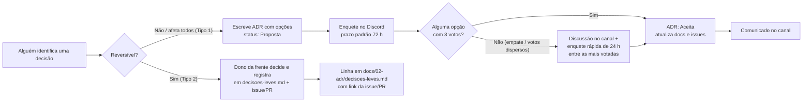
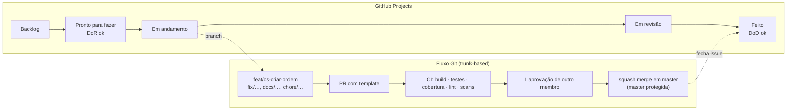

# Como trabalhamos (assíncrono por padrão)

Todo mundo trabalha e os horários não batem. Então: **assíncrono por padrão, síncrono por exceção**. Este documento é o
contrato de funcionamento do grupo. Mudanças nele passam por enquete.

## 1. Princípios

1. **Documentar antes de codar.** PRD aprovado + ADRs aceitas + contrato da API antes de abrir a primeira feature. Evita
   scope creep e retrabalho (o enunciado é o limite do escopo; "Could" só se sobrar tempo).
2. **Decisão registrada é decisão que existe.** Se não está em uma ADR, no PRD ou numa enquete encerrada, não foi decidido.
3. **Ninguém bloqueia ninguém.** Se uma dúvida trava você por mais de 24 h sem resposta, tome a decisão mais simples,
   registre-a em `docs/02-adr/decisoes-leves.md` (com link da issue) e siga. Reversível > perfeito.
4. **Pequeno e frequente.** PRs pequenos (≤ 400 linhas), commits diários, `master` sempre executável.
5. **A nota vem da evidência.** Cada requisito do enunciado precisa aparecer em código + teste + Swagger + vídeo
   (`docs/06-entrega/checklist-de-entrega.md`).

## 2. Canais e cadência

| Canal | Uso | Cadência |
|---|---|---|
| Discord — canal do grupo | Conversa geral, **enquetes** (recurso nativo de enquete), avisos | Contínuo |
| Discord — threads por frente | Discussão técnica de cada frente (ex.: `#os-e-orcamento`, `#ddd-miro`, `#qualidade-seguranca`) | Contínuo |
| GitHub Issues + Projects (kanban) | Tarefas, status, bloqueios | Contínuo |
| GitHub PRs | Revisão de código e docs | Contínuo |
| **Check-in assíncrono** (mensagem curta no Discord) | "✅ fiz / ▶️ vou fazer / ⛔ bloqueios" | 3×/semana (seg · qua · sex) |
| Call opcional (30 min) | Só para destravar algo que o texto não resolveu; gravada/resumida para quem faltar | No máximo 1×/semana |
| Sessão de gravação do vídeo | Síncrona ou por partes (cada um grava seu bloco e junta na edição) | Última semana |

## 3. Como decidimos



Regras da enquete:

- **Tipo 1** (difícil de reverter ou afeta todo mundo): linguagem, banco, arquitetura, fluxo Git, escopo. Exige ADR + enquete.
- **Tipo 2** (reversível/local): nome de um endpoint, biblioteca auxiliar, formato de log. O dono da frente decide e
  registra em `docs/02-adr/decisoes-leves.md` (uma linha, com link da issue/PR).
- Prazo padrão de enquete (opção *3 dias* do recurso de enquete do Discord): **72 h**. Quem não votou no prazo = abstenção.
- Regra de vitória (prática já adotada no Discord, registrada na issue #1): vence a opção com **3 votos** (maioria
  absoluta — 3 de 4 membros desde 16/09). Se nenhuma chega a 3 (empate ou votos dispersos): **discussão no canal** e, em seguida,
  **enquete rápida de 24 h** entre as opções mais votadas; o resultado da enquete rápida decide. Ninguém desempata
  sozinho. Esta é a única definição da regra — os demais documentos apontam para cá.
- Toda enquete tem o texto pronto em `enquetes.md` com link para a ADR/PRD. Resultado é copiado para a ADR (seção *Decisão*).
- Lotes de votação para não travar: **Lote 1** (linguagem, banco, arquitetura, idioma do código) → **Lote 2** (auth, API
  docs, Git/CI, IDs/validação) → **Lote 3** (testes, scans, máquina de estados, acesso do cliente, estoque).

## 4. Fluxo de trabalho (kanban + Git)



> 🗳️ O fluxo Git (trunk-based, squash, Conventional Commits) é **definido por votação**: é a proposta da ADR-008, a ser
> votada na enquete E-10 (Lote 2, abre 17/09). O texto abaixo descreve essa proposta; o resultado da E-10 atualiza esta seção.

Convenções:

- Branch: `tipo/escopo-descricao-curta` (`feat/service-orders-create`, `docs/adr-002-banco`, `test/catalog-withdraw`).
- Commits: **Conventional Commits** — `feat(service-orders): create service order`, `fix(catalog): prevent negative stock`,
  `docs(adr): aceitar ADR-002`, `test(service-orders): cover quote calculation`. Mensagens de commit de código em inglês
  (ADR-013); commits só de documentação podem ser em português.
- Escopos: os módulos do monólito em inglês (`customers`, `catalog`, `service-orders`, `identity`, `shared`) ou os
  transversais (`infra`, `ci`) — nomes conforme ADR-013 e `docs/03-ddd/linguagem-ubiqua.md` §1 (substituem os escopos em
  português da issue #1; `catalog` continua sendo **um** módulo para catálogo e estoque). `docs` é **tipo**, não escopo: mudança só de documentação usa
  `docs(<pasta>)`, com a pasta afetada como escopo (`guia`, `prd`, `adr`, `ddd`, `arquitetura`, `qualidade`, `entrega`,
  `github`, `prompts`), ou `docs:` sem escopo em mudanças na raiz (`README.md`, `CLAUDE.md`, `CONTRIBUTING.md`).
- PR: usa o template; 1 aprovação de **outro** membro; CI verde; squash merge; branch apagada.
- `master` protegida (configuração já feita — issue #1): sem push direto, sem merge com CI vermelho. Todos os
  membros têm permissão de *bypass*, **reservada a emergências**; fora disso, o caminho é sempre PR com revisão.
- Issues: título no imperativo (`Implementar aprovação do orçamento`), com PRD/ADR referenciados e critérios de aceite.
- Labels: 1 `frente:*` + 1 `tipo:*` + 1 `prioridade:*` por issue (lista na aba *Labels* do repositório).

### Tags e releases

- Formato **SemVer** `vMAJOR.MINOR.PATCH`, tags **anotadas** (`git tag -a`), criadas pelo líder/F1 em `master` com CI verde.
  Nunca mover ou apagar uma tag publicada; erro depois de um marco vira patch (`v0.2.1`).
- Fase 1 é a série `v0.x`; a entrega vira **`v1.0.0`**. A Fase 2 começa em `v2.0.0` no mesmo repositório — assim o avaliador
  (e nós) sempre encontram exatamente o que foi entregue em cada fase.

| Tag | Marco | Quando | O que precisa estar verdadeiro |
|---|---|---|---|
| `v0.1.0` | M2 walking skeleton | 04/10 | `docker compose up` sobe; login; criar cliente/veículo/OS; Swagger; CI com gate |
| `v0.2.0` | M3 fluxo completo | 18/10 | Diagnóstico → orçamento → aprovação → execução → entrega; estoque; histórico |
| `v0.3.0` | M4 qualidade & segurança | 25/10 | Cobertura ≥ 80 %; **scan 1** feito sobre esta tag (o relatório cita a tag) |
| `v1.0.0-rc.1` | M6 code freeze | 01/11 | README final; **scan 2** sobre esta tag; ensaio do vídeo gravado a partir dela |
| `v1.0.0` | M7 entrega | ~08/11 | Commit citado no PDF e mostrado no vídeo; release no GitHub com os anexos |

- **Release no GitHub** só para `v1.0.0` ("Fase 1 — Entrega"): notas geradas automaticamente a partir dos títulos dos PRs
  (Conventional Commits + squash deixam isso legível de graça) e anexos: PDF de entrega, relatório de vulnerabilidades,
  link do vídeo e do Miro.
- **Imagem Docker no CI:** sempre `<sistema>-api:<sha-curto>`; quando uma tag é criada, também `<sistema>-api:vX.Y.Z` —
  é o que a Fase 2 vai empurrar para o ECR. `<sistema>` é o nome escolhido na enquete E-01 (`oficina-api` é só o
  provisório dos exemplos).
- Comandos:

```bash
git checkout master && git pull
git tag -a v0.1.0 -m "M2 walking skeleton: auth, cadastro, criar OS, compose, CI"
git push origin v0.1.0
# entrega
gh release create v1.0.0 --title "Fase 1 — Entrega" --generate-notes docs/06-entrega/evidencias/*.pdf
```

- Proteção opcional: *Settings → Rules → Rulesets → New tag ruleset* com padrão `v*`, bloqueando deleção e atualização.

## 5. Definition of Ready (DoR) e Definition of Done (DoD)

**DoR — uma tarefa só entra em "Pronto para fazer" se:**

- [ ] Está ligada a um PRD (requisito RF-xx) ou ADR;
- [ ] Tem critérios de aceite (Gherkin ou lista) claros;
- [ ] Contrato de API definido (se expõe endpoint);
- [ ] Cabe em ≤ 2 dias de trabalho de uma pessoa (senão, quebrar).

**DoD — uma tarefa só é "Feito" se:**

- [ ] Código + testes (unitários e/ou integração) passando no CI;
- [ ] Cobertura dos módulos críticos (`service-orders`, `catalog`) ≥ 80 %;
- [ ] Swagger/OpenAPI atualizado (se houver endpoint);
- [ ] Linguagem ubíqua respeitada nos nomes;
- [ ] README/docs atualizados se mudou execução ou comportamento;
- [ ] PR revisado e mergeado; issue fechada; checklist de entrega atualizado (se cobre requisito do enunciado).

## 6. Ferramentas

| Necessidade | Ferramenta | Observação |
|---|---|---|
| Código | GitHub (repo privado, acesso a `soat-architecture`) | Projects para kanban; Issues com templates em `.github/` |
| Documentação DDD oficial | Miro (ou Excalidraw/Lucid) | Montar a partir de `docs/03-ddd/*.md` (Mermaid) |
| Diagramas versionados | Mermaid nos `.md` | Renderiza no GitHub; base do Miro e do vídeo |
| Sessões de IA | Claude (contas do grupo) | Prompts em `prompts/`; **tudo que a IA gerar passa por revisão humana e teste** |
| Vídeo | OBS/Loom + edição simples | Roteiro em `docs/06-entrega/roteiro-do-video.md` |

## 7. Uso de IA (regras do grupo)

- IA gera esqueleto, testes de exemplo, documentação de apoio — **a pessoa da frente entende, revisa e testa antes de subir**.
- Nada de código que ninguém do grupo sabe explicar: o vídeo e a avaliação exigem que a gente justifique cada escolha.
- Sem dados pessoais reais (CPF/CNPJ/placa) em prompts, seeds ou testes — usar geradores de dados válidos fictícios.
- Prompts úteis ficam versionados em `prompts/` para reuso pelo grupo.
- No GitHub, `@claude` em issues/PRs responde e pode abrir PRs (branch `claude/`), e todo PR recebe uma revisão
  automática com o checklist do grupo (`docs/README.md`, seção *Claude no GitHub*). As regras que ele segue estão
  em `CLAUDE.md`. A revisão automática **não substitui** a aprovação humana obrigatória.

## 8. Riscos e mitigação

| Risco | Sinal | Mitigação |
|---|---|---|
| Prazo | Semana 3 sem `master` executável | Escopo congelado no MoSCoW do PRD-000; "Could" cai primeiro |
| Disponibilidade irregular | Check-in faltando 2× seguidas | Frente redistribuída; tarefas pequenas (≤ 2 dias) |
| Scope creep | Tarefa sem RF/ADR de origem | DoR bloqueia; líder devolve para backlog |
| Integração tardia | Módulos prontos, fluxo ponta a ponta não | Fluxo "criar OS → aprovar → entregar" é a **primeira** história ponta a ponta (walking skeleton) |
| Cobertura abaixo de 80 % | CI sem gate | Gate de cobertura desde o primeiro PR de código |
| Vídeo estourar 15 min | Ensaio > 15 min | Roteiro com tempo por bloco; ensaio cronometrado na última semana |
