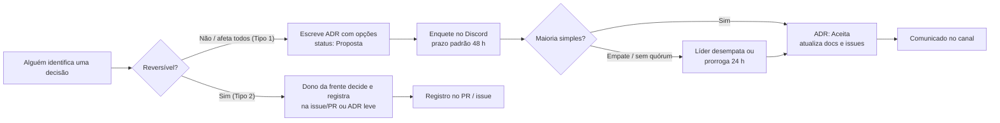
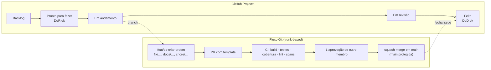

# Como trabalhamos (assíncrono por padrão)

Todo mundo trabalha e os horários não batem. Então: **assíncrono por padrão, síncrono por exceção**. Este documento é o
contrato de funcionamento do grupo. Mudanças nele passam por enquete.

## 1. Princípios

1. **Documentar antes de codar.** PRD aprovado + ADRs aceitas + contrato da API antes de abrir a primeira feature. Evita
   scope creep e retrabalho (o enunciado é o limite do escopo; "Could" só se sobrar tempo).
2. **Decisão registrada é decisão que existe.** Se não está em uma ADR, no PRD ou numa enquete encerrada, não foi decidido.
3. **Ninguém bloqueia ninguém.** Se uma dúvida trava você por mais de 24 h sem resposta, tome a decisão mais simples,
   registre-a (issue/ADR leve) e siga. Reversível > perfeito.
4. **Pequeno e frequente.** PRs pequenos (≤ 400 linhas), commits diários, `main` sempre executável.
5. **A nota vem da evidência.** Cada requisito do enunciado precisa aparecer em código + teste + Swagger + vídeo
   (`docs/06-entrega/checklist-de-entrega.md`).

## 2. Canais e cadência

| Canal | Uso | Cadência |
|---|---|---|
| Discord — canal do grupo | Conversa geral, **enquetes** (recurso nativo de enquete), avisos | Contínuo |
| Discord — threads por frente | Discussão técnica de cada frente (ex.: `#os-e-orcamento`, `#ddd-miro`, `#qualidade-seguranca`) | Contínuo |
| GitHub Issues + Projects (kanban) | Tarefas, status, bloqueios | Contínuo |
| GitHub PRs | Revisão de código e docs | Contínuo |
| **Check-in assíncrono** (mensagem curta no Discord) | "✅ fiz / ▶️ vou fazer / ⛔ bloqueios" | 3×/semana (seg · qua · sex) |
| Call opcional (30 min) | Só para destravar algo que o texto não resolveu; gravada/resumida para quem faltar | No máximo 1×/semana |
| Sessão de gravação do vídeo | Síncrona ou por partes (cada um grava seu bloco e junta na edição) | Última semana |

## 3. Como decidimos

Regras da enquete:

- **Tipo 1** (difícil de reverter ou afeta todo mundo): linguagem, banco, arquitetura, fluxo Git, escopo. Exige ADR + enquete.
- **Tipo 2** (reversível/local): nome de um endpoint, biblioteca auxiliar, formato de log. O dono da frente decide e registra.
- Prazo padrão de enquete: **48 h**. Quem não votou no prazo = abstenção. Empate: o líder desempata (ou prorroga 24 h, uma vez).
- Toda enquete tem o texto pronto em `enquetes.md` com link para a ADR/PRD. Resultado é copiado para a ADR (seção *Decisão*).
- Lotes de votação para não travar: **Lote 1** (linguagem, banco, arquitetura, idioma do código) → **Lote 2** (auth, API
  docs, Git/CI, IDs/validação) → **Lote 3** (testes, scans, máquina de estados, acesso do cliente, estoque).

## 4. Fluxo de trabalho (kanban + Git)

Convenções:

- Branch: `tipo/escopo-descricao-curta` (`feat/atendimento-criar-os`, `docs/adr-002-banco`, `test/estoque-baixa`).
- Commits: **Conventional Commits** — `feat(atendimento): criar ordem de serviço`, `fix(estoque): impedir quantidade negativa`,
  `docs(adr): aceitar ADR-002`, `test(orcamento): cobrir cálculo total`.
- Escopos = módulos do monólito: `cadastro`, `catalogo`, `estoque`, `atendimento`, `identidade`, `shared`, `infra`, `docs`.
- PR: usa o template; 1 aprovação de **outro** membro; CI verde; squash merge; branch apagada.
- `main` protegida: sem push direto, sem merge com CI vermelho.
- Issues: título no imperativo (`Implementar aprovação do orçamento`), com PRD/ADR referenciados e critérios de aceite.

## 5. Definition of Ready (DoR) e Definition of Done (DoD)

**DoR — uma tarefa só entra em "Pronto para fazer" se:**

- [ ] Está ligada a um PRD (requisito RF-xx) ou ADR;
- [ ] Tem critérios de aceite (Gherkin ou lista) claros;
- [ ] Contrato de API definido (se expõe endpoint);
- [ ] Cabe em ≤ 2 dias de trabalho de uma pessoa (senão, quebrar).

**DoD — uma tarefa só é "Feito" se:**

- [ ] Código + testes (unitários e/ou integração) passando no CI;
- [ ] Cobertura dos módulos críticos (`atendimento`, `catalogo`/`estoque`) ≥ 80 %;
- [ ] Swagger/OpenAPI atualizado (se houver endpoint);
- [ ] Linguagem ubíqua respeitada nos nomes;
- [ ] README/docs atualizados se mudou execução ou comportamento;
- [ ] PR revisado e mergeado; issue fechada; checklist de entrega atualizado (se cobre requisito do enunciado).

## 6. Ferramentas

| Necessidade | Ferramenta | Observação |
|---|---|---|
| Código | GitHub (repo privado, acesso a `soat-architecture`) | Projects para kanban; Issues com templates em `_github/` |
| Documentação DDD oficial | Miro (ou Excalidraw/Lucid) | Montar a partir de `docs/03-ddd/*.md` (Mermaid) |
| Diagramas versionados | Mermaid nos `.md` | Renderiza no GitHub; base do Miro e do vídeo |
| Sessões de IA | Claude (contas do grupo) | Prompts em `prompts/`; **tudo que a IA gerar passa por revisão humana e teste** |
| Vídeo | OBS/Loom + edição simples | Roteiro em `docs/06-entrega/roteiro-do-video.md` |

## 7. Uso de IA (regras do grupo)

- IA gera esqueleto, testes de exemplo, documentação de apoio — **a pessoa da frente entende, revisa e testa antes de subir**.
- Nada de código que ninguém do grupo sabe explicar: o vídeo e a avaliação exigem que a gente justifique cada escolha.
- Sem dados pessoais reais (CPF/CNPJ/placa) em prompts, seeds ou testes — usar geradores de dados válidos fictícios.
- Prompts úteis ficam versionados em `prompts/` para reuso pelo grupo.

## 8. Riscos e mitigação

| Risco | Sinal | Mitigação |
|---|---|---|
| Prazo | Semana 3 sem `main` executável | Escopo congelado no MoSCoW do PRD-000; "Could" cai primeiro |
| Disponibilidade irregular | Check-in faltando 2× seguidas | Frente redistribuída; tarefas pequenas (≤ 2 dias) |
| Scope creep | Tarefa sem RF/ADR de origem | DoR bloqueia; líder devolve para backlog |
| Integração tardia | Módulos prontos, fluxo ponta a ponta não | Fluxo "criar OS → aprovar → entregar" é a **primeira** história ponta a ponta (walking skeleton) |
| Cobertura abaixo de 80 % | CI sem gate | Gate de cobertura desde o primeiro PR de código |
| Vídeo estourar 15 min | Ensaio > 15 min | Roteiro com tempo por bloco; ensaio cronometrado na última semana |
