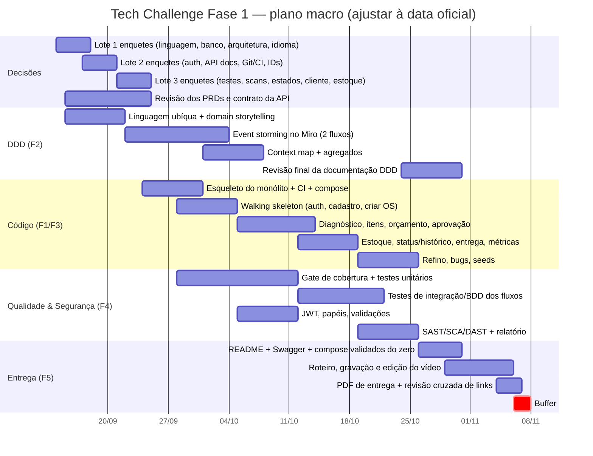

# Cronograma macro

> ⚠️ **Premissa a confirmar:** o plano abaixo assume **8 semanas** a partir de 14/09/2026, com entrega em **~08/11/2026**.
> A data oficial está na plataforma da FIAP — **confirmar e ajustar** (enquete E-03 pede a data). Se o prazo for menor,
> cortar na ordem: Could → Should → buffer, nunca os Must.

## 1. Marcos

| Marco | Data alvo | Critério de "atingido" |
|---|---|---|
| **M0 — Kickoff assíncrono** | 14/09 | Repo criado (privado, `soat-architecture` convidado), docs base publicadas, Lote 1 de enquetes aberto |
| **M1 — Decisões fechadas** | 25/09 | ADRs do Lote 1–3 aceitas; PRDs revisados; contrato da API v1; linguagem ubíqua v1 |
| **M2 — Walking skeleton** | 04/10 | `docker compose up` sobe API + banco; login JWT; criar cliente/veículo/OS; Swagger; CI com gate de cobertura |
| **M3 — Fluxo completo da OS** | 18/10 | Diagnóstico → itens → orçamento → aprovação do cliente → execução → finalizada → entregue; estoque; histórico |
| **M4 — Qualidade & segurança** | 25/10 | Cobertura ≥ 80 % nos módulos críticos; validações; scans rodando; relatório v1; tempo médio de execução |
| **M5 — Documentação DDD final** | 30/10 | Miro completo (event storming 2 fluxos, context map, agregados, glossário) revisado pelo grupo |
| **M6 — Congelamento** | 01/11 | Code freeze; README final; ensaio do vídeo cronometrado |
| **M7 — Entrega** | ~08/11 | Vídeo ≤ 15 min; PDF de entrega; relatório de vulnerabilidades; links validados por outra pessoa |

## 2. Gantt

## 3. Plano semana a semana

| Semana | Foco | Saídas |
|---|---|---|
| **S1** 14–20/09 | Kickoff; enquetes Lote 1 e 2; revisão de PRDs; linguagem ubíqua v1 | ADR-001/002/003/013 aceitas; PRDs comentados |
| **S2** 21–27/09 | Lote 3; contrato da API v1; começar Miro; esqueleto do repo na linguagem escolhida | Contrato v1; repo com CI verde e compose |
| **S3** 28/09–04/10 | Walking skeleton (auth, cadastro, criar OS); gate de cobertura | M2 |
| **S4** 05–11/10 | Diagnóstico, itens, orçamento automático, envio para aprovação; JWT/papéis | Fluxo até "Aguardando aprovação" |
| **S5** 12–18/10 | Aprovação/recusa pelo cliente, execução, finalização, entrega; estoque; histórico; métricas | M3 |
| **S6** 19–25/10 | Testes de integração/BDD; scans; relatório v1; refino | M4 |
| **S7** 26/10–01/11 | Miro final; README; ensaio do vídeo; code freeze | M5, M6 |
| **S8** 02–08/11 | Gravação/edição; PDF; revisão cruzada; entrega | M7 |

## 4. Regras de ajuste

- Atrasou 1 semana em M2 → cortar **Could** do PRD-000 (alertas de estoque mínimo, filtros extras, dashboards).
- Atrasou M3 → cortar **Should** que não estão no vídeo obrigatório (ex.: refresh token, paginação avançada).
- **Nunca cortar:** os 6 status da OS, orçamento automático, aprovação do cliente, JWT, CRUDs, estoque, tempo médio,
  Swagger, Dockerfile/compose, testes ≥ 80 %, scan + relatório, README, Miro, vídeo, PDF.
