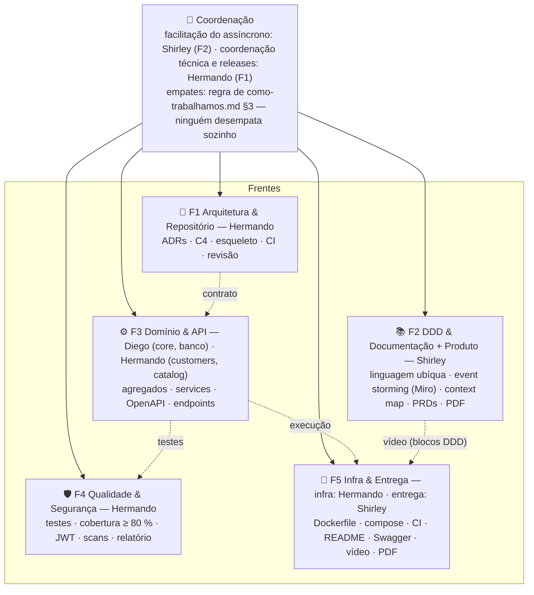
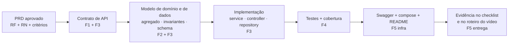

# Frentes de trabalho e responsabilidades

> Aprovado na enquete E-02, **redistribuído em 16/09/2026** (saída do Daniel) e **de novo em 22/09/2026** (saída da Vi),
> em reunião do grupo — registro em `docs/02-adr/decisoes-leves.md`. Com 3 pessoas, toda frente tem um **dono** (responde
> pelo resultado), os demais apoiam, e todo mundo revisa PR de todo mundo.

## 0. Perfil do grupo (das apresentações no Discord)

| Pessoa | Experiência relevante | Stack | Disponibilidade / observações |
|---|---|---|---|
| **Shirley** | Technical Product Manager, 7 anos em times de plataforma (APIs, integrações, engines, arquitetura) | Python (na prática, só) | Todos os dias; mais às quartas, sextas e fins de semana |
| **Diego** | 22 anos de área; atua como arquiteto de software; já passou por concepção, front, back, devops, sustentação | .NET, JavaScript/Node (Vue) | Sênior → segundo par de olhos da arquitetura; dono do core e da modelagem do banco |
| **Hermando** | Automações, qualidade e análise de dados; front e back; contabilidade/finanças | Generalista | Estrutura do código e ADRs; qualidade/testes; métricas |

Saíram: Daniel (16/09) e Vi (22/09). A ADR-001 (E-04, **TypeScript + NestJS**) foi escolhida por ser a stack do dia a dia
da Vi e o denominador comum do grupo (JavaScript/Node); ela continua válida — Diego (Node) e Hermando revisam o código
Nest um do outro, e revotar a E-04 seria uma decisão Tipo 1 (ADR + enquete). Shirley (Python) contribui como descrito
na §3.

## 1. Redistribuição de 22/09 (decisão do grupo em reunião)

| Tarefa combinada | Quem | O que entra |
|---|---|---|
| **Modelagem do banco de dados** | **Diego** | `docs/04-arquitetura/modelo-de-dados.md`, `prisma/schema.prisma` (multiSchema), migrações SQL (sequência da OS, `CHECK`s, índices parciais), seed de demonstração, justificativa do banco (ADR-002) no README e no vídeo (bloco 4) |
| **Estrutura do código + ADRs** | **Hermando** | Esqueleto do monólito (`prompts/02`: módulos, camadas clássicas, Dockerfile, compose, workflows de CI/segurança, README de execução), `dependency-cruiser`, curadoria das ADRs e do índice, `develop`/`master` protegidas, releases/tags, revisão de PRs (arquitetura) — ou seja, a F1 inteira mais a parte de infra da F5 |
| **Documentação DDD** | **Shirley** (majoritariamente), em conjunto com Diego e Hermando | Miro (event storming dos 3 fluxos — criação, acompanhamento, peças —, context map, agregados, glossário) e exportação em `docs/ddd/`, PRDs e critérios de aceite, features Gherkin; Diego valida agregados/invariantes do core, Hermando garante glossário ↔ código |

## 2. Organograma das frentes

## 3. Descrição das frentes

| Frente | Entregas | Documentos base | Dono | Apoio |
|---|---|---|---|---|
| **F1 Arquitetura & Repositório** | ADRs (curadoria, índice, novas propostas); esqueleto do monólito (módulos, camadas clássicas, Prisma); `develop` e `master` protegidas (GitFlow); releases/tags nos marcos; revisão de PRs; `evolucao-fases.md` | `docs/02-adr/`, `docs/04-arquitetura/` | **Hermando** — estrutura do código + ADRs | **Diego** (co-revisão de arquitetura; substitui o dono se ele sumir) |
| **F2 DDD & Documentação + Produto** | Miro com event storming (3 fluxos), context map, agregados, linguagem ubíqua, exportados em `docs/ddd/`; PRDs e critérios de aceite; features BDD (Gherkin); checklist de entrega; roteiro do vídeo; documento de entrega (PDF); facilitação do assíncrono (check-ins, enquetes, prazos) | `docs/ddd/`, `docs/01-requisitos/`, `docs/06-entrega/` | **Shirley** — Product & DDD Lead | **Diego** e **Hermando** (DDD em conjunto: agregados/invariantes e glossário ↔ código) |
| **F3 Domínio & API** | Módulos `service-orders` (core, Diego), `customers` e `catalog` (Hermando); agregados e services; controllers/DTOs; OpenAPI; **modelagem do banco** (`modelo-de-dados.md`, `schema.prisma`, migrações, seed, justificativa da ADR-002) | `docs/01-requisitos/`, `docs/04-arquitetura/contrato-api.md`, `docs/04-arquitetura/modelo-de-dados.md` | **Diego** — core `service-orders` + banco de dados | **Hermando** — `customers` + `catalog` |
| **F4 Qualidade & Segurança** | Testes unitários/integração/BDD; gate de cobertura; validações CPF/CNPJ/placa; JWT/papéis; SAST/SCA/DAST; relatório de vulnerabilidades; métrica de tempo médio | `docs/05-qualidade-e-seguranca/` | **Hermando** — Qualidade & Segurança | **Diego** — testes do core e revisão de segurança (JWT/papéis, dados sensíveis, relatório) |
| **F5 Infra & Entrega** | Infra: `Dockerfile`, `docker-compose.yml`, workflows de CI/segurança, README de execução, Swagger publicado (vem junto com o esqueleto). Entrega: roteiro, gravação e edição do vídeo, PDF, evidências no checklist | `docs/06-entrega/` | **Hermando** — infra · **Shirley** — entrega | **Diego** — validação do compose em máquina limpa e revisão cruzada final |

Cargas resultantes (3 pessoas): **Shirley** = F2 + entrega (vídeo/PDF) + facilitação; **Diego** = F3 core + banco de
dados + apoio F1/F4/F5; **Hermando** = F1 + F5 infra + F3 (`customers`/`catalog`) + F4. Hermando concentra o maior peso:
o **primeiro ajuste**, se apertar, é Diego assumir `catalog` (é o módulo mais acoplado ao core e ele já modela o banco);
o **segundo** é Diego assumir os scans de segurança (ele já revisa o relatório). Decidir no check-in do marco M2, não depois.

Como Shirley contribui com código sem dominar a linguagem escolhida: (1) escreve as **features Gherkin** dos PRDs — F4
automatiza os steps; (2) revisa **contratos de API e Swagger** contra os PRDs (é o trabalho dela de TPM); (3) valida
o **fluxo ponta a ponta pelo Swagger** a cada marco e registra evidências no checklist; (4) revisa o glossário
(`linguagem-ubiqua.md`) contra o código — com tudo em inglês (ADR-013), alguém precisa garantir que o nome do código
ainda é a linguagem que a oficina fala.

## 4. Matriz RACI (R = executa · A = responde · C = consultado · I = informado)

| Entregável do enunciado | F1 Arq. (Hermando) | F2 DDD (Shirley) | F3 Dom./API (Diego · Hermando) | F4 Qual./Seg. (Hermando) | F5 Infra (Hermando) / Entrega (Shirley) |
|---|---|---|---|---|---|
| Event storming completo (3 fluxos) + exportação em `docs/ddd/` | C | **R/A** | R | I | I |
| Diagramas DDD + linguagem ubíqua | C | **R/A** | R | I | I |
| Monólito em camadas clássicas por contexto (esqueleto) | **R/A** | I | R | C | C |
| Modelagem do banco (schema, migrações, seed) | C | I | **R/A** (Diego) | C | I |
| Justificativa do banco de dados | C | C | **R/A** (Diego) | I | I |
| APIs: OS, orçamento, status, CRUDs | C | C | **R/A** | C | I |
| Consulta do cliente via API | C | C | **R/A** | C | I |
| Tempo médio de execução | C | I | **R/A** | C | I |
| Autenticação JWT (APIs admin) | C | I | R | **R/A** | I |
| Validação CPF/CNPJ/placa | I | C | R | **R/A** | I |
| Testes ≥ 80 % (domínios críticos) | C | I | R | **R/A** | I |
| Dockerfile + docker-compose | R | I | C | I | **R/A** (infra) |
| README de execução | R | C | C | C | **R/A** (infra) |
| Swagger/OpenAPI | C | I | R | I | **R/A** (infra) |
| Análise de vulnerabilidades + relatório | C | I | C | **R/A** | R |
| Vídeo (≤ 15 min) | R | R | R | R | **R/A** (entrega) |
| Documento de entrega (PDF) | C | **R/A** | I | C | R (entrega) |

## 5. Como uma feature atravessa as frentes

## 6. Primeira sprint sugerida (walking skeleton)

Objetivo: em ~2 semanas ter **um fluxo ponta a ponta fininho** rodando em `docker compose up`:

1. `POST /auth/login` → JWT (usuário seed);
2. `POST /customers`, `POST /vehicles` (validação CPF/CNPJ e placa);
3. `POST /service-orders` (status *Recebida* = `RECEIVED`) → `GET /service-orders/{id}`;
4. Swagger no ar; 1 teste unitário + 1 teste de integração no CI com gate de cobertura.

Depois disso, cada frente evolui em paralelo sem se bloquear (diagnóstico/itens/orçamento, aprovação do cliente, estoque,
métricas, scans, vídeo).

## 7. Transição após a saída da Vi (22/09) — pendências

Itens que dependem de acesso ou de conta e que a documentação sozinha não resolve:

- [ ] **Repositório**: `katomaro/FIAP-SOAT` está na conta da Vi, que transfere para um membro (ou organização do grupo)
  **assim que o grupo pedir** — o GitHub mantém histórico, issues e PRs. Depois, reaplicar a proteção de `master`, criar e
  proteger `develop` (ADR-008) e rever quem tem *bypass*. O enunciado atualizado (23/09) exige o repositório **público**
  durante a correção; o convite a `soat-architecture` deixou de ser exigido.
- [x] **Workflows do Claude** (`.github/workflows/claude*.yml`): a Vi mantém a assinatura e o secret `CLAUDE_CODE_OAUTH_TOKEN`
  à disposição do grupo — nada a fazer enquanto funcionar. Se parar (ou na transferência do repositório), trocar por token
  de outro membro (`claude setup-token`) ou `ANTHROPIC_API_KEY` e reinstalar o GitHub App (`docs/README.md`, *Claude no GitHub*).
- [ ] **Discord**: a Vi transfere a administração do servidor/canal quando o grupo pedir. **Miro**: o board precisa ficar
  acessível sem pedir permissão (link "qualquer pessoa pode ver") — enunciado de 23/09.
- [ ] **Enunciado atualizado (23/09)**: repositório público na entrega, vídeo público no YouTube, exportação DDD em `docs/ddd/`,
  rejeição do orçamento obrigatória, transações explícitas, PDF com grupo 49 e branch + hash — já refletido nos docs;
  F1 decide se renomeia `master` → `main` (o enunciado cita "branch main protegida").
- [ ] **Regra de votação**: com 3 membros, vence a opção com **2 votos** (maioria absoluta — `como-trabalhamos.md` §3).
- [ ] **Documento de entrega e README**: participantes já atualizados nesta reconsolidação (`docs/06-entrega/documento-de-entrega-template.md`, `README.md`).
- [ ] **Carga**: aplicar o primeiro ajuste da §3 (Diego assume `catalog`) se Hermando estiver sobrecarregado em M2.
