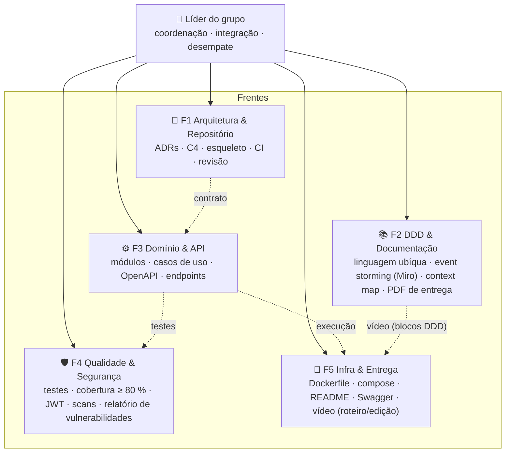
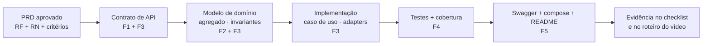

# Frentes de trabalho e responsabilidades

> Sugestão inicial para votação (enquete E-02). Com 5 pessoas, cada uma assume **1 frente principal + 1 apoio**.
> Toda frente tem um **dono** (responde pelo resultado) e todo mundo revisa PR de todo mundo.

## 0. Perfil do grupo (das apresentações no Discord)

| Pessoa | Experiência relevante | Stack | Disponibilidade / observações |
|---|---|---|---|
| **Vi** (líder) | Sistema em produção para prefeitura (LGPD, RBAC/ABAC), app próprio em escala, ERP Comercial com vertical de saúde (ICP-Brasil), auditorias de segurança | NestJS + Next, Docker por hábito, AWS | Tempo mais limitado (4 trabalhos) → coordena, decide, revisa; não é dona de implementação |
| **Shirley** | Technical Product Manager, 7 anos em times de plataforma (APIs, integrações, engines, arquitetura) | Python (na prática, só) | Todos os dias; mais às quartas, sextas e fins de semana |
| **Diego** | 22 anos de área; atua como arquiteto de software; já passou por concepção, front, back, devops, sustentação | .NET, JavaScript/Node (Vue) | Sênior → segundo par de olhos da arquitetura; dono do core |
| **Dan** | Fullstack, foco em backend Go; PHP/Laravel/WordPress | Go, JS | Backend + infra |
| **Hermando** | Automações, qualidade e análise de dados; front e back; contabilidade/finanças | Generalista | Qualidade/testes; métricas |

Leitura para a ADR-001 (enquete E-04): o denominador comum de stacks é **JavaScript/Node** (Vi, Diego, Dan e Hermando
transitam; Shirley só Python). Go e .NET são fortes para uma pessoa cada; Python para uma. A enquete decide, mas quem
votar em uma stack que só ela domina precisa assumir que vai revisar o código dos outros nela.

## 1. Organograma das frentes

## 2. Descrição das frentes

| Frente | Entregas | Documentos base | Dono (sugestão) | Apoio |
|---|---|---|---|---|
| **F1 Arquitetura & Repositório** | ADRs aceitas; esqueleto do monólito (módulos, camadas); pipeline CI; `main` protegida; revisão de PRs; `evolucao-fases.md` | `docs/02-adr/`, `docs/04-arquitetura/` | **Vi** — Tech Lead & Arquiteta | **Diego** (co-revisão; substitui a líder se ela sumir) |
| **F2 DDD & Documentação + Produto** | Miro com event storming (2 fluxos), context map, agregados, linguagem ubíqua; PRDs e critérios de aceite; features BDD (Gherkin); checklist de entrega; roteiro do vídeo; documento de entrega (PDF); facilitação do assíncrono (check-ins, enquetes) | `docs/03-ddd/`, `docs/01-requisitos/`, `docs/06-entrega/` | **Shirley** — Product & DDD Lead | Vi |
| **F3 Domínio & API** | Módulos `atendimento` (core, Diego), `cadastro` e `catalogo-estoque` (Dan); casos de uso; controllers; OpenAPI; seeds | `docs/01-requisitos/`, `docs/04-arquitetura/contrato-api.md` | **Diego** — core `atendimento` | **Dan** — `cadastro` + `catalogo-estoque` |
| **F4 Qualidade & Segurança** | Testes unitários/integração/BDD; gate de cobertura; validações CPF/CNPJ/placa; SAST/SCA/DAST; relatório de vulnerabilidades; métrica de tempo médio | `docs/05-qualidade-e-seguranca/` | **Hermando** — Qualidade | **Vi** — segurança (JWT/papéis, dados sensíveis, revisão do relatório) |
| **F5 Infra & Entrega** | `Dockerfile`, `docker-compose.yml`, workflows de CI, README de execução, Swagger publicado, edição do vídeo | `docs/06-entrega/` | **Dan** — Infra | Shirley (roteiro/vídeo), Vi (CI) |

Cargas resultantes: Vi = F1 + apoio F4/F5 (decisão e revisão, pouco código); Shirley = F2 + apoio F5; Diego = F3 core
+ apoio F1; Dan = F3 módulos + F5; Hermando = F4 (+ métrica do PRD-006). Se alguém ficar sobrecarregado, o primeiro
ajuste é mover `catalogo-estoque` de Dan para Hermando.

Como Shirley contribui com código sem dominar a linguagem escolhida: (1) escreve as **features Gherkin** dos PRDs — F4
automatiza os steps; (2) revisa **contratos de API e Swagger** contra os PRDs (é o trabalho dela de TPM); (3) valida
o **fluxo ponta a ponta pelo Swagger** a cada marco e registra evidências no checklist; (4) se a ADR-001 for Python,
entra em F3 normalmente.

## 3. Matriz RACI (R = executa · A = responde · C = consultado · I = informado)

| Entregável do enunciado | F1 Arq. | F2 DDD | F3 Dom./API | F4 Qual./Seg. | F5 Infra/Entrega |
|---|---|---|---|---|---|
| Event storming completo (2 fluxos) | C | **R/A** | C | I | I |
| Diagramas DDD + linguagem ubíqua | C | **R/A** | C | I | I |
| Monólito em camadas / hexagonal (esqueleto) | **R/A** | I | R | C | C |
| APIs: OS, orçamento, status, CRUDs | C | C | **R/A** | C | I |
| Consulta do cliente via API | C | C | **R/A** | C | I |
| Tempo médio de execução | C | I | **R/A** | C | I |
| Autenticação JWT (APIs admin) | C | I | R | **R/A** | I |
| Validação CPF/CNPJ/placa | I | C | R | **R/A** | I |
| Testes ≥ 80 % (domínios críticos) | C | I | R | **R/A** | I |
| Dockerfile + docker-compose | C | I | C | I | **R/A** |
| README de execução | C | C | C | C | **R/A** |
| Swagger/OpenAPI | C | I | R | I | **R/A** |
| Análise de vulnerabilidades + relatório | C | I | C | **R/A** | R |
| Vídeo (≤ 15 min) | R | R | R | R | **R/A** |
| Documento de entrega (PDF) | C | **R/A** | I | C | R |
| Justificativa do banco de dados | **R/A** | C | C | I | I |

## 4. Como uma feature atravessa as frentes

## 5. Primeira sprint sugerida (walking skeleton)

Objetivo: em ~2 semanas ter **um fluxo ponta a ponta fininho** rodando em `docker compose up`:

1. `POST /auth/login` → JWT (usuário seed);
2. `POST /clientes`, `POST /veiculos` (validação CPF/CNPJ e placa);
3. `POST /ordens-servico` (status *Recebida*) → `GET /ordens-servico/{id}`;
4. Swagger no ar; 1 teste unitário + 1 teste de integração no CI com gate de cobertura.

Depois disso, cada frente evolui em paralelo sem se bloquear (diagnóstico/itens/orçamento, aprovação do cliente, estoque,
métricas, scans, vídeo).
