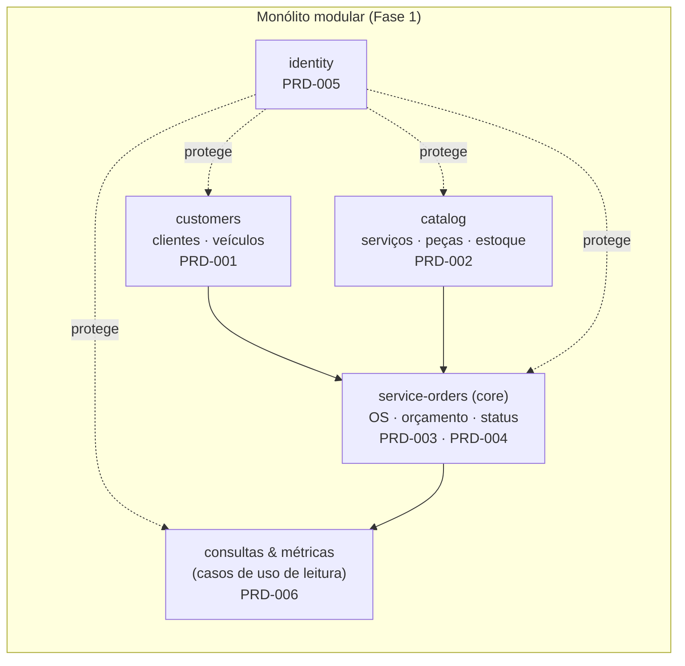

# PRD-000 — Visão do produto: Sistema de Gestão da Oficina (MVP back-end)

| Campo | Valor |
|---|---|
| Status | 📝 Rascunho para revisão do grupo |
| Dono | F2 (Shirley — produto) · apoio F1 (Hermando) |
| Origem | Enunciado *SOAT — Fase 1 — Tech Challenge* da FIAP, versão de 23/09/2026 — não versionado; requisitos transcritos em `docs/06-entrega/checklist-de-entrega.md` |
| Última atualização | 23/09/2026 (revalidado contra o enunciado atualizado) |

## 1. Problema

Uma oficina mecânica de médio porte, especializada em manutenção de veículos, opera atendimento, diagnóstico, execução e
entrega de forma desorganizada (anotações manuais e planilhas). Consequências relatadas no enunciado:

| Dor | Como o MVP ataca |
|---|---|
| Erros na priorização dos atendimentos | OS com status e histórico com data/hora; listagem por status |
| Falhas no controle de peças e insumos | Cadastro de peças com estoque; reserva na aprovação e baixa na finalização da OS; movimentações registradas |
| Dificuldade em acompanhar o status dos serviços | Máquina de estados da OS; consulta do cliente via API |
| Perda de histórico de clientes e veículos | Cadastro de clientes (CPF/CNPJ) e veículos (placa) com vínculo às OS |
| Ineficiência no fluxo de orçamentos e autorizações | Orçamento gerado automaticamente; aprovação do cliente via API; execução inicia automaticamente |

## 2. Objetivos do MVP

1. Registrar e acompanhar **ordens de serviço** do recebimento à entrega, com status atualizados automaticamente pelas ações.
2. **Gerar orçamento automaticamente** a partir de serviços + peças e obter **aprovação do cliente** antes de executar.
3. Manter cadastros administrativos (clientes, veículos, serviços, peças/insumos com estoque) protegidos por **JWT**.
4. Expor **APIs REST documentadas** (Swagger/OpenAPI), executáveis com `docker compose up`.
5. Entregar com **qualidade** (testes ≥ 80 % nos domínios críticos) e **segurança** (validação de dados sensíveis, análise de vulnerabilidades).

**Fora de objetivo nesta fase:** front-end, notificações reais (e-mail/SMS/push), pagamento, agenda/agendamento,
multi-oficina, relatórios financeiros, integração com fornecedores.

## 3. Personas e atores

| Ator | Descrição | Acesso |
|---|---|---|
| **Atendente** | Recebe o cliente, identifica cliente/veículo, abre a OS, registra a entrega | Admin (JWT) — papel `ATTENDANT` |
| **Mecânico** | Faz o diagnóstico, inclui serviços/peças, envia orçamento, executa e finaliza | Admin (JWT) — papel `MECHANIC` |
| **Gerente** | Mantém cadastros (serviços, peças, usuários), acompanha métricas | Admin (JWT) — papel `MANAGER` |
| **Cliente** | Pessoa física (CPF) ou jurídica (CNPJ); acompanha a OS e aprova/recusa o orçamento | Token de acompanhamento (uma OS) ou login com papel `CUSTOMER` (ADR-011); sem JWT de equipe |
| **Sistema** | Políticas automáticas: recalcular orçamento, mudar status, reservar/baixar estoque, registrar histórico | — |

> Papéis são um *Should*: o obrigatório é "autenticação JWT para APIs administrativas". Se o tempo apertar, um único papel
> `ADMIN` atende ao enunciado (ver PRD-005).

## 4. Escopo (MoSCoW)

| Prioridade | Item | PRD |
|---|---|---|
| **Must** | Identificação do cliente por CPF/CNPJ; cadastro de veículo (placa, marca, modelo, ano) | PRD-001 |
| **Must** | CRUD de clientes, veículos, serviços, peças/insumos com controle de estoque | PRD-001, PRD-002 |
| **Must** | Criar OS; incluir serviços, peças e insumos; orçamento automático; envio ao cliente para aprovação | PRD-003 |
| **Must** | 6 status (Recebida → Em diagnóstico → Aguardando aprovação → Em execução → Finalizada → Entregue), alteração automática conforme ações | PRD-004 |
| **Must** | Consulta do cliente via API para acompanhar o progresso | PRD-004 |
| **Must** | Listagem e detalhamento de OS; monitoramento do tempo médio de execução | PRD-006 |
| **Must** | JWT nas APIs administrativas; validação de CPF/CNPJ e placa | PRD-005 |
| **Must** | Testes unitários e de integração dos fluxos principais (≥ 80 % nos domínios críticos) | `docs/05` |
| **Must** | Swagger/OpenAPI; Dockerfile; docker-compose; README; scan de vulnerabilidades + relatório | `docs/05`, `docs/06` |
| **Must** | Registro da **aprovação ou rejeição** do orçamento pelo cliente (enunciado §5; rejeição → Cancelada, ADR-010) | PRD-003 |
| **Should** | Papéis (`ATTENDANT`/`MECHANIC`/`MANAGER`); histórico de status com data/hora; movimentações de estoque | PRD-004, PRD-005, PRD-002 |
| **Should** | Filtros nas listagens (status, cliente, período); paginação simples | PRD-006 |
| **Could** | Alerta de estoque mínimo; tempo médio por serviço e por período; refresh token; soft delete | PRD-002, PRD-006, PRD-005 |
| **Won't (Fase 1)** | Notificação real ao cliente; pagamento; front-end; agendamento; múltiplas oficinas | — |

## 5. Mapa de módulos → PRDs → contextos delimitados

## 6. Requisitos não funcionais (NFR)

| ID | Requisito | Meta / verificação |
|---|---|---|
| NFR-01 | Back-end **monolítico** em camadas clássicas (controller → service → repository) dentro de módulos por contexto delimitado, com domínio rico (ADR-003, Aceita — revotada em 22/09) | Estrutura do repo; vídeo |
| NFR-02 | APIs RESTful documentadas via **Swagger/OpenAPI** | Swagger UI acessível no compose |
| NFR-03 | **Dockerfile** para build da aplicação | `docker build` funciona do zero |
| NFR-04 | **docker-compose.yml** orquestra ambiente completo (API + banco + seeds) | `docker compose up` em máquina limpa |
| NFR-05 | Testes automatizados com **cobertura mínima de 80 % nos domínios críticos** (`service-orders`, `catalog`) | Evidência versionada (`docs/06-entrega/evidencias/cobertura.md`) + gate no CI |
| NFR-06 | **README** com os itens mínimos do enunciado: objetivo, solução, arquitetura, tecnologias, pré-requisitos, execução, testes, Swagger, banco, credenciais de demonstração, estrutura de diretórios, links da documentação DDD e do vídeo | Outra pessoa do grupo executa seguindo só o README |
| NFR-07 | Repositório **público** no GitHub durante todo o período de correção e revisão de notas, só com arquivos necessários e sem credenciais; versão da entrega identificada por branch + hash (tag `v1.0.0`) | Visibilidade pública ligada na entrega; PDF com branch e hash |
| NFR-08 | **Justificativa do banco** documentada | ADR-002 + README + vídeo |
| NFR-09 | Segurança: JWT, validação de entrada, senhas com hash forte, sem segredos no repo, sem PII em logs | Checklist OWASP (`docs/05`) |
| NFR-10 | Análise de vulnerabilidades (SAST/SCA/imagem/segredos/DAST) com relatório | Relatório em `docs/06` |
| NFR-11 | Preparado para evolução (config por variáveis de ambiente, stateless, health check, migrações versionadas) | `docs/04-arquitetura/evolucao-fases.md` |
| NFR-12 | Desempenho: respostas < 500 ms nas operações do MVP com dados de demonstração | Observação manual |
| NFR-13 | **Tratamento adequado das transações** nos fluxos principais (enunciado §6): aprovação + reserva de estoque e finalização + baixa em transação única, com rollback em falha | `prisma.$transaction`; teste de integração de rollback |

## 7. Métricas de sucesso do MVP (para o vídeo e README)

- 100 % dos requisitos do enunciado rastreados no checklist com evidência.
- Fluxo ponta a ponta (criar OS → aprovar orçamento → entregar) demonstrável em < 3 min via Swagger.
- Cobertura ≥ 80 % em `service-orders` e `catalog`; 0 vulnerabilidades críticas/altas abertas no relatório final.

## 8. Premissas e restrições

- Valores monetários em **BRL** com 2 casas decimais (tipo decimal, nunca float).
- Uma OS refere-se a **um** veículo de **um** cliente.
- "Envio do orçamento ao cliente" é **simulado** (porta de notificação com adaptador que registra em log / devolve o token de acompanhamento) — sem provedor externo.
- Dados de demonstração são fictícios (CPF/CNPJ/placas válidos sintaticamente, não reais).

## 9. Questões abertas (viram enquetes)

| # | Questão | Enquete |
|---|---|---|
| Q1 | Nome do sistema/grupo | E-01 |
| Q2 | O que acontece quando o cliente recusa o orçamento | ✅ E-14 / ADR-010 — OS vai para Cancelada |
| Q3 | Como o cliente acessa a consulta/aprovação | ✅ E-15 / ADR-011 — token de acompanhamento ou login `CUSTOMER` |
| Q4 | Momento da baixa de estoque e comportamento sem estoque | ✅ E-16 / ADR-012 — reserva na aprovação, baixa na finalização; sem estoque → 422 |
| Q5 | Papéis (3) ou papel único ADMIN | decidir em PRD-005 na revisão |
