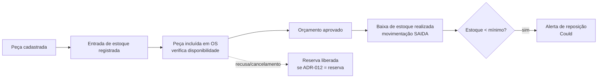

# PRD-002 — Catálogo de serviços, peças/insumos e estoque (contexto `catalog`)

| Campo | Valor |
|---|---|
| Status | 📝 Rascunho para revisão |
| Dono | F3 (Domínio & API) |
| Origem no enunciado | "CRUD de serviços"; "CRUD de peças e insumos, com controle de estoque"; "Possibilidade de incluir peças e insumos necessários"; Event storming obrigatório do fluxo **gestão de peças e insumos** |
| Contexto DDD | `catalog` (supporting) |

## 1. Objetivo

Manter o catálogo do que a oficina vende (serviços de mão de obra) e usa (peças e insumos), com preços e **controle de
estoque** confiável, para que o orçamento seja calculado automaticamente e o estoque reflita o que foi consumido pelas OS.

## 2. Conceitos

- **Serviço**: item de mão de obra do catálogo (ex.: troca de óleo, alinhamento). Tem preço e tempo estimado.
- **Peça**: item físico rastreado por unidade (ex.: filtro de óleo, pastilha de freio).
- **Insumo**: item consumível, geralmente por quantidade fracionária/unidade de medida (ex.: óleo 5W30 em litros). No MVP,
  peças e insumos compartilham o mesmo agregado (`Part`, com campo `type = PART | SUPPLY` e `unitOfMeasure`).
- **Movimentação de estoque**: registro imutável de entrada, saída, reserva, liberação ou ajuste.

## 3. Requisitos funcionais

| ID | Requisito | Prioridade |
|---|---|---|
| RF-020 | CRUD de serviços: nome (único), descrição, preço, tempo estimado (min), ativo | Must |
| RF-021 | CRUD de peças/insumos: SKU (único), nome, tipo, unidade de medida, preço unitário, quantidade em estoque, estoque mínimo, ativo | Must |
| RF-022 | Registrar **entrada** de estoque (compra/abastecimento) com quantidade e observação | Must |
| RF-023 | Registrar **ajuste** de estoque (inventário) com motivo | Should |
| RF-024 | **Baixa** de estoque vinculada a uma OS quando o orçamento é aprovado (momento conforme ADR-012) | Must |
| RF-025 | **Liberação/estorno** quando a OS é cancelada/recusada após baixa/reserva | Should |
| RF-026 | Consultar histórico de movimentações de uma peça | Should |
| RF-027 | Listar peças com estoque abaixo do mínimo | Could |
| RF-028 | Inativar serviço/peça (não remove; deixa de aparecer para novas OS; OS antigas mantêm snapshot) | Must |

## 4. Regras de negócio

| ID | Regra |
|---|---|
| RN-020 | Preços com 2 casas decimais, ≥ 0; quantidade em estoque nunca negativa |
| RN-021 | Estoque só muda por **movimentação** registrada (entrada, saída/baixa, reserva, liberação, ajuste) — nunca por edição direta do campo |
| RN-022 | Uma OS grava **snapshot** de nome e preço unitário do serviço/peça no momento da inclusão; mudar o catálogo depois não altera OS já orçadas |
| RN-023 | Inclusão de peça na OS verifica disponibilidade: `disponivel = estoque − reservado`; comportamento sem estoque conforme ADR-012 (bloquear ou sinalizar) |
| RN-024 | Serviço/peça inativos não podem ser incluídos em novas OS |
| RN-025 | Tempo estimado do serviço alimenta a comparação com o tempo médio real de execução (PRD-006) |

## 5. Fluxo (referência para o event storming — detalhado em `docs/03-ddd/event-storming.md`)



## 6. Critérios de aceite (Gherkin)

```gherkin
Funcionalidade: Controle de estoque
  Cenário: Entrada de estoque
    Dado a peça "Filtro de óleo" com estoque 2
    Quando registro entrada de 10 unidades
    Então o estoque passa a 12 e existe uma movimentação INBOUND de 10

  Cenário: Baixa ao aprovar orçamento
    Dado uma OS aguardando aprovação com 2 unidades de "Filtro de óleo" (estoque 12)
    Quando o cliente aprova o orçamento
    Então o estoque passa a 10 e existe movimentação OUTBOUND de 2 vinculada à OS

  Cenário: Estoque insuficiente
    Dado a peça "Pastilha de freio" com estoque 0
    Quando incluo 1 unidade dela em uma OS em diagnóstico
    Então a resposta segue a regra da ADR-012 (422 "estoque insuficiente" ou 201 com sinalização)

  Cenário: Snapshot de preço
    Dado uma OS com o serviço "Alinhamento" a R$ 120,00
    Quando o preço do serviço no catálogo muda para R$ 150,00
    Então o orçamento da OS continua R$ 120,00
```

## 7. API (resumo)

| Método | Rota | Papel | Descrição |
|---|---|---|---|
| POST/GET/PUT/DELETE | `/services`, `/services/{id}` | MANAGER (leitura: todos) | CRUD de serviços |
| POST/GET/PUT/DELETE | `/parts`, `/parts/{id}` | MANAGER (leitura: todos) | CRUD de peças/insumos |
| POST | `/parts/{id}/stock-movements` | MANAGER | Entrada/ajuste (`type`, `quantity`, `reason`) |
| GET | `/parts/{id}/stock-movements` | MANAGER | Histórico |
| GET | `/parts?belowMinimum=true` | MANAGER | Alerta (Could) |

## 8. Modelo (resumo)

- **Service**: `id`, `name`, `description`, `price`, `estimatedMinutes`, `active`.
- **Part**: `id`, `sku`, `name`, `type (PART|SUPPLY)`, `unitOfMeasure (UN|L|ML|KG…)`, `unitPrice`, `stockQuantity`, `reservedQuantity?`, `minimumStock`, `active`.
- **StockMovement**: `id`, `partId`, `type (INBOUND|OUTBOUND|RESERVATION|RELEASE|ADJUSTMENT)`, `quantity`, `serviceOrderId?`, `reason?`, `userId`, `occurredAt`.

## 9. Questões abertas

| # | Questão | Enquete |
|---|---|---|
| Q1 | Momento da baixa (aprovação vs. finalização) e reserva | E-16 / ADR-012 |
| Q2 | Sem estoque: bloquear inclusão ou permitir com sinalização | E-16 / ADR-012 |
| Q3 | Insumos fracionários (litros) — aceitar decimal na quantidade? | Proposta: sim, `quantity` decimal(10,3) |

## 10. Evidências

Swagger dos CRUDs e movimentações; testes unitários das invariantes (estoque nunca negativo; snapshot); teste de
integração "aprovar orçamento baixa estoque"; bloco do vídeo "inclusão de serviços, peças e insumos".
