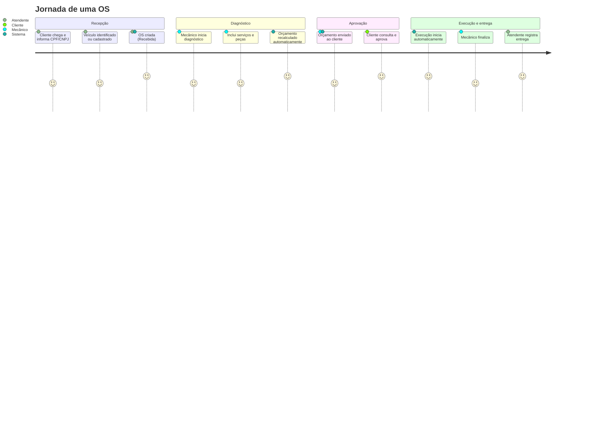

# PRD-003 — Ordem de serviço e orçamento (contexto `service-orders`, core)

| Campo | Valor |
|---|---|
| Status | 📝 Rascunho para revisão |
| Dono | F3 (Domínio & API) · apoio F1 |
| Origem no enunciado | Bloco "Criação da Ordem de Serviço (OS)" completo; "A geração e aprovação do orçamento"; "A inclusão de serviços, peças e insumos" (itens do vídeo) |
| Contexto DDD | `service-orders` (**core domain**) |

## 1. Objetivo

Transformar um atendimento em uma **Ordem de Serviço** rastreável: identificar cliente e veículo, registrar o que foi
solicitado, diagnosticar, compor serviços + peças, **gerar o orçamento automaticamente**, enviar ao cliente e só executar
depois da **aprovação**.

## 2. Jornada (visão do atendimento)



## 3. Requisitos funcionais

| ID | Requisito | Prioridade |
|---|---|---|
| RF-030 | Criar OS informando cliente (por id **ou** documento), veículo (por id **ou** placa), descrição do problema/solicitação e, opcionalmente, serviços iniciais solicitados | Must |
| RF-031 | OS nasce em **Recebida** com número legível (`OS-AAAA-NNNNNN`) e data/hora de recebimento | Must |
| RF-032 | Iniciar diagnóstico (→ **Em diagnóstico**) | Must |
| RF-033 | Incluir/remover **serviços** na OS (quantidade, snapshot de preço) enquanto em Recebida/Em diagnóstico | Must |
| RF-034 | Incluir/remover **peças e insumos** na OS (quantidade, snapshot de preço; verificação de estoque) enquanto em Recebida/Em diagnóstico | Must |
| RF-035 | **Orçamento gerado automaticamente**: total = Σ(serviços × qtd) + Σ(peças × qtd); recalculado a cada alteração de itens | Must |
| RF-036 | **Enviar orçamento ao cliente** para aprovação (→ **Aguardando aprovação**); OS precisa ter ≥ 1 item; gera token/identificação de acompanhamento (ADR-011); notificação simulada | Must |
| RF-037 | Cliente **aprova** o orçamento (→ **Em execução**, automático) | Must |
| RF-038 | Cliente **recusa** o orçamento (comportamento conforme ADR-010) | Should |
| RF-039 | Mecânico **finaliza** a execução (→ **Finalizada**) | Must |
| RF-040 | Atendente registra a **entrega** do veículo (→ **Entregue**) | Must |
| RF-041 | Detalhar OS: dados do cliente/veículo, itens, orçamento (valor, status, datas), status atual, histórico | Must |
| RF-042 | Cancelar OS (antes da execução) com motivo — se ADR-010 aprovar status *Cancelada* | Could |
| RF-043 | Reabrir orçamento após recusa (voltar a Em diagnóstico e reenviar) | Should (depende da ADR-010) |

## 4. Regras de negócio

| ID | Regra |
|---|---|
| RN-030 | Uma OS pertence a exatamente um cliente e um veículo; o veículo deve pertencer ao cliente |
| RN-031 | Itens só podem ser alterados em **Recebida** ou **Em diagnóstico**; após enviar o orçamento, os itens ficam congelados (alterar exige voltar a Em diagnóstico — ADR-010) |
| RN-032 | O orçamento é **derivado** dos itens (nunca digitado); total com 2 casas decimais; quantidade de serviço ≥ 1; de peça > 0 |
| RN-033 | Enviar orçamento exige pelo menos 1 item e total > 0 |
| RN-034 | Aprovação/recusa só é válida em **Aguardando aprovação** e só pelo cliente da OS (ADR-011); registra data/hora |
| RN-035 | Aprovação dispara automaticamente: status → Em execução; baixa/reserva de estoque (ADR-012); `executionStartedAt = agora` |
| RN-036 | Finalizar só em Em execução; registra `completedAt` (base do tempo médio — PRD-006) |
| RN-037 | Entregar só em Finalizada; registra `deliveredAt`; OS entregue é imutável |
| RN-038 | Toda transição gera um registro de histórico (de, para, quando, quem, motivo) — PRD-004 |
| RN-039 | Não pode existir mais de uma OS **em aberto** para o mesmo veículo (Should; evita duplicidade) |
| RN-040 | Concorrência: alterações na OS usam versão otimista (`version`) — duas ações simultâneas não corrompem o estado |

## 5. Critérios de aceite (Gherkin)

```gherkin
Funcionalidade: Criação e orçamento da OS
  Cenário: Criar OS a partir do documento do cliente
    Dado que estou autenticado como ATTENDANT
    E existe cliente com CPF "52998224725" e veículo "ABC1D23"
    Quando crio uma OS para o CPF "52998224725", placa "ABC1D23", descrição "barulho ao frear"
    Então a OS é criada com status "RECEIVED", número "OS-2026-000001" e "receivedAt" preenchido

  Cenário: Orçamento recalculado ao incluir itens
    Dado uma OS em "IN_DIAGNOSIS" sem itens
    Quando incluo o serviço "Troca de pastilhas" (R$ 150,00 × 1)
    E incluo a peça "Pastilha de freio" (R$ 90,00 × 2)
    Então o orçamento da OS é R$ 330,00

  Cenário: Enviar orçamento sem itens é rejeitado
    Dado uma OS em "IN_DIAGNOSIS" sem itens
    Quando envio o orçamento para aprovação
    Então a resposta é 422 "orçamento sem itens"

  Cenário: Aprovação inicia a execução automaticamente
    Dado uma OS em "AWAITING_APPROVAL" com orçamento R$ 330,00
    Quando o cliente aprova o orçamento
    Então o status passa a "IN_PROGRESS"
    E "executionStartedAt" é registrado
    E o estoque da "Pastilha de freio" é reduzido em 2

  Cenário: Itens congelados após envio
    Dado uma OS em "AWAITING_APPROVAL"
    Quando tento incluir um serviço
    Então a resposta é 409 "itens não podem ser alterados neste status"
```

## 6. API (resumo)

| Método | Rota | Papel | Efeito |
|---|---|---|---|
| POST | `/service-orders` | ATTENDANT+ | Cria (Recebida) |
| GET | `/service-orders/{id}` | ATTENDANT+ | Detalha (itens, orçamento, histórico) |
| POST | `/service-orders/{id}/diagnosis` | MECHANIC+ | Recebida → Em diagnóstico |
| POST | `/service-orders/{id}/items/services` | MECHANIC+ | Inclui serviço `{serviceId, quantity}` |
| DELETE | `/service-orders/{id}/items/services/{itemId}` | MECHANIC+ | Remove |
| POST | `/service-orders/{id}/items/parts` | MECHANIC+ | Inclui peça `{partId, quantity}` |
| DELETE | `/service-orders/{id}/items/parts/{itemId}` | MECHANIC+ | Remove |
| GET | `/service-orders/{id}/quote` | ATTENDANT+ | Orçamento atual (calculado) |
| POST | `/service-orders/{id}/quote/send` | MECHANIC+ | Em diagnóstico → Aguardando aprovação |
| POST | `/service-orders/{id}/complete` | MECHANIC+ | Em execução → Finalizada |
| POST | `/service-orders/{id}/deliver` | ATTENDANT+ | Finalizada → Entregue |
| POST | `/service-orders/{id}/cancel` | MANAGER | (Could, ADR-010) |
| POST | `/tracking/service-orders/{id}/quote/approve` | Cliente (ADR-011) | Aguardando aprovação → Em execução |
| POST | `/tracking/service-orders/{id}/quote/reject` | Cliente (ADR-011) | conforme ADR-010 |

## 7. Modelo (resumo — agregado `ServiceOrder`)

`id`, `number`, `customerId`, `vehicleId`, `problemDescription`, `status`, `serviceItems[] {id, serviceId, nameSnapshot,
priceSnapshot, quantity}`, `partItems[] {id, partId, nameSnapshot, unitPriceSnapshot, quantity}`,
`quote {totalAmount, status (PENDING|SENT|APPROVED|REJECTED), sentAt, respondedAt}`, marcos temporais
(`receivedAt`, `diagnosisStartedAt`, `quoteSentAt`, `executionStartedAt`, `completedAt`, `deliveredAt`),
`statusHistory[]`, `version`, `createdBy`.

Invariantes e detalhes em `docs/03-ddd/agregados.md`.

## 8. Fora de escopo

Orçamento parcial/itens opcionais aprovados separadamente; descontos; pagamento; garantia; múltiplos veículos por OS.

## 9. Questões abertas

| # | Questão | Enquete |
|---|---|---|
| Q1 | Recusa do orçamento: voltar a diagnóstico ou Cancelada | E-14 / ADR-010 |
| Q2 | Acesso do cliente para aprovar | E-15 / ADR-011 |
| Q3 | Baixa de estoque na aprovação vs. finalização | E-16 / ADR-012 |
| Q4 | Permitir criar OS já com serviços "solicitados" pelo cliente (RF-030) e diferenciar de "diagnosticados"? | Proposta: sim, campo `origin = REQUESTED|DIAGNOSED` no item (Could) |

## 10. Evidências

Demonstração no Swagger do fluxo completo (bloco central do vídeo, ~3 min); testes unitários do agregado (transições,
cálculo, congelamento); teste de integração ponta a ponta; BDD dos cenários acima (se ADR-006 aprovar).
