# PRD-004 — Acompanhamento da OS e ciclo de status (contexto `service-orders`)

| Campo | Valor |
|---|---|
| Status | 📝 Rascunho para revisão (máquina de estados e acesso do cliente consolidados pelas ADRs 010/011 em 22/09/2026) |
| Dono | F3 · apoio F4 (acesso do cliente) |
| Origem no enunciado | Bloco "Acompanhamento da OS": 6 status; "Alteração automática dos status conforme ações no sistema"; "Permitir consulta por parte do cliente via API para acompanhar o progresso"; vídeo: "A alteração dos status da Ordem de Serviço"; §5 do enunciado de 23/09: "Controlar as alterações de status; Aplicar as regras de transição" |
| Contexto DDD | `service-orders` (core) + read model de acompanhamento |

## 1. Objetivo

Dar visibilidade do andamento da OS para a oficina e para o cliente, com status que mudam **automaticamente em função
das ações** (nunca por edição manual de campo) e histórico auditável.

## 2. Máquina de estados (oficial do enunciado + extensão Cancelada)

```mermaid
stateDiagram-v2
    direction LR
    [*] --> Recebida: criar OS (Atendente)
    Recebida --> EmDiagnostico: iniciar diagnóstico (Mecânico)
    EmDiagnostico --> AguardandoAprovacao: enviar orçamento (Mecânico)
    AguardandoAprovacao --> EmExecucao: cliente aprova (automático · reserva estoque)
    AguardandoAprovacao --> Cancelada: cliente recusa (ADR-010)
    Recebida --> Cancelada: cancelar (Gerente)
    EmDiagnostico --> Cancelada: cancelar (Gerente)
    AguardandoAprovacao --> Cancelada: cancelar (Gerente)
    EmExecucao --> Finalizada: finalizar execução (Mecânico · baixa estoque)
    Finalizada --> Entregue: registrar entrega (Atendente)
    Entregue --> [*]
    Cancelada --> [*]
    state "Recebida · RECEIVED" as Recebida
    state "Em diagnóstico · IN_DIAGNOSIS" as EmDiagnostico
    state "Aguardando aprovação · AWAITING_APPROVAL" as AguardandoAprovacao
    state "Em execução · IN_PROGRESS" as EmExecucao
    state "Finalizada · COMPLETED" as Finalizada
    state "Entregue · DELIVERED" as Entregue
    state "Cancelada · CANCELLED (extensão, ADR-010)" as Cancelada
```



Nomes do enunciado (português) e enums do código (inglês, ADR-013) lado a lado — mapeamento oficial em
`docs/ddd/linguagem-ubiqua.md` §7.

> Extensão decidida (ADR-010, E-14): status terminal **Cancelada**, alcançável de Recebida/Em diagnóstico/Aguardando
> aprovação por recusa do cliente ou cancelamento do gerente. Não há volta para Em diagnóstico: renegociar = nova OS.
> No vídeo: "o enunciado define seis status; adicionamos um estado terminal, mantendo os seis intactos".

Tabela de transições (fonte da verdade para o código e para os testes):

| De | Ação (comando) | Quem | Para | Efeitos automáticos |
|---|---|---|---|---|
| — | Criar OS | Atendente | Recebida | `receivedAt`; histórico |
| Recebida | Iniciar diagnóstico | Mecânico | Em diagnóstico | `diagnosisStartedAt`; histórico |
| Em diagnóstico | Enviar orçamento | Mecânico | Aguardando aprovação | congela itens; `quoteSentAt`; token de acompanhamento; notificação simulada |
| Aguardando aprovação | Aprovar orçamento | Cliente | Em execução | `executionStartedAt`; **reserva** de estoque das peças (tudo ou nada, mesma transação — ADR-012); histórico |
| Aguardando aprovação | Recusar orçamento (motivo) | Cliente | **Cancelada** | `quote.status = REJECTED`; `respondedAt`; motivo; histórico; sem efeito no estoque |
| Em execução | Finalizar | Mecânico | Finalizada | `completedAt`; **baixa** das peças reservadas (mesma transação — ADR-012); histórico |
| Finalizada | Entregar | Atendente | Entregue | `deliveredAt`; histórico; OS imutável |
| Recebida / Em diagnóstico / Aguardando aprovação | Cancelar (motivo) | Gerente | **Cancelada** | motivo; histórico; sem efeito no estoque (Should) |

Qualquer outra combinação (inclusive qualquer comando em Entregue ou Cancelada) → **409 Conflict** com mensagem
"transição inválida de X para Y".

> **Implementação atual (31/10/2026)** — o código usa 9 status (`StatusOrdemServico`): `RECEBIDA`, `EM_DIAGNOSTICO`,
> `AGUARDANDO_APROVACAO`, `AGUARDANDO_EXECUCAO`, `EM_EXECUCAO`, `FINALIZADA`, `ENTREGUE`, `ORCAMENTO_RECUSADO`, `CANCELADA`.
> Diferenças em relação à tabela acima: aprovar o orçamento leva a `AGUARDANDO_EXECUCAO` (e o comando `startExecution`,
> pelo Mecânico, leva a `EM_EXECUCAO`); recusar o orçamento leva a `ORCAMENTO_RECUSADO`, não a `CANCELADA`. `Cancelar`,
> `Finalizar` e `Entregar` seguem a tabela. Fonte no código: `service-orders/domain/policies/status-transition.policy.ts`,
> testada em todas as combinações status × comando. Registro em `docs/02-adr/decisoes-leves.md` (2026-10-31).

## 3. Requisitos funcionais

| ID | Requisito | Prioridade |
|---|---|---|
| RF-050 | O status é alterado **somente** por comandos de negócio (nunca `PATCH status`) | Must |
| RF-051 | Registrar histórico de transições: de, para, data/hora, usuário/cliente, motivo | Should (Must para o vídeo "alteração dos status") |
| RF-052 | Consulta do cliente via API: status atual, descrição amigável, orçamento (valor/status), marcos temporais, itens; dados pessoais mascarados — com token de acompanhamento ou login de cliente (ADR-011) | Must |
| RF-053 | Consulta do cliente lista suas OS (`GET /tracking/service-orders`) — só com login de cliente (papel `CUSTOMER`), ADR-011 | Should |
| RF-054 | Listagem administrativa por status (fila de trabalho: "o que está em diagnóstico", "aguardando aprovação há mais de X horas") | Must (listagem) / Could (alertas) |
| RF-055 | Payload do cliente inclui `nextAction` ("aguardando sua aprovação", "em execução, previsão …") | Could |

## 4. Regras de negócio

| ID | Regra |
|---|---|
| RN-050 | Transições válidas somente conforme a tabela; validação no **domínio** (agregado), não no controller nem no service |
| RN-051 | Toda transição é atômica com seus efeitos (aprovação + reserva de estoque; finalização + baixa) na mesma transação |
| RN-052 | Histórico é append-only; `actor` = id do usuário da equipe, `CUSTOMER` ou `SYSTEM` |
| RN-053 | Cliente só enxerga OS próprias; respostas ao cliente mascaram CPF/CNPJ e placa e não expõem ids internos de usuários |
| RN-054 | Consulta do cliente é **sem JWT de equipe**: token de acompanhamento (uma OS) ou login com papel `CUSTOMER` (todas as OS do `customerId`), ADR-011; OS alheia → 404; rate limit básico (Should) |

## 5. Critérios de aceite

```gherkin
Funcionalidade: Ciclo de status
  Cenário: Transição inválida
    Dado uma OS em "RECEIVED"
    Quando tento finalizar a OS
    Então a resposta é 409 "transição inválida de RECEIVED para COMPLETED"

  Cenário: OS cancelada é terminal
    Dado uma OS em "CANCELLED"
    Quando tento iniciar o diagnóstico
    Então a resposta é 409

  Cenário: Histórico registrado
    Dado uma OS que passou por RECEIVED → IN_DIAGNOSIS → AWAITING_APPROVAL
    Quando consulto o histórico
    Então vejo 3 registros ordenados por data, com o usuário de cada ação

Funcionalidade: Consulta do cliente
  Cenário: Cliente acompanha a OS com o token de acompanhamento
    Dado uma OS "OS-2026-000001" do cliente com CPF "52998224725" em "IN_PROGRESS"
    Quando o cliente consulta a OS com o token de acompanhamento recebido no envio do orçamento
    Então recebe status "IN_PROGRESS", o orçamento aprovado e o CPF mascarado "***.982.247-**"

  Cenário: Cliente lista suas OS com login
    Dado que o cliente com CPF "52998224725" está autenticado com papel CUSTOMER
    Quando consulta GET /tracking/service-orders
    Então recebe só as OS do seu cadastro

  Cenário: Cliente não acessa OS de outro
    Quando o cliente tenta consultar uma OS que não é sua (token de outra OS ou login de outro cliente)
    Então a resposta é 404 (sem revelar existência)
```

## 6. API (resumo)

| Método | Rota | Acesso | Descrição |
|---|---|---|---|
| GET | `/service-orders?status=&customerId=&from=&to=&page=&size=` | ATTENDANT+ | Fila/listagem |
| GET | `/service-orders/{id}/status-history` | ATTENDANT+ | Histórico de status |
| GET | `/tracking/service-orders/{id}` | Cliente — token de acompanhamento ou login `CUSTOMER` (ADR-011) | Progresso da OS |
| GET | `/tracking/service-orders?status=&page=&size=` | Cliente — só login `CUSTOMER` (ADR-011) | Minhas OS (Should) |

## 7. Questões abertas

| # | Questão | Situação |
|---|---|---|
| Q1 | Recusa: voltar a diagnóstico vs. Cancelada | ✅ E-14 / ADR-010 — Cancelada |
| Q2 | Credencial do cliente | ✅ E-15 / ADR-011 — token de acompanhamento + login `CUSTOMER` |

## 8. Evidências

Diagrama de estados no Miro e no vídeo; testes unitários parametrizados cobrindo **todas** as combinações de transição
(7 status × comandos); teste de integração da consulta do cliente pelos dois caminhos; bloco do vídeo "alteração dos
status" + "fluxo de acompanhamento".
