# PRD-004 — Acompanhamento da OS e ciclo de status (contexto `service-orders`)

| Campo | Valor |
|---|---|
| Status | 📝 Rascunho para revisão |
| Dono | F3 · apoio F4 (acesso do cliente) |
| Origem no enunciado | Bloco "Acompanhamento da OS": 6 status; "Alteração automática dos status conforme ações no sistema"; "Permitir consulta por parte do cliente via API para acompanhar o progresso"; vídeo: "A alteração dos status da Ordem de Serviço" |
| Contexto DDD | `service-orders` (core) + read model de acompanhamento |

## 1. Objetivo

Dar visibilidade do andamento da OS para a oficina e para o cliente, com status que mudam **automaticamente em função
das ações** (nunca por edição manual de campo) e histórico auditável.

## 2. Máquina de estados (oficial do enunciado)

```mermaid
stateDiagram-v2
    direction LR
    [*] --> Recebida: criar OS (Atendente)
    Recebida --> EmDiagnostico: iniciar diagnóstico (Mecânico)
    EmDiagnostico --> AguardandoAprovacao: enviar orçamento (Mecânico)
    AguardandoAprovacao --> EmExecucao: cliente aprova (automático)
    AguardandoAprovacao --> EmDiagnostico: cliente recusa (ADR-010 opção A)
    EmExecucao --> Finalizada: finalizar execução (Mecânico)
    Finalizada --> Entregue: registrar entrega (Atendente)
    Entregue --> [*]
    state "Recebida · RECEIVED" as Recebida
    state "Em diagnóstico · IN_DIAGNOSIS" as EmDiagnostico
    state "Aguardando aprovação · AWAITING_APPROVAL" as AguardandoAprovacao
    state "Em execução · IN_PROGRESS" as EmExecucao
    state "Finalizada · COMPLETED" as Finalizada
    state "Entregue · DELIVERED" as Entregue
```



Nomes do enunciado (português) e enums do código (inglês, ADR-013) lado a lado — mapeamento oficial em
`docs/03-ddd/linguagem-ubiqua.md` §7.

> Extensão em votação (ADR-010): status terminal **Cancelada**, alcançável de Recebida/Em diagnóstico/Aguardando aprovação.

Tabela de transições (fonte da verdade para o código e para os testes):

| De | Ação (comando) | Quem | Para | Efeitos automáticos |
|---|---|---|---|---|
| — | Criar OS | Atendente | Recebida | `receivedAt`; histórico |
| Recebida | Iniciar diagnóstico | Mecânico | Em diagnóstico | `diagnosisStartedAt`; histórico |
| Em diagnóstico | Enviar orçamento | Mecânico | Aguardando aprovação | congela itens; `quoteSentAt`; token de acompanhamento; notificação simulada |
| Aguardando aprovação | Aprovar orçamento | Cliente | Em execução | `executionStartedAt`; baixa/reserva de estoque; histórico |
| Aguardando aprovação | Recusar orçamento | Cliente | Em diagnóstico *ou* Cancelada (ADR-010) | libera estoque (se reservado); motivo; histórico |
| Em execução | Finalizar | Mecânico | Finalizada | `completedAt`; histórico |
| Finalizada | Entregar | Atendente | Entregue | `deliveredAt`; histórico; OS imutável |
| Recebida / Em diagnóstico / Aguardando aprovação | Cancelar (Could) | Gerente | Cancelada | motivo; libera estoque; histórico |

Qualquer outra combinação → **409 Conflict** com mensagem "transição inválida de X para Y".

## 3. Requisitos funcionais

| ID | Requisito | Prioridade |
|---|---|---|
| RF-050 | O status é alterado **somente** por comandos de negócio (nunca `PATCH status`) | Must |
| RF-051 | Registrar histórico de transições: de, para, data/hora, usuário/cliente, motivo | Should (Must para o vídeo "alteração dos status") |
| RF-052 | Consulta do cliente via API: status atual, descrição amigável, orçamento (valor/status), marcos temporais, itens; dados pessoais mascarados | Must |
| RF-053 | Consulta do cliente lista suas OS (por documento) — depende da ADR-011 | Should |
| RF-054 | Listagem administrativa por status (fila de trabalho: "o que está em diagnóstico", "aguardando aprovação há mais de X horas") | Must (listagem) / Could (alertas) |
| RF-055 | Payload do cliente inclui `nextAction` ("aguardando sua aprovação", "em execução, previsão …") | Could |

## 4. Regras de negócio

| ID | Regra |
|---|---|
| RN-050 | Transições válidas somente conforme a tabela; validação no **domínio** (agregado), não no controller |
| RN-051 | Toda transição é atômica com seus efeitos (ex.: aprovação + baixa de estoque na mesma transação/unidade de trabalho) |
| RN-052 | Histórico é append-only |
| RN-053 | Cliente só enxerga OS próprias; respostas ao cliente mascaram CPF/CNPJ e não expõem ids internos de usuários |
| RN-054 | Consulta do cliente é **sem JWT administrativo** (mecanismo da ADR-011) e tem rate limit básico (Should) |

## 5. Critérios de aceite

```gherkin
Funcionalidade: Ciclo de status
  Cenário: Transição inválida
    Dado uma OS em "RECEIVED"
    Quando tento finalizar a OS
    Então a resposta é 409 "transição inválida de RECEIVED para COMPLETED"

  Cenário: Histórico registrado
    Dado uma OS que passou por RECEIVED → IN_DIAGNOSIS → AWAITING_APPROVAL
    Quando consulto o histórico
    Então vejo 3 registros ordenados por data, com o usuário de cada ação

Funcionalidade: Consulta do cliente
  Cenário: Cliente acompanha a OS
    Dado uma OS "OS-2026-000001" do cliente com CPF "52998224725" em "IN_PROGRESS"
    Quando o cliente consulta a OS com sua credencial de acompanhamento
    Então recebe status "IN_PROGRESS", o orçamento aprovado e o CPF mascarado "***.982.247-**"

  Cenário: Cliente não acessa OS de outro
    Quando o cliente tenta consultar uma OS que não é sua
    Então a resposta é 404 (sem revelar existência)
```

## 6. API (resumo)

| Método | Rota | Acesso | Descrição |
|---|---|---|---|
| GET | `/service-orders?status=&customerId=&from=&to=&page=&size=` | ATTENDANT+ | Fila/listagem |
| GET | `/service-orders/{id}/status-history` | ATTENDANT+ | Histórico de status |
| GET | `/tracking/service-orders/{id}` | Cliente (ADR-011) | Progresso da OS |
| GET | `/tracking/service-orders?document=` | Cliente (ADR-011) | Minhas OS (Should) |

## 7. Questões abertas

| # | Questão | Enquete |
|---|---|---|
| Q1 | Recusa: voltar a diagnóstico vs. Cancelada | E-14 / ADR-010 |
| Q2 | Credencial do cliente | E-15 / ADR-011 |

## 8. Evidências

Diagrama de estados no Miro e no vídeo; testes unitários parametrizados cobrindo **todas** as combinações de transição;
teste de integração da consulta do cliente; bloco do vídeo "alteração dos status" + "fluxo de acompanhamento".
