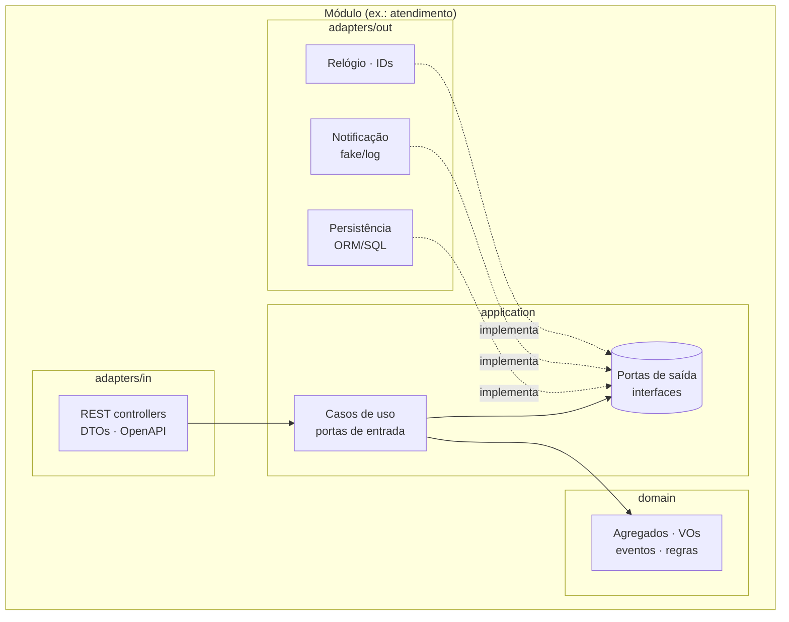

# ADR-003 — Estilo arquitetural do monólito

| Campo | Valor |
|---|---|
| Status | ✅ **Aceita** — **Opção A (camadas clássicas)**, revotação da enquete E-06 encerrada em 22/09/2026. Substitui a decisão de 16/09/2026 (Opção C, Clean Architecture completa) — ver *Histórico* |
| Tipo | Tipo 1 |
| Decisores | Grupo — enquete **E-06** (16/09) e **revotação da E-06** (22/09) |
| Data | 2026-09-14 (proposta) · 2026-09-16 (1ª decisão) · 2026-09-22 (revotação) |
| Relacionadas | ADR-001, ADR-013, `docs/04-arquitetura/estrutura-do-repositorio.md`, `docs/04-arquitetura/visao-geral.md`, `docs/03-ddd/contextos-delimitados.md` |

## Contexto e problema

O enunciado exige **monólito** e permite "arquitetura em camadas" por ser MVP. A disciplina de Arquitetura da Fase 1
ensina **Arquitetura Hexagonal**; a Fase 2 ensina **Clean Architecture**; a Fase 4 refatora o monólito em
**microsserviços**. O vídeo pede "a organização do monólito e suas camadas" e "os principais elementos de DDD".
Precisamos de uma organização que seja rápida de construir agora, fácil de explicar no vídeo e que não vire uma
reescrita nas próximas fases.

## Critérios de decisão

1. Velocidade para 6–8 semanas com time assíncrono (paralelizar módulos sem conflitos) — peso 5
2. Aderência ao que a disciplina ensina (DDD + hexagonal) e ao que o vídeo pede — peso 4
3. Testabilidade do domínio sem banco/HTTP (cobertura ≥ 80 % barata) — peso 4
4. Evolução para Clean Architecture (Fase 2) e extração de microsserviços (Fase 4) — peso 4

## Opções consideradas

### Opção A — Camadas clássica (Controller → Service → Repository), organizada por tipo técnico

- **Prós:** todo mundo conhece; mínimo de arquivos; explicitamente permitido pelo enunciado.
- **Contras:** regras de negócio tendem a escorrer para *services* anêmicos; domínio acoplado ao ORM; separar em
  microsserviços depois exige "desembaraçar" tudo; difícil mostrar "elementos de DDD" no vídeo.
- **Fases futuras:** refatoração pesada na Fase 2 (Clean) e Fase 4 (microsserviços).

### Opção B — Monólito **modular** por contexto delimitado + **hexagonal** (Ports & Adapters) dentro de cada módulo

Cada módulo (`customers`, `catalog`, `service-orders`, `identity`) tem: `domain` (agregados, VOs, eventos,
interfaces de repositório), `application` (casos de uso / portas de entrada e saída), `adapters` (`in`: REST/DTOs;
`out`: persistência, notificação, relógio). Módulos se comunicam por **portas de aplicação** (interfaces) ou eventos
em processo — nunca por tabelas/JOINs cruzados.

- **Prós:** paraleliza por módulo (uma pessoa por contexto, poucos conflitos); domínio puro e testável em memória;
  mostra DDD + hexagonal (o que a disciplina ensina); extrair um módulo vira microsserviço com fronteiras já definidas;
  trocar adaptadores (JWT → Cognito, log → SQS) sem tocar no domínio.
- **Contras:** mais arquivos/boilerplate (DTOs, mapeadores, interfaces); exige disciplina para não "furar" módulos.
- **Fases futuras:** Clean Architecture é uma reorganização leve (nomes: entities/use cases/interface adapters);
  microsserviços = mover módulo + trocar chamadas em processo por HTTP/eventos.

### Opção C — Clean Architecture completa desde já (entities / use cases / interface adapters / frameworks & drivers)

- **Prós:** alinhamento direto com a Fase 2; máxima independência de framework.
- **Contras:** mais boilerplate que B sem ganho no MVP; é conteúdo da Fase 2 (o vídeo da Fase 1 pede hexagonal/camadas);
  risco de gastar tempo em abstração em vez de funcionalidade.

## Recomendação (não vinculante)

**Opção B — monólito modular + hexagonal, pragmático:** sem abstração sem uso (uma interface só onde há ≥ 2
implementações reais ou teste), DTOs finos, e o walking skeleton primeiro. É o melhor custo-benefício para a nota da
Fase 1 e para as fases 2 e 4.

## Decisão

**Camadas clássicas** (Opção A), resultado da **revotação da enquete E-06** encerrada em 22/09/2026 — substitui a decisão
de 16/09/2026 (Opção C, Clean Architecture completa). O grupo optou pela organização mais simples, explicitamente
permitida pelo enunciado ("arquitetura em camadas"), e deixa a Clean Architecture para a Fase 2, quando ela é conteúdo
da disciplina.

A Opção A "pura" (pastas por tipo técnico: `controllers/`, `services/`, `repositories/` na raiz) **não** foi adotada:
as camadas clássicas ficam **dentro de cada módulo por contexto delimitado**, porque a modularidade vem do DDD e do
enunciado (event storming por fluxo, contextos em `contextos-delimitados.md`), não do estilo de camadas.

Como fica (árvore e regras em `docs/04-arquitetura/estrutura-do-repositorio.md`):

| Camada | Pasta (por módulo) | Conteúdo | Depende de |
|---|---|---|---|
| Apresentação | `controllers/` + `dto/` | Controllers REST, DTOs de entrada (class-validator) e de saída (`fromDomain()`), decorators do OpenAPI | `services/` |
| Aplicação | `services/` | Serviços de aplicação (`ServiceOrdersService`, `PartsService`…): orquestram cada caso de uso, transações e chamadas a outros módulos | `domain/`, `repositories/` |
| Domínio | `domain/` | Agregados, entidades, value objects, eventos, `StatusTransitionPolicy` — TypeScript puro | nada |
| Persistência | `repositories/` | Repositórios sobre o Prisma, mapeando registros ↔ agregados | `domain/` |
| Composição | `<modulo>.module.ts` | Módulo Nest: providers, `imports`, `exports` | tudo |

O que **não** muda com a revotação:

- **Modularidade por contexto delimitado**: um módulo Nest por contexto (`customers`, `catalog`, `service-orders`,
  `identity`) + `shared`; um schema PostgreSQL por módulo; sem JOIN entre schemas (`contextos-delimitados.md` §3).
- **Domínio rico**: invariantes, transições de status, cálculo do orçamento e movimentações de estoque ficam nos
  agregados (`agregados.md`), não nos services — é o que o vídeo mostra como "elementos de DDD" e o que a cobertura de
  80 % mede.
- **`domain/` sem framework**: não importa `@nestjs/*` nem Prisma; testável sem banco e sem HTTP.
- **Fronteira entre módulos = serviço exportado**: um módulo só usa outro pelo serviço de aplicação que ele exporta
  (`exports: [CustomersService]`), nunca por repositórios ou entidades do outro.
- Regras verificadas por `dependency-cruiser` no CI e na revisão de PR.

Nomenclatura: serviços de aplicação com sufixo `Service` (convenção do Nest). A entidade `Service` do catálogo mantém o
nome do glossário; o serviço de aplicação que a mantém chama-se `CatalogService` — nunca `ServicesService`
(`linguagem-ubiqua.md` §4 e §9).

## Consequências

- **Positivas:** menos arquivos por caso de uso (sem boundaries/presenters); curva zero para quem já usa Nest; mais
  tempo para funcionalidade, testes e segurança — o que a nota da Fase 1 mede.
- **Negativas / riscos aceitos:** a Fase 2 (Clean Architecture) exige refatorar `services/` em casos de uso + portas; o
  custo fica contido porque o domínio rico, os módulos por contexto e a regra "sem framework no domínio" já isolam o que
  importa. Risco de regra de negócio escorrer para o service: mitigado pela revisão de PR (`prompts/09-revisao-de-pr.md`,
  item 3) e pela cobertura medida em `domain/` + `services/`.
- **O que muda nos docs/código:** `estrutura-do-repositorio.md`, `visao-geral.md`, `fluxos.md`, `agregados.md` §5,
  `linguagem-ubiqua.md` §4/§9, `contextos-delimitados.md` §3, `evolucao-fases.md`, PRD-000 (NFR-01), prompts 00/02–05/09,
  `CLAUDE.md` e o roteiro do vídeo atualizados em 22/09/2026 para camadas clássicas.
- Cobertura ≥ 80 % medida sobre `domain/` + `services/` dos módulos críticos (ADR-006).
- Vídeo: bloco "organização do monólito e suas camadas" mostra a árvore por módulo, o caminho controller → service →
  repository de um caso real e o domínio rico; explicar que a disciplina ensina hexagonal e que a Fase 2 leva **este
  mesmo** monólito para Clean Architecture (`evolucao-fases.md`).

## Histórico

| Data | Evento |
|---|---|
| 2026-09-14 | Proposta (recomendação: Opção B) |
| 2026-09-16 | E-06 encerrada: **Opção C** (Clean Architecture completa) — Aceita |
| 2026-09-22 | E-06 revotada: **Opção A** (camadas clássicas) — Aceita; substitui a decisão de 16/09 |

## Enquete (texto para o Discord)

> **Enquete E-06 — ADR-003 Arquitetura do monólito** (prazo 48 h)
> 🥞 Camadas clássica · ⬡ Monólito modular + hexagonal (recomendada) · 🧅 Clean Architecture completa
