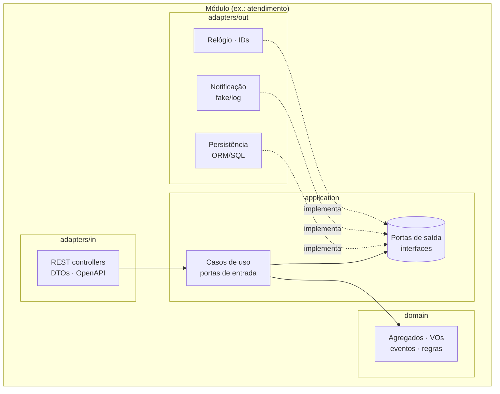

# ADR-003 — Estilo arquitetural do monólito

| Campo | Valor |
|---|---|
| Status | 🗳️ Em votação (Lote 1) |
| Tipo | Tipo 1 |
| Decisores | Grupo — enquete **E-06** |
| Data | 2026-09-14 |
| Relacionadas | ADR-001, ADR-013, `docs/04-arquitetura/visao-geral.md`, `docs/03-ddd/contextos-delimitados.md` |

## Contexto e problema

O enunciado exige **monólito** e permite "arquitetura em camadas" por ser MVP. A disciplina de Arquitetura da Fase 1
ensina **Arquitetura Hexagonal**; a Fase 2 ensina **Clean Architecture**; a Fase 4 refatora o monólito em
**microsserviços**. O vídeo pede "a organização do monólito e suas camadas" e "os principais elementos de DDD".
Precisamos de uma organização que seja rápida de construir agora, fácil de explicar no vídeo e que não vire uma
reescrita nas próximas fases.

## Critérios de decisão

1. Velocidade para 6–8 semanas com time assíncrono (paralelizar módulos sem conflitos) — peso 5
2. Aderência ao que a disciplina ensina (DDD + hexagonal) e ao que o vídeo pede — peso 4
3. Testabilidade do domínio sem banco/HTTP (cobertura ≥ 80 % barata) — peso 4
4. Evolução para Clean Architecture (Fase 2) e extração de microsserviços (Fase 4) — peso 4

## Opções consideradas

### Opção A — Camadas clássica (Controller → Service → Repository), organizada por tipo técnico

- **Prós:** todo mundo conhece; mínimo de arquivos; explicitamente permitido pelo enunciado.
- **Contras:** regras de negócio tendem a escorrer para *services* anêmicos; domínio acoplado ao ORM; separar em
  microsserviços depois exige "desembaraçar" tudo; difícil mostrar "elementos de DDD" no vídeo.
- **Fases futuras:** refatoração pesada na Fase 2 (Clean) e Fase 4 (microsserviços).

### Opção B — Monólito **modular** por contexto delimitado + **hexagonal** (Ports & Adapters) dentro de cada módulo

Cada módulo (`cadastro`, `catalogo-estoque`, `atendimento`, `identidade`) tem: `domain` (agregados, VOs, eventos,
interfaces de repositório), `application` (casos de uso / portas de entrada e saída), `adapters` (`in`: REST/DTOs;
`out`: persistência, notificação, relógio). Módulos se comunicam por **portas de aplicação** (interfaces) ou eventos
em processo — nunca por tabelas/JOINs cruzados.

- **Prós:** paraleliza por módulo (uma pessoa por contexto, poucos conflitos); domínio puro e testável em memória;
  mostra DDD + hexagonal (o que a disciplina ensina); extrair um módulo vira microsserviço com fronteiras já definidas;
  trocar adaptadores (JWT → Cognito, log → SQS) sem tocar no domínio.
- **Contras:** mais arquivos/boilerplate (DTOs, mapeadores, interfaces); exige disciplina para não "furar" módulos.
- **Fases futuras:** Clean Architecture é uma reorganização leve (nomes: entities/use cases/interface adapters);
  microsserviços = mover módulo + trocar chamadas em processo por HTTP/eventos.

### Opção C — Clean Architecture completa desde já (entities / use cases / interface adapters / frameworks & drivers)

- **Prós:** alinhamento direto com a Fase 2; máxima independência de framework.
- **Contras:** mais boilerplate que B sem ganho no MVP; é conteúdo da Fase 2 (o vídeo da Fase 1 pede hexagonal/camadas);
  risco de gastar tempo em abstração em vez de funcionalidade.

## Recomendação (não vinculante)

**Opção B — monólito modular + hexagonal, pragmático:** sem abstração sem uso (uma interface só onde há ≥ 2
implementações reais ou teste), DTOs finos, e o walking skeleton primeiro. É o melhor custo-benefício para a nota da
Fase 1 e para as fases 2 e 4.

## Decisão

> Preencher após a enquete E-06.

## Consequências

- Estrutura de pastas em `docs/04-arquitetura/estrutura-do-repositorio.md`; regra de dependência verificada em revisão (e,
  se a linguagem permitir, por lint de arquitetura: ArchUnit, dependency-cruiser, NetArchTest, import-linter).
- Cobertura ≥ 80 % medida sobre `domain` + `application` dos módulos críticos.
- Vídeo: bloco "organização do monólito e suas camadas" usa o diagrama acima + árvore do repositório.

## Enquete (texto para o Discord)

> **Enquete E-06 — ADR-003 Arquitetura do monólito** (prazo 48 h)
> 🥞 Camadas clássica · ⬡ Monólito modular + hexagonal (recomendada) · 🧅 Clean Architecture completa
