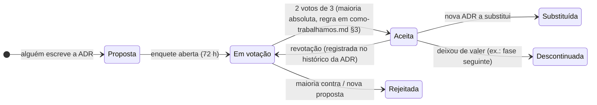

# ADRs — Architecture Decision Records

Registro das decisões de arquitetura do projeto no formato ensinado na disciplina *Documentação de Arquitetura (ADR/RFC)*.
Cada ADR apresenta **contexto, critérios, opções com prós/contras, recomendação e a decisão tomada pelo grupo via enquete**.

## Ciclo de vida

## Índice

**Todas as ADRs estão Aceitas** (Lotes 1–3 encerrados; E-06 revotada em 22/09). Vale o que está na seção *Decisão* de
cada uma; as opções e recomendações ficam como registro.

| ADR | Título | Tipo | Lote | Status | Enquete |
|---|---|---|---|---|---|
| [ADR-000](ADR-000-template.md) | Template | — | — | ✅ | — |
| [ADR-001](ADR-001-linguagem-e-framework.md) | Linguagem e framework do back-end — **TypeScript + NestJS** (ORM: **Prisma**, E-17) | Tipo 1 | 1 | ✅ Aceita (16/09) | E-04 (+ E-17) |
| [ADR-002](ADR-002-banco-de-dados.md) | Banco de dados — **PostgreSQL 16** (justificativa exigida no enunciado) | Tipo 1 | 1 | ✅ Aceita (16/09) | E-05 |
| [ADR-003](ADR-003-arquitetura-do-monolito.md) | Estilo arquitetural do monólito — **camadas clássicas** dentro de módulos por contexto (16/09: Clean; **revotada em 22/09**) | Tipo 1 | 1 | ✅ Aceita (22/09, revotação) | E-06 |
| [ADR-004](ADR-004-autenticacao-jwt.md) | Autenticação — **JWT próprio** (usuários no banco, bcrypt, HS256, papéis) | Tipo 1 | 2 | ✅ Aceita (22/09) | E-08 |
| [ADR-005](ADR-005-documentacao-da-api.md) | Documentação da API — **code-first** (`@nestjs/swagger`) | Tipo 2 | 2 | ✅ Aceita (22/09) | E-09 |
| [ADR-006](ADR-006-estrategia-de-testes-e-cobertura.md) | Testes e cobertura ≥ 80 % — **Testcontainers + BDD (Cucumber-js)** | Tipo 1 | 3 | ✅ Aceita (22/09) | E-12 |
| [ADR-007](ADR-007-analise-de-vulnerabilidades.md) | Análise de vulnerabilidades — **Semgrep + npm audit/Trivy + gitleaks + ZAP** | Tipo 2 | 3 | ✅ Aceita (22/09) | E-13 |
| [ADR-008](ADR-008-fluxo-git-e-ci.md) | Fluxo Git, revisão e CI — **GitFlow + Conventional Commits obrigatórios** | Tipo 1 | 2 | ✅ Aceita (22/09) | E-10 |
| [ADR-009](ADR-009-identificadores-e-dados-sensiveis.md) | Identificadores e dados sensíveis — **UUID v4 + número da OS**; VOs validados | Tipo 1 | 2 | ✅ Aceita (22/09) | E-11 |
| [ADR-010](ADR-010-maquina-de-estados-da-os.md) | Máquina de estados da OS — **status terminal `CANCELLED`** para recusa e cancelamento | Tipo 1 | 3 | ✅ Aceita (22/09) | E-14 |
| [ADR-011](ADR-011-acesso-do-cliente.md) | Acesso do cliente — **token de acompanhamento + login `CUSTOMER`** | Tipo 1 | 3 | ✅ Aceita (22/09) | E-15 |
| [ADR-012](ADR-012-controle-de-estoque-na-os.md) | Estoque na OS — **reserva na aprovação + baixa na finalização; bloqueia sem estoque (422)** | Tipo 1 | 3 | ✅ Aceita (22/09) | E-16 |
| [ADR-013](ADR-013-idioma-do-codigo-e-da-api.md) | Idioma do código e da API — **tudo em inglês + glossário** | Tipo 1 | 1 | ✅ Aceita (16/09) | E-07 |
| [ADR-014](ADR-014-orm.md) | Escolha do ORM - **Prisma ORM** | Tipo 1 | 1 | ✅ Aceita (23/09) | E-17 |
| [ADR-015](ADR-015-hash-senha.md) | Escolha de Hash para senha - **Argon2id** | Tipo 1 | 1 | ✅ Aceita (23/09) | E-18 |

Tipo 1 = difícil de reverter/afeta todos (exige enquete) · Tipo 2 = reversível (dono da frente decide; enquete opcional) —
decisões Tipo 2 que não precisam de ADR ficam em [decisoes-leves.md](decisoes-leves.md) (ex.: E-17, ORM = Prisma).

## Leitura das divergências

As ADRs registram a decisão da época e não foram reescritas. Onde o código difere, vale o código (ver também [decisoes-leves.md](decisoes-leves.md) e a [visão geral](../04-arquitetura/visao-geral.md)).

| ADR | O que a ADR diz | O que o código entregue faz |
|---|---|---|
| 003 | Camadas `controllers` → `services` → `repositories`, agregados ricos no `domain/` | Sem camada `repositories/`: os serviços usam o Prisma direto; `domain/` tem funções e políticas puras, não agregados ricos |
| 004 | Senha com bcrypt | Argon2id (ADR-015 prevalece); JWT HS256 e papéis `Admin`/`Atendente`/`Mecanico`/`Cliente` (sem `MANAGER`) |
| 005 | Swagger só em desenvolvimento, em `/docs/openapi.json` | UI em `/docs` e JSON em `/docs-json`, **sempre expostos** |
| 006 | Testcontainers e BDD (Cucumber-js) | Testes unitários, de serviço e de integração com Testcontainers; **não há `test/bdd`** |
| 009 | UUID v4 gerado na aplicação; número `OS-AAAA-NNNNNN` | UUIDs por default do Prisma; número da OS sequencial do banco, sem o formato anual |
| 010 | Status terminal `CANCELLED` para recusa e cancelamento, 7 status | 9 status; recusa → `ORCAMENTO_RECUSADO`; cancelamento só do Admin antes da aprovação; aprovação leva a `AGUARDANDO_EXECUCAO` e `start-execution` é comando separado |
| 011 | Token de acompanhamento ou login `CUSTOMER` | Mantido; papel chama-se `Cliente` |
| 012 | Reserva na aprovação, baixa na finalização, 422 sem estoque | Mantido; incluir peça apenas confere disponibilidade; nenhum fluxo libera reserva |
| 013 | Código e API em inglês | Misto: rotas em inglês ou português (`/itens`), schema e DTOs em português |

Itens que não estão em nenhuma ADR e ainda não existem: `/health` e `/ready`, estoque mínimo e envio real de notificação.

## Como criar uma nova ADR

1. Copie `ADR-000-template.md` → `ADR-0NN-titulo-curto.md` (numeração sequencial).
2. Preencha contexto, critérios, **pelo menos 2 opções** com prós/contras e impacto nas fases futuras.
3. Abra PR `docs(adr): propor ADR-0NN …`; se Tipo 1, cole a enquete em `docs/00-guia-do-grupo/enquetes.md` e no Discord.
4. Ao encerrar a enquete, preencha *Decisão* e *Consequências*, mude o status e atualize este índice.
5. Nunca apague uma ADR: se mudar de ideia, crie outra que **substitui** a anterior — ou, se a mesma enquete for
   **revotada**, registre as duas decisões na seção *Histórico* da ADR (como na ADR-003).

## Decisões já implícitas no enunciado (não votamos)

| Decisão | Fonte |
|---|---|
| Back-end **monolítico** nesta fase | Requisitos técnicos |
| APIs **RESTful** documentadas (Swagger/OpenAPI) | Requisitos técnicos |
| **Dockerfile** + **docker-compose.yml** | Requisitos técnicos |
| **JWT** para APIs administrativas | Segurança e qualidade |
| Testes automatizados, **≥ 80 %** nos domínios críticos | Requisitos técnicos |
| Repositório **público** no GitHub durante a correção e a revisão de notas (enunciado de 23/09; o convite a `soat-architecture` deixou de existir) | Entregáveis §2 |
| **Organização em camadas** (compatível com a ADR-003) | Requisitos técnicos §6 |
| **Registro da aprovação ou rejeição** do orçamento (a ADR-010 define o efeito da rejeição) | Funcionalidades §5 |
| **Tratamento adequado das transações** nos fluxos principais (aprovação + reserva; finalização + baixa) | Requisitos técnicos §6 |
| Vídeo **público no YouTube**; documentação DDD exportada em `docs/ddd/`; PDF único com branch + hash | Entregáveis §1, §3, §4 |
| Documentação DDD em Miro ou equivalente | Entregáveis |
