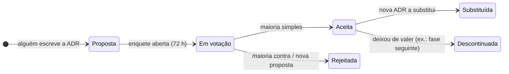

# ADRs — Architecture Decision Records

Registro das decisões de arquitetura do projeto no formato ensinado na disciplina *Documentação de Arquitetura (ADR/RFC)*.
Cada ADR apresenta **contexto, critérios, opções com prós/contras, recomendação e a decisão tomada pelo grupo via enquete**.

## Ciclo de vida

## Índice

| ADR | Título | Tipo | Lote | Status | Enquete |
|---|---|---|---|---|---|
| [ADR-000](ADR-000-template.md) | Template | — | — | ✅ | — |
| [ADR-001](ADR-001-linguagem-e-framework.md) | Linguagem e framework do back-end | Tipo 1 | 1 | 🗳️ Em votação | E-04 |
| [ADR-002](ADR-002-banco-de-dados.md) | Banco de dados (com justificativa exigida no enunciado) | Tipo 1 | 1 | 🗳️ Em votação | E-05 |
| [ADR-003](ADR-003-arquitetura-do-monolito.md) | Estilo arquitetural do monólito (camadas × hexagonal × clean) | Tipo 1 | 1 | 🗳️ Em votação | E-06 |
| [ADR-004](ADR-004-autenticacao-jwt.md) | Autenticação JWT das APIs administrativas | Tipo 1 | 2 | ⏳ Proposta | E-08 |
| [ADR-005](ADR-005-documentacao-da-api.md) | Documentação da API (OpenAPI code-first × design-first) | Tipo 2 | 2 | ⏳ Proposta | E-09 |
| [ADR-006](ADR-006-estrategia-de-testes-e-cobertura.md) | Estratégia de testes e cobertura ≥ 80 % | Tipo 1 | 3 | ⏳ Proposta | E-12 |
| [ADR-007](ADR-007-analise-de-vulnerabilidades.md) | Ferramentas da análise de vulnerabilidades | Tipo 2 | 3 | ⏳ Proposta | E-13 |
| [ADR-008](ADR-008-fluxo-git-e-ci.md) | Fluxo Git, revisão e CI | Tipo 1 | 2 | ⏳ Proposta | E-10 |
| [ADR-009](ADR-009-identificadores-e-dados-sensiveis.md) | Identificadores, validação e proteção de dados sensíveis | Tipo 1 | 2 | ⏳ Proposta | E-11 |
| [ADR-010](ADR-010-maquina-de-estados-da-os.md) | Máquina de estados da OS (recusa/cancelamento) | Tipo 1 | 3 | ⏳ Proposta | E-14 |
| [ADR-011](ADR-011-acesso-do-cliente.md) | Acesso do cliente para consulta e aprovação | Tipo 1 | 3 | ⏳ Proposta | E-15 |
| [ADR-012](ADR-012-controle-de-estoque-na-os.md) | Momento da baixa de estoque e comportamento sem estoque | Tipo 1 | 3 | ⏳ Proposta | E-16 |
| [ADR-013](ADR-013-idioma-do-codigo-e-da-api.md) | Idioma do código e da API | Tipo 1 | 1 | 🗳️ Em votação | E-07 |

Tipo 1 = difícil de reverter/afeta todos (exige enquete) · Tipo 2 = reversível (dono da frente decide; enquete opcional).

## Como criar uma nova ADR

1. Copie `ADR-000-template.md` → `ADR-0NN-titulo-curto.md` (numeração sequencial).
2. Preencha contexto, critérios, **pelo menos 2 opções** com prós/contras e impacto nas fases futuras.
3. Abra PR `docs(adr): propor ADR-0NN …`; se Tipo 1, cole a enquete em `docs/00-guia-do-grupo/enquetes.md` e no Discord.
4. Ao encerrar a enquete, preencha *Decisão* e *Consequências*, mude o status e atualize este índice.
5. Nunca apague uma ADR: se mudar de ideia, crie outra que **substitui** a anterior.

## Decisões já implícitas no enunciado (não votamos)

| Decisão | Fonte |
|---|---|
| Back-end **monolítico** nesta fase | Requisitos técnicos |
| APIs **RESTful** documentadas (Swagger/OpenAPI) | Requisitos técnicos |
| **Dockerfile** + **docker-compose.yml** | Requisitos técnicos |
| **JWT** para APIs administrativas | Segurança e qualidade |
| Testes automatizados, **≥ 80 %** nos domínios críticos | Requisitos técnicos |
| Repositório **privado** com acesso a `soat-architecture` | Requisitos técnicos |
| Documentação DDD em Miro ou equivalente | Entregáveis |
