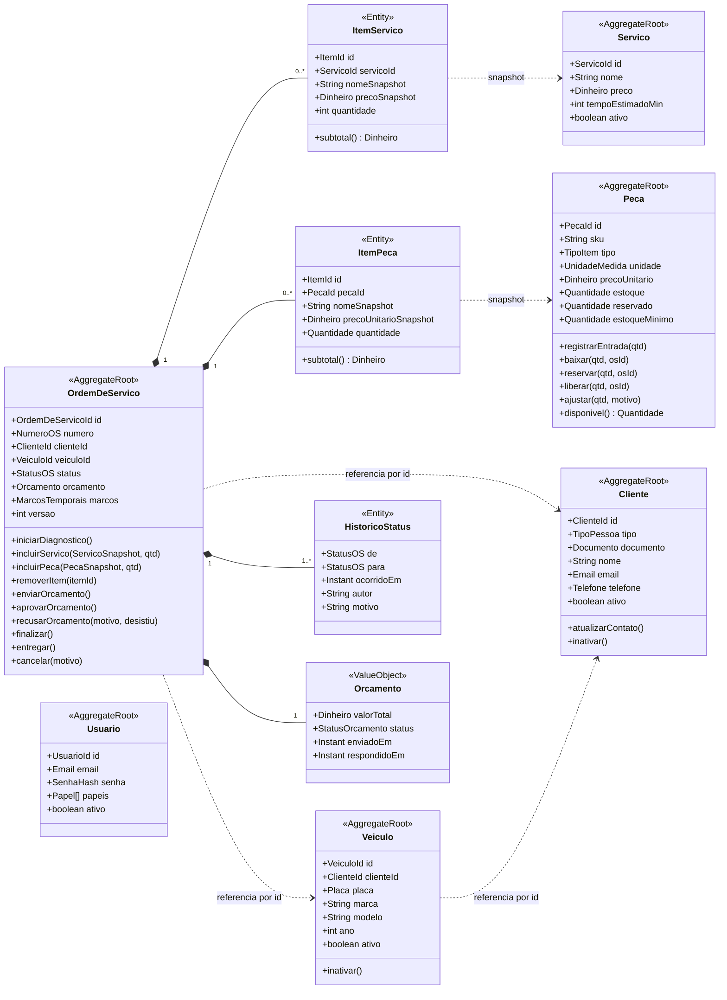

# Agregados, entidades, value objects e invariantes

> Diagramas "conforme apresentado na disciplina de DDD". Nomes conforme ADR-013 (domínio em português, sem acentos em
> identificadores). Cada agregado é a **unidade de consistência**: invariantes valem dentro dele e são garantidas pela raiz.

## 1. Visão geral dos agregados

Referências entre agregados são **sempre por id** (nunca objeto navegável) — regra de DDD que também evita JOINs
entre módulos.

## 2. Value objects compartilhados (`shared/domain`)

| VO | Regras | Testes obrigatórios |
|---|---|---|
| `Documento` (`CPF` \| `CNPJ`) | só dígitos; tamanho 11/14; dígitos verificadores; rejeita sequências repetidas; `mascarado()` | válidos, inválidos por DV, tamanho errado, repetidos, formatação com pontos/traço |
| `Placa` | normaliza maiúsculas/sem hífen; antiga `AAA9999` ou Mercosul `AAA9A99`; `mascarada()` | ambos os padrões, minúsculas, com hífen, inválidas |
| `Dinheiro` | decimal 2 casas, BRL, ≥ 0; soma/multiplicação sem float | arredondamento, soma, multiplicação por quantidade |
| `Quantidade` | decimal(10,3) ≥ 0 (insumos fracionários) ou inteiro para peças | negativa rejeitada |
| `Email`, `Telefone` | formato; normalização | válidos/inválidos |
| `NumeroOS` | `OS-AAAA-NNNNNN`; gerado por sequência anual | formato; sequência |
| `StatusOS` (enum) + `TransicaoStatus` | tabela de transições da PRD-004 | todas as combinações |

## 3. Invariantes por agregado

### OrdemDeServico

1. Itens só podem ser incluídos/removidos em `RECEBIDA` ou `EM_DIAGNOSTICO`.
2. `orcamento.valorTotal` = Σ `itensServico.subtotal()` + Σ `itensPeca.subtotal()` — recalculado a cada mudança de item; nunca atribuído de fora.
3. `enviarOrcamento()` exige ≥ 1 item e total > 0; muda status para `AGUARDANDO_APROVACAO`; congela itens; marca `orcamentoEnviadoEm`.
4. `aprovarOrcamento()` só em `AGUARDANDO_APROVACAO`; muda para `EM_EXECUCAO`; marca `execucaoIniciadaEm`; emite evento `OrcamentoAprovado` (a baixa de estoque é política da aplicação, fora do agregado — módulos diferentes).
5. `recusarOrcamento()` só em `AGUARDANDO_APROVACAO`; efeito conforme ADR-010.
6. `finalizar()` só em `EM_EXECUCAO`; `entregar()` só em `FINALIZADA`; após `ENTREGUE`, qualquer comando lança erro.
7. Toda transição adiciona `HistoricoStatus` (append-only) e incrementa `versao` (lock otimista).
8. `veiculoId` deve pertencer a `clienteId` — verificado pelo caso de uso (consulta ao cadastro) antes de criar.

### Peca

1. `estoque ≥ 0` e `reservado ≥ 0` e `reservado ≤ estoque` sempre.
2. Estoque só muda por método que gera `MovimentacaoEstoque` (`registrarEntrada`, `baixar`, `reservar`, `liberar`, `ajustar`).
3. `baixar(qtd)` exige `disponivel() ≥ qtd` (ADR-012 = bloquear).
4. Peça inativa não pode ser incluída em OS (verificado pelo caso de uso ao montar o snapshot).

### Cliente / Veiculo

1. Documento único entre clientes ativos (unicidade garantida no repositório + constraint).
2. Placa única entre veículos ativos.
3. Inativação bloqueada se houver OS em aberto (verificado pelo caso de uso via consulta ao atendimento).

### Usuario

1. E-mail único; senha sempre em hash; ≥ 1 papel.

## 4. Eventos de domínio (nomes canônicos)

`ClienteCadastrado` · `VeiculoCadastrado` · `OrdemDeServicoRecebida` · `DiagnosticoIniciado` · `ItemIncluidoNaOS` ·
`ItemRemovidoDaOS` · `OrcamentoRecalculado` · `OrcamentoEnviado` · `OrcamentoAprovado` · `OrcamentoRecusado` ·
`ExecucaoIniciada` · `ExecucaoFinalizada` · `VeiculoEntregue` · `OrdemDeServicoCancelada` · `PecaCadastrada` ·
`EntradaDeEstoqueRegistrada` · `BaixaDeEstoqueRealizada` · `ReservaLiberada` · `EstoqueAbaixoDoMinimo`

Payload mínimo: `id do agregado`, `ocorridoEm`, dados necessários ao handler (ex.: `OrcamentoAprovado { osId, itensPeca[] }`).

## 5. Serviços de domínio e de aplicação

| Nome | Tipo | Responsabilidade |
|---|---|---|
| `CalculadoraDeOrcamento` | Domínio (pode ser método do agregado) | Soma itens com `Dinheiro` |
| `PoliticaDeTransicao` | Domínio | Tabela de transições válidas e quem pode executar |
| `CriarOrdemDeServico` | Aplicação (caso de uso) | Valida cliente/veículo via portas; cria OS; persiste; publica evento |
| `IncluirItemNaOS` | Aplicação | Busca snapshot no catálogo; verifica disponibilidade; chama agregado |
| `EnviarOrcamento` | Aplicação | Chama agregado; gera token de acompanhamento; notifica |
| `AprovarOrcamento` | Aplicação (**transacional, 2 módulos**) | Valida token; agregado aprova; política baixa estoque; commit único |
| `FinalizarExecucao`, `RegistrarEntrega`, `CancelarOS` | Aplicação | Transições + histórico |
| `ConsultarAcompanhamento` | Aplicação (leitura) | Projeção para o cliente, com máscara |
| `CalcularTempoMedioExecucao` | Aplicação (leitura) | Consulta agregada |
