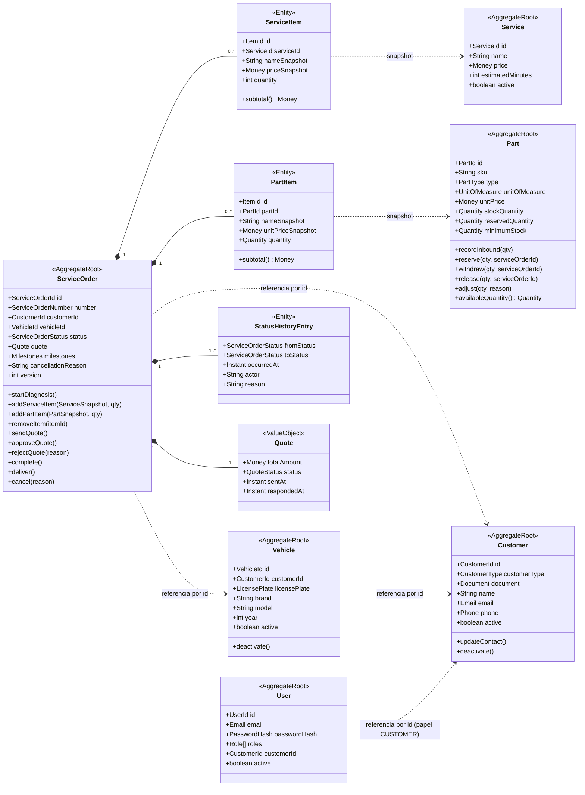

# Agregados, entidades, value objects e invariantes

> Diagramas "conforme apresentado na disciplina de DDD". Identificadores em inglês conforme ADR-013 (Aceita) e o
> glossário `linguagem-ubiqua.md`; o texto explicativo fica em português. Cada agregado é a **unidade de consistência**:
> invariantes valem dentro dele e são garantidas pela raiz. Regras de recusa/cancelamento (ADR-010), estoque (ADR-012)
> e acesso do cliente (ADR-011) já consolidadas (22/09/2026).

## 1. Visão geral dos agregados

Referências entre agregados são **sempre por id** (nunca objeto navegável) — regra de DDD que também evita JOINs
entre módulos.

## 2. Value objects compartilhados (`shared/domain`)

| VO | Regras | Testes obrigatórios |
|---|---|---|
| `Document` (`Cpf` \| `Cnpj`) | só dígitos; tamanho 11/14; dígitos verificadores; rejeita sequências repetidas; `masked()` | válidos, inválidos por DV, tamanho errado, repetidos, formatação com pontos/traço |
| `LicensePlate` | normaliza maiúsculas/sem hífen; antiga `AAA9999` ou Mercosul `AAA9A99`; `masked()` | ambos os padrões, minúsculas, com hífen, inválidas |
| `Money` | decimal 2 casas, BRL, ≥ 0; soma/multiplicação sem float | arredondamento, soma, multiplicação por quantidade |
| `Quantity` | decimal(10,3) ≥ 0 (insumos fracionários) ou inteiro para peças | negativa rejeitada |
| `Email`, `Phone` | formato; normalização | válidos/inválidos |
| `ServiceOrderNumber` | `OS-AAAA-NNNNNN`; gerado por sequência anual | formato; sequência |
| `ServiceOrderStatus` (enum, 7 valores) + `StatusTransitionPolicy` | tabela de transições da PRD-004 §2 | todas as combinações status × comando |

## 3. Invariantes por agregado

### ServiceOrder

1. Itens só podem ser incluídos/removidos em `RECEIVED` ou `IN_DIAGNOSIS`.
2. `quote.totalAmount` = Σ `serviceItems.subtotal()` + Σ `partItems.subtotal()` — recalculado a cada mudança de item; nunca atribuído de fora.
3. `sendQuote()` exige ≥ 1 item e total > 0; muda status para `AWAITING_APPROVAL`; congela itens; marca `quoteSentAt`.
4. `approveQuote()` só em `AWAITING_APPROVAL`; muda para `IN_PROGRESS`; marca `executionStartedAt`; `quote.status =
   APPROVED`; emite `QuoteApproved` — a **reserva** de estoque é orquestrada pelo serviço de aplicação, fora do agregado
   (módulos diferentes), na mesma transação; falha na reserva reverte tudo (ADR-012).
5. `rejectQuote(reason)` só em `AWAITING_APPROVAL`; `quote.status = REJECTED`, `respondedAt`; muda para `CANCELLED` com o
   motivo (ADR-010) — sem volta para diagnóstico.
6. `cancel(reason)` só em `RECEIVED`, `IN_DIAGNOSIS` ou `AWAITING_APPROVAL` (`MANAGER`); muda para `CANCELLED` com o motivo.
7. `complete()` só em `IN_PROGRESS`; marca `completedAt` — a **baixa** das peças reservadas é orquestrada pelo serviço de
   aplicação na mesma transação (ADR-012). `deliver()` só em `COMPLETED`. Após `DELIVERED` ou `CANCELLED`, qualquer comando
   lança `InvalidTransitionError`.
8. Toda transição adiciona `StatusHistoryEntry` (append-only, com `actor` = id do usuário, `CUSTOMER` ou `SYSTEM`) e
   incrementa `version` (lock otimista).
9. `vehicleId` deve pertencer a `customerId` — verificado pelo serviço de aplicação (consulta ao módulo `customers`) antes de criar.

### Part

1. `stockQuantity ≥ 0`, `reservedQuantity ≥ 0` e `reservedQuantity ≤ stockQuantity` sempre; `availableQuantity() =
   stockQuantity − reservedQuantity`.
2. Estoque só muda por método que gera `StockMovement` (`recordInbound`, `reserve`, `withdraw`, `release`, `adjust`).
3. `reserve(qty)` exige `availableQuantity() ≥ qty` (ADR-012 — senão `422 estoque insuficiente`); aumenta `reservedQuantity`.
4. `withdraw(qty)` exige `reservedQuantity ≥ qty`; consome a reserva: reduz `stockQuantity` **e** `reservedQuantity`
   (movimentação `OUTBOUND`, na finalização da OS).
5. `release(qty)` exige `reservedQuantity ≥ qty`; reduz só `reservedQuantity` (sem gatilho no MVP — Could).
6. `adjust(qty, reason)` nunca deixa `stockQuantity` abaixo de `reservedQuantity`.
7. Peça inativa não pode ser incluída em OS (verificado pelo serviço de aplicação ao montar o snapshot).

### Customer / Vehicle

1. Documento único entre clientes ativos (unicidade garantida no repositório + constraint).
2. Placa única entre veículos ativos.
3. Inativação bloqueada se houver OS em aberto (verificado pelo serviço de aplicação via consulta ao módulo `service-orders`).

### User

1. E-mail único; senha sempre em hash (bcrypt); ≥ 1 papel.
2. `CUSTOMER` é papel exclusivo (não se combina com papéis de equipe) e exige `customerId` de um cliente existente;
   usuários de equipe não têm `customerId` (ADR-011).

## 4. Eventos de domínio (nomes canônicos)

`CustomerRegistered` · `VehicleRegistered` · `ServiceOrderReceived` · `DiagnosisStarted` · `ItemAddedToServiceOrder` ·
`ItemRemovedFromServiceOrder` · `QuoteRecalculated` · `QuoteSent` · `QuoteApproved` · `QuoteRejected` · `ExecutionStarted` ·
`ExecutionCompleted` · `VehicleDelivered` · `ServiceOrderCancelled` · `PartRegistered` · `StockInboundRecorded` ·
`StockAdjusted` · `StockReserved` · `StockWithdrawn` · `ReservationReleased` · `StockBelowMinimum` · `UserRegistered` ·
`UserAuthenticated`

Payload mínimo: `id do agregado`, `occurredAt`, dados necessários ao handler (ex.: `QuoteApproved { serviceOrderId, partItems[] }`,
`ExecutionCompleted { serviceOrderId, partItems[], executionTimeMinutes }`).

## 5. Serviços de domínio e serviços de aplicação (camadas clássicas, ADR-003)

| Nome | Tipo | Responsabilidade |
|---|---|---|
| `QuoteCalculator` | Domínio (pode ser método do agregado) | Soma itens com `Money` |
| `StatusTransitionPolicy` | Domínio | Tabela de transições válidas e quem pode executar |
| `ServiceOrdersService.create` | Aplicação | Valida cliente/veículo via `CustomersService`/`VehiclesService`; RN-039; cria OS; persiste; publica evento |
| `ServiceOrdersService.addServiceItem` / `addPartItem` | Aplicação | Busca snapshot via `CatalogService`/`PartsService`; verifica disponibilidade (422); chama agregado |
| `ServiceOrdersService.sendQuote` | Aplicação | Chama agregado; emite token via `TrackingTokenService`; notifica via `CustomerNotifier` |
| `ServiceOrdersService.approveQuote` | Aplicação (**transacional, 2 módulos**) | Agregado aprova; `PartsService.reserveForServiceOrder` (tudo ou nada); commit único |
| `ServiceOrdersService.complete` | Aplicação (**transacional, 2 módulos**) | Agregado finaliza; `PartsService.withdrawReservedForServiceOrder`; commit único |
| `ServiceOrdersService.rejectQuote` / `deliver` / `cancel` | Aplicação | Transições + histórico (recusa e cancelamento → `CANCELLED`, sem efeito no estoque) |
| `TrackingService` | Aplicação (leitura + comandos do cliente) | Verifica a propriedade da OS pela credencial (token de acompanhamento ou login `CUSTOMER`; senão 404); projeção mascarada com `statusDescription` em português |
| `MetricsService.averageExecutionTime` | Aplicação (leitura) | Consulta agregada |
