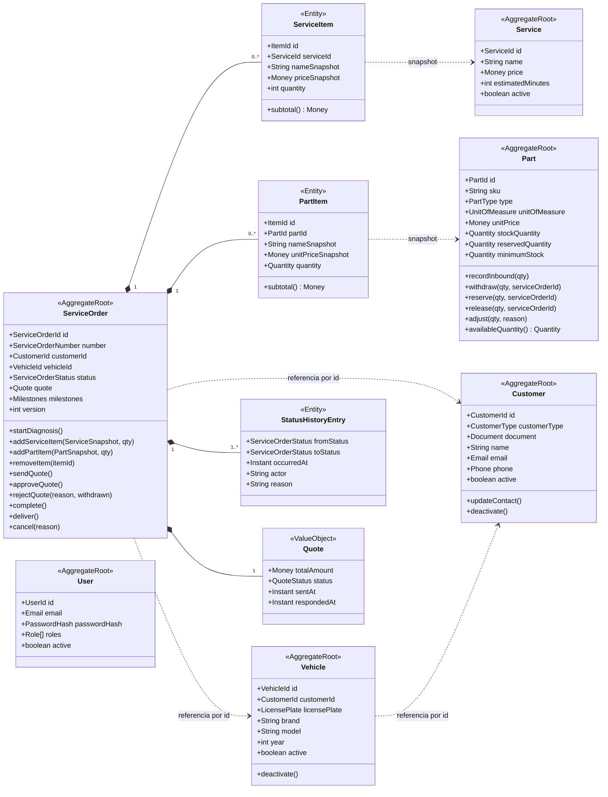

# Agregados, entidades, value objects e invariantes

> Diagramas "conforme apresentado na disciplina de DDD". Identificadores em inglês conforme ADR-013 (Aceita) e o
> glossário `linguagem-ubiqua.md`; o texto explicativo fica em português. Cada agregado é a **unidade de consistência**:
> invariantes valem dentro dele e são garantidas pela raiz.

## 1. Visão geral dos agregados

Referências entre agregados são **sempre por id** (nunca objeto navegável) — regra de DDD que também evita JOINs
entre módulos.

## 2. Value objects compartilhados (`shared/domain`)

| VO | Regras | Testes obrigatórios |
|---|---|---|
| `Document` (`Cpf` \| `Cnpj`) | só dígitos; tamanho 11/14; dígitos verificadores; rejeita sequências repetidas; `masked()` | válidos, inválidos por DV, tamanho errado, repetidos, formatação com pontos/traço |
| `LicensePlate` | normaliza maiúsculas/sem hífen; antiga `AAA9999` ou Mercosul `AAA9A99`; `masked()` | ambos os padrões, minúsculas, com hífen, inválidas |
| `Money` | decimal 2 casas, BRL, ≥ 0; soma/multiplicação sem float | arredondamento, soma, multiplicação por quantidade |
| `Quantity` | decimal(10,3) ≥ 0 (insumos fracionários) ou inteiro para peças | negativa rejeitada |
| `Email`, `Phone` | formato; normalização | válidos/inválidos |
| `ServiceOrderNumber` | `OS-AAAA-NNNNNN`; gerado por sequência anual | formato; sequência |
| `ServiceOrderStatus` (enum) + `StatusTransitionPolicy` | tabela de transições da PRD-004 | todas as combinações |

## 3. Invariantes por agregado

### ServiceOrder

1. Itens só podem ser incluídos/removidos em `RECEIVED` ou `IN_DIAGNOSIS`.
2. `quote.totalAmount` = Σ `serviceItems.subtotal()` + Σ `partItems.subtotal()` — recalculado a cada mudança de item; nunca atribuído de fora.
3. `sendQuote()` exige ≥ 1 item e total > 0; muda status para `AWAITING_APPROVAL`; congela itens; marca `quoteSentAt`.
4. `approveQuote()` só em `AWAITING_APPROVAL`; muda para `IN_PROGRESS`; marca `executionStartedAt`; emite `QuoteApproved`
   (a baixa de estoque é política da aplicação, fora do agregado — módulos diferentes).
5. `rejectQuote()` só em `AWAITING_APPROVAL`; efeito conforme ADR-010.
6. `complete()` só em `IN_PROGRESS`; `deliver()` só em `COMPLETED`; após `DELIVERED`, qualquer comando lança erro.
7. Toda transição adiciona `StatusHistoryEntry` (append-only) e incrementa `version` (lock otimista).
8. `vehicleId` deve pertencer a `customerId` — verificado pelo caso de uso (consulta ao módulo `customers`) antes de criar.

### Part

1. `stockQuantity ≥ 0` e `reservedQuantity ≥ 0` e `reservedQuantity ≤ stockQuantity` sempre.
2. Estoque só muda por método que gera `StockMovement` (`recordInbound`, `withdraw`, `reserve`, `release`, `adjust`).
3. `withdraw(qty)` exige `availableQuantity() ≥ qty` (ADR-012 = bloquear).
4. Peça inativa não pode ser incluída em OS (verificado pelo caso de uso ao montar o snapshot).

### Customer / Vehicle

1. Documento único entre clientes ativos (unicidade garantida no repositório + constraint).
2. Placa única entre veículos ativos.
3. Inativação bloqueada se houver OS em aberto (verificado pelo caso de uso via consulta ao módulo `service-orders`).

### User

1. E-mail único; senha sempre em hash; ≥ 1 papel.

## 4. Eventos de domínio (nomes canônicos)

`CustomerRegistered` · `VehicleRegistered` · `ServiceOrderReceived` · `DiagnosisStarted` · `ItemAddedToServiceOrder` ·
`ItemRemovedFromServiceOrder` · `QuoteRecalculated` · `QuoteSent` · `QuoteApproved` · `QuoteRejected` · `ExecutionStarted` ·
`ExecutionCompleted` · `VehicleDelivered` · `ServiceOrderCancelled` · `PartRegistered` · `StockInboundRecorded` ·
`StockWithdrawn` · `ReservationReleased` · `StockBelowMinimum`

Payload mínimo: `id do agregado`, `occurredAt`, dados necessários ao handler (ex.: `QuoteApproved { serviceOrderId, partItems[] }`).

## 5. Serviços de domínio e casos de uso

| Nome | Tipo | Responsabilidade |
|---|---|---|
| `QuoteCalculator` | Domínio (pode ser método do agregado) | Soma itens com `Money` |
| `StatusTransitionPolicy` | Domínio | Tabela de transições válidas e quem pode executar |
| `CreateServiceOrderUseCase` | Aplicação | Valida cliente/veículo via `CustomerLookup`; cria OS; persiste; publica evento |
| `AddServiceItemUseCase` / `AddPartItemUseCase` | Aplicação | Busca snapshot via `CatalogLookup`; verifica disponibilidade; chama agregado |
| `SendQuoteUseCase` | Aplicação | Chama agregado; emite `TrackingToken`; notifica via `CustomerNotifier` |
| `ApproveQuoteUseCase` | Aplicação (**transacional, 2 módulos**) | Valida token; agregado aprova; `StockMovements.withdraw`; commit único |
| `CompleteExecutionUseCase`, `RegisterDeliveryUseCase`, `CancelServiceOrderUseCase` | Aplicação | Transições + histórico |
| `GetTrackingUseCase` | Aplicação (leitura) | Projeção para o cliente, com máscara e `statusDescription` em português |
| `CalculateAverageExecutionTimeUseCase` | Aplicação (leitura) | Consulta agregada |
