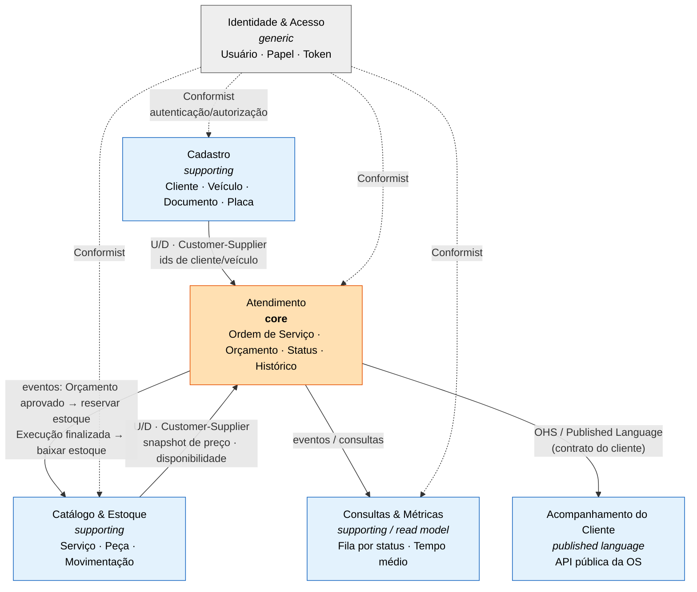

# Contextos delimitados e context map

## 1. Subdomínios

| Subdomínio | Tipo | Por quê |
|---|---|---|
| **Atendimento** (ordem de serviço, orçamento, status, acompanhamento) | **Core** | É onde a oficina ganha ou perde eficiência; regras mais ricas (máquina de estados, orçamento automático, aprovação) |
| **Catálogo & Estoque** (serviços, peças/insumos, movimentações) | Supporting | Necessário e específico da oficina, mas regras mais simples |
| **Cadastro** (clientes, veículos) | Supporting | CRUD com validações de CPF/CNPJ/placa |
| **Identidade & Acesso** (usuários, JWT, papéis) | Generic | Problema resolvido; poderia ser comprado (Keycloak/Cognito) |
| **Consultas & Métricas** (fila por status, tempo médio) | Supporting (read model) | Leitura sobre o core; sem regras próprias |

## 2. Context map

Legenda: **U/D** upstream/downstream · **Customer-Supplier** o upstream atende necessidades do downstream (Atendimento
pede ids e preços; Cadastro/Catálogo entregam) · **Conformist** os contextos aceitam o modelo de identidade como está ·
**OHS/Published Language** Atendimento publica um contrato estável para o cliente (Open Host Service).

## 3. Regras de integração no monólito (hoje) e no futuro

| Relação | Fase 1 (monólito modular) | Fases 4+ (microsserviços) |
|---|---|---|
| Atendimento → Cadastro (validar cliente/veículo) | Chamada em processo aos serviços **exportados** pelo módulo `customers` (`CustomersService`, `VehiclesService`) — nunca aos repositórios ou entidades dele | HTTP síncrono (`GET /customers/{id}`) ou réplica local via eventos |
| Atendimento → Catálogo (preço/disponibilidade ao incluir item) | `CatalogService`/`PartsService` exportados; **snapshot** de nome/preço gravado na OS; sem disponibilidade → 422 (ADR-012) | HTTP síncrono + snapshot (já preparado) |
| Atendimento → Estoque (reserva na aprovação, baixa na finalização — ADR-012) | `ServiceOrdersService.approveQuote` e `.complete` orquestram as duas mudanças na mesma transação (`prisma.$transaction`), chamando `PartsService.reserveForServiceOrder` / `withdrawReservedForServiceOrder` | **SAGA** (orquestrada ou coreografada) com eventos `QuoteApproved` → `StockReserved` / `StockReservationFailed` → compensação |
| Atendimento → Notificação | `CustomerNotifier` (implementação `LogCustomerNotifier`); token de acompanhamento emitido pelo `TrackingTokenService` do `identity` (ADR-011) | SNS/SES/WhatsApp |
| Identidade → todos | Guards JWT compartilhados (`shared/auth`): equipe, cliente (`CUSTOMER`) e token de acompanhamento | API Gateway + Cognito/Lambda authorizer (Fase 3) |
| Consultas & Métricas | Consultas SQL sobre as tabelas de `service_orders` (mesmo banco) | Read model próprio alimentado por eventos (CQRS) |

Regras inegociáveis já na Fase 1 (para que a extração seja barata):

1. **Nenhum módulo importa entidades de domínio ou repositórios de outro módulo** — só o serviço de aplicação que o outro exporta (ou eventos).
2. **Nenhum JOIN entre tabelas de módulos diferentes** no código de domínio/aplicação; consultas de leitura (`REL`) podem, e são marcadas como tal.
3. **Ids gerados na aplicação** (ADR-009), nunca dependentes de sequência de outro módulo.
4. **Eventos de domínio** nomeados no passado e publicados em processo (barramento simples); hoje os handlers rodam na mesma transação, amanhã viram mensagens.

## 4. Mapeamento contexto → módulo → futuro serviço

| Contexto | Módulo (Fase 1) | Tabelas (schema) | Candidato a serviço (Fase 4) |
|---|---|---|---|
| Atendimento | `service-orders` | `service_orders.service_orders`, `service_order_service_items`, `service_order_part_items`, `service_order_status_history` | `service-orders-service` |
| Catálogo & Estoque | `catalog` | `catalog.services`, `parts`, `stock_movements` | `catalog-service` (+ `stock-service` se necessário) |
| Cadastro | `customers` | `customers.customers`, `vehicles` | `customers-service` |
| Identidade | `identity` | `identity.users` | Cognito / `identity-service` |
| Consultas & Métricas | métodos de leitura dentro de `service-orders` no MVP (`ServiceOrdersService.list`, `MetricsService.averageExecutionTime`) | views/consultas | read model com CQRS |
| Acompanhamento do Cliente | rotas `/tracking` em `service-orders` (`TrackingService`; token de acompanhamento ou login `CUSTOMER`) | — | BFF / API Gateway |

Nomes em inglês conforme ADR-013 (Aceita); os nomes dos contextos em português continuam sendo a linguagem ubíqua
falada — o mapeamento está em `linguagem-ubiqua.md` §1.
