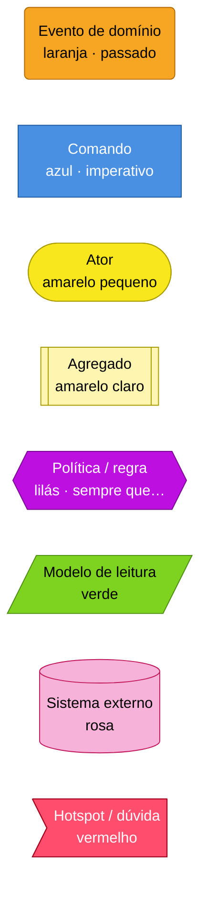
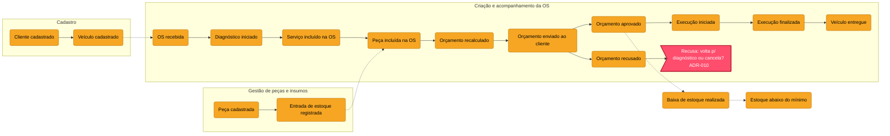
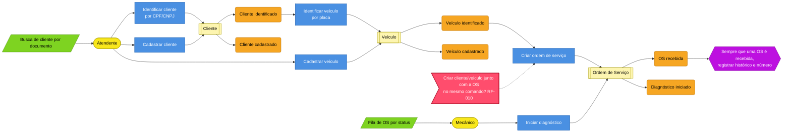
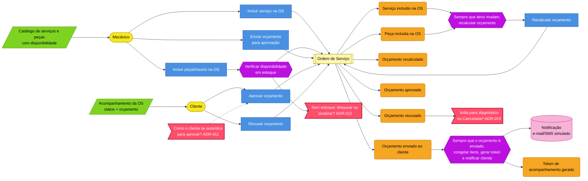
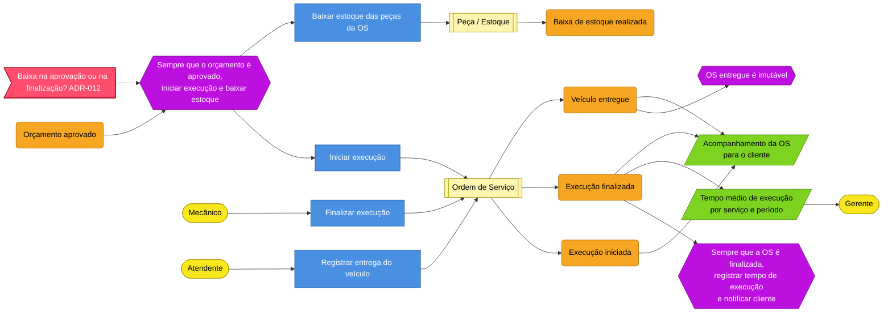
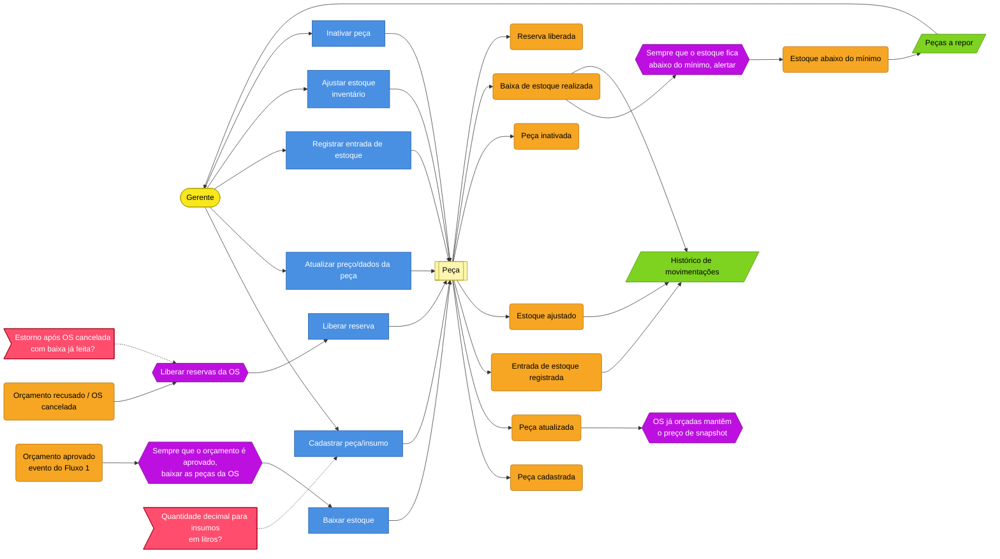

# Event Storming — fluxos obrigatórios

> Entregável do enunciado: *"Event Storming completo dos fluxos: (1) criação e acompanhamento da OS; (2) gestão de peças
> e insumos"*, em Miro ou equivalente. Este arquivo é a **versão versionada** (Mermaid) que a F2 transfere para o Miro,
> post-it por post-it, e que o vídeo usa para explicar "o processo de Event Storming".

## 0. Legenda (cores padrão do Event Storming)

Gramática usada: **Ator → Comando → Agregado → Evento**; **Evento → Política → Comando** (automação);
**Modelo de leitura** alimenta a decisão do ator.

## 1. Big picture — linha do tempo dos eventos (os dois fluxos juntos)

Eventos pivotais (marcos que separam fases do processo): **OS recebida** · **Orçamento enviado ao cliente** ·
**Orçamento aprovado** · **Execução finalizada** · **Veículo entregue**.

## 2. Fluxo 1 — Criação e acompanhamento da OS (process modeling)

### 2.1 Recepção e diagnóstico

### 2.2 Composição do orçamento e aprovação

### 2.3 Execução, finalização e entrega

### 2.4 Tabela consolidada do Fluxo 1 (para colar no Miro)

| # | Ator | Comando | Agregado | Evento | Política disparada | Modelo de leitura |
|---|---|---|---|---|---|---|
| 1 | Atendente | Identificar cliente por CPF/CNPJ | Cliente | Cliente identificado / cadastrado | — | Busca de cliente |
| 2 | Atendente | Identificar/cadastrar veículo | Veículo | Veículo identificado / cadastrado | — | Veículos do cliente |
| 3 | Atendente | Criar ordem de serviço | Ordem de Serviço | **OS recebida** | Registrar histórico + número | Fila por status |
| 4 | Mecânico | Iniciar diagnóstico | Ordem de Serviço | Diagnóstico iniciado | Registrar histórico | Fila por status |
| 5 | Mecânico | Incluir serviço | Ordem de Serviço | Serviço incluído na OS | Recalcular orçamento | Catálogo |
| 6 | Mecânico | Incluir peça/insumo | Ordem de Serviço | Peça incluída na OS | Verificar disponibilidade; recalcular orçamento | Catálogo c/ disponibilidade |
| 7 | Sistema | Recalcular orçamento | Ordem de Serviço | Orçamento recalculado | — | Orçamento da OS |
| 8 | Mecânico | Enviar orçamento | Ordem de Serviço | **Orçamento enviado ao cliente** | Congelar itens; gerar token; notificar | Acompanhamento |
| 9 | Cliente | Aprovar orçamento | Ordem de Serviço | **Orçamento aprovado** | Iniciar execução; baixar estoque | Acompanhamento |
| 9b | Cliente | Recusar orçamento | Ordem de Serviço | Orçamento recusado | Liberar reservas; (ADR-010) | Acompanhamento |
| 10 | Sistema | Iniciar execução | Ordem de Serviço | Execução iniciada | Registrar histórico | Acompanhamento |
| 11 | Mecânico | Finalizar execução | Ordem de Serviço | **Execução finalizada** | Registrar tempo de execução; notificar | Tempo médio |
| 12 | Atendente | Registrar entrega | Ordem de Serviço | **Veículo entregue** | Tornar OS imutável | Histórico |

## 3. Fluxo 2 — Gestão de peças e insumos

### 3.1 Tabela consolidada do Fluxo 2

| # | Ator | Comando | Agregado | Evento | Política | Leitura |
|---|---|---|---|---|---|---|
| 1 | Gerente | Cadastrar peça/insumo | Peça | Peça cadastrada | — | Catálogo |
| 2 | Gerente | Atualizar peça | Peça | Peça atualizada | OS orçadas mantêm snapshot | Catálogo |
| 3 | Gerente | Registrar entrada | Peça | Entrada de estoque registrada | — | Movimentações |
| 4 | Gerente | Ajustar estoque | Peça | Estoque ajustado | — | Movimentações |
| 5 | Sistema (política) | Baixar estoque | Peça | Baixa de estoque realizada | Alertar se abaixo do mínimo | Movimentações |
| 6 | Sistema (política) | Liberar reserva | Peça | Reserva liberada | — | Movimentações |
| 7 | Gerente | Inativar peça | Peça | Peça inativada | — | Catálogo |

## 4. Hotspots (decisões em aberto) e onde são resolvidos

| Hotspot | Resolução |
|---|---|
| Recusa do orçamento: voltar a diagnóstico ou cancelar | ADR-010 / E-14 |
| Como o cliente se autentica para consultar/aprovar | ADR-011 / E-15 |
| Momento da baixa de estoque; comportamento sem estoque | ADR-012 / E-16 |
| Criar cliente/veículo junto com a OS | PRD-001 RF-010 (Should) |
| Quantidade decimal para insumos | PRD-002 Q3 (proposta: sim) |
| Estorno após cancelamento com baixa já feita | ADR-010/012 (cancelar só antes da execução → sem baixa) |

## 5. Software design — agregados por evento

Post-its em português (linguagem falada); a coluna *No código* traz o nome em inglês (ADR-013, glossário em
`linguagem-ubiqua.md` §8).

| Agregado | Eventos que emite (post-it) | No código | Módulo |
|---|---|---|---|
| Cliente | Cliente cadastrado, atualizado, inativado | `Customer` — `CustomerRegistered` … | `customers` |
| Veículo | Veículo cadastrado, atualizado, inativado | `Vehicle` — `VehicleRegistered` … | `customers` |
| Serviço | Serviço cadastrado, atualizado, inativado | `Service` — `ServiceRegistered` … | `catalog` |
| Peça (com estoque) | Peça cadastrada/atualizada/inativada; Entrada registrada; Estoque ajustado; Baixa realizada; Reserva liberada; Estoque abaixo do mínimo | `Part` — `PartRegistered`, `StockInboundRecorded`, `StockAdjusted`, `StockWithdrawn`, `ReservationReleased`, `StockBelowMinimum` | `catalog` |
| Ordem de Serviço | OS recebida; Diagnóstico iniciado; Serviço/Peça incluído(a)/removido(a); Orçamento recalculado/enviado/aprovado/recusado; Execução iniciada/finalizada; Veículo entregue; OS cancelada | `ServiceOrder` — `ServiceOrderReceived`, `DiagnosisStarted`, `ItemAddedToServiceOrder`, `ItemRemovedFromServiceOrder`, `QuoteRecalculated`, `QuoteSent`, `QuoteApproved`, `QuoteRejected`, `ExecutionStarted`, `ExecutionCompleted`, `VehicleDelivered`, `ServiceOrderCancelled` | `service-orders` |
| Usuário | Usuário criado; Login realizado/falhou | `User` — `UserRegistered`, `UserAuthenticated` | `identity` |

## 6. Como montar no Miro (F2)

1. Frame "Legenda" com os 8 tipos de post-it.
2. Frame "Big picture" só com eventos laranja em linha do tempo + pivotais marcados com linha vertical.
3. Frame "Fluxo 1 — Criação e acompanhamento da OS" com as 3 raias (recepção/diagnóstico · orçamento/aprovação · execução/entrega) usando a gramática ator → comando → agregado → evento → política.
4. Frame "Fluxo 2 — Gestão de peças e insumos".
5. Frame "Hotspots" com os post-its vermelhos e link para as ADRs.
6. Frame "Context map" e "Agregados" (`contextos-delimitados.md`, `agregados.md`) e "Glossário" (`linguagem-ubiqua.md`).
7. Exportar o board como imagem para `docs/06-entrega/evidencias/` e colocar o link no PDF de entrega.
