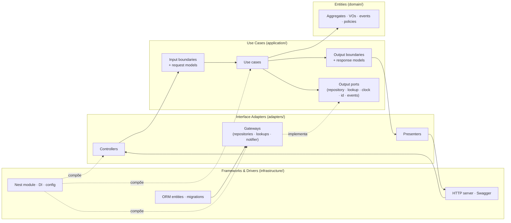

# Estrutura do repositório — NestJS + Clean Architecture

> Concretiza as ADRs **001 (TypeScript + NestJS)**, **003 (Clean Architecture completa)** e **013 (código em inglês)**, todas
> Aceitas. O prompt `prompts/02-esqueleto-do-projeto.md` gera o esqueleto real a partir desta estrutura.

## 1. As quatro camadas da Clean Architecture, no nosso vocabulário

| Camada (Uncle Bob) | Pasta no módulo | O que mora aqui | Depende de |
|---|---|---|---|
| **Entities** (regras de negócio da empresa) | `domain/` | Agregados, entidades, value objects, eventos de domínio, `StatusTransitionPolicy`, interfaces de repositório | nada |
| **Use Cases** (regras de negócio da aplicação) | `application/` | Um caso de uso por comando/consulta; **input boundary** (interface do caso de uso) e **output boundary** (interface do presenter); *request/response models*; portas de saída (gateways) | `domain` |
| **Interface Adapters** | `adapters/` | Controllers (HTTP → request model), presenters (response model → DTO/HTTP), gateways (implementações de repositório e portas, mapeando ORM ↔ domínio) | `application`, `domain` |
| **Frameworks & Drivers** | `infrastructure/` | Módulo Nest (`*.module.ts`, DI), entidades/esquema do ORM, migrações, config | tudo (é a camada mais externa) |

Regra de dependência: **de fora para dentro, sempre**. Nada em `domain/` ou `application/` importa `@nestjs/*`, o ORM
ou `express`. O framework é detalhe; o domínio é o produto.



## 2. Árvore alvo

```text
FIAP-SOAT/
├── README.md
├── CLAUDE.md
├── docker-compose.yml                  # api + postgres (+ migrações/seed) — obrigatório
├── Dockerfile                          # multi-stage (node:22-alpine), usuário não-root — obrigatório
├── .env.example                        # DB_URL, JWT_SECRET, JWT_EXPIRES_MIN, APP_ENV, ADMIN_EMAIL, ADMIN_PASSWORD, PORT
├── package.json · tsconfig*.json · nest-cli.json · .eslintrc.cjs · .prettierrc
├── .github/
│   ├── workflows/ci.yml                # build · lint · unit · integration (Testcontainers) · bdd · cobertura (gate) · openapi.json
│   ├── workflows/security.yml          # semgrep · npm audit/trivy fs · trivy image · gitleaks · (zap manual)
│   ├── workflows/claude.yml · claude-code-review.yml
│   ├── ISSUE_TEMPLATE/ · PULL_REQUEST_TEMPLATE.md
├── docs/ · prompts/
├── src/
│   ├── main.ts                         # bootstrap Nest, ValidationPipe, Problem Details filter, Swagger (/docs)
│   ├── app.module.ts                   # importa os módulos abaixo
│   ├── shared/
│   │   ├── domain/                     # Money, Quantity, Document (Cpf, Cnpj), LicensePlate, Email, Phone,
│   │   │                               # DomainError, DomainEvent, AggregateRoot
│   │   ├── application/                # ports: Clock, IdGenerator, EventPublisher, UnitOfWork; Page<T>
│   │   ├── adapters/                   # ProblemDetails exception filter, logging interceptor com máscara de PII,
│   │   │                               # JWT auth guard + Roles decorator (usa identity), request-id middleware
│   │   └── infrastructure/             # config (env schema), SystemClock, UuidV7IdGenerator, InProcessEventBus,
│   │                                   # TypeORM/Prisma UnitOfWork, health (/health, /ready)
│   └── modules/
│       ├── customers/                  # contexto Cadastro
│       │   ├── domain/                 # Customer, Vehicle, events, CustomerRepository, VehicleRepository (interfaces)
│       │   ├── application/            # use-cases/ (RegisterCustomer, RegisterVehicle, …), boundaries/, models/,
│       │   │                           # ports/ (CustomerLookup — porta exposta para service-orders)
│       │   ├── adapters/               # controllers/ (CustomersController, VehiclesController) · presenters/ ·
│       │   │                           # gateways/ (CustomerRepositoryImpl, VehicleRepositoryImpl, CustomerLookupImpl) · dto/
│       │   └── infrastructure/         # customers.module.ts, orm/ (entities/schema), migrations/
│       ├── catalog/                    # contexto Catálogo & Estoque
│       │   ├── domain/                 # Service, Part, StockMovement, events, repositories
│       │   ├── application/            # RegisterService, RegisterPart, RecordStockInbound, AdjustStock,
│       │   │                           # WithdrawStockForServiceOrder, ReleaseReservationForServiceOrder,
│       │   │                           # ports/ (CatalogLookup, StockMovements — expostas para service-orders)
│       │   ├── adapters/ · infrastructure/
│       ├── service-orders/             # contexto Atendimento (core)
│       │   ├── domain/                 # ServiceOrder, ServiceItem, PartItem, Quote, ServiceOrderStatus,
│       │   │                           # StatusTransitionPolicy, StatusHistoryEntry, events, ServiceOrderRepository
│       │   ├── application/            # CreateServiceOrder, StartDiagnosis, AddServiceItem, AddPartItem, RemoveItem,
│       │   │                           # SendQuote, ApproveQuote, RejectQuote, CompleteExecution, RegisterDelivery,
│       │   │                           # CancelServiceOrder, GetServiceOrder, ListServiceOrders, GetTracking,
│       │   │                           # CalculateAverageExecutionTime
│       │   │                           # ports/ (CustomerLookup, CatalogLookup, StockMovements, CustomerNotifier,
│       │   │                           #         TrackingTokenIssuer)
│       │   ├── adapters/               # controllers/ (ServiceOrdersController, TrackingController, MetricsController)
│       │   │                           # presenters/ · gateways/ (repository, LogCustomerNotifier, JwtTrackingTokenIssuer,
│       │   │                           #   CustomerLookup → chama a aplicação de customers; CatalogLookup/StockMovements → catalog)
│       │   └── infrastructure/         # service-orders.module.ts, orm/, migrations/, tracking auth guard
│       └── identity/
│           ├── domain/                 # User, Role, PasswordHash, UserRepository
│           ├── application/            # AuthenticateUser, IssueAccessToken, ValidateAccessToken, RegisterUser
│           ├── adapters/               # AuthController, UsersController, gateways (BcryptPasswordHasher, JwtTokenService)
│           └── infrastructure/         # identity.module.ts, orm/, seed do usuário admin
├── test/
│   ├── unit/                           # domain + application com fakes em memória (sem Nest, sem banco) — rápidos
│   ├── integration/                    # use cases + gateways reais (Testcontainers Postgres) + controllers (supertest)
│   ├── bdd/                            # features/*.feature (# language: pt) + steps (Cucumber-js)
│   └── support/                        # builders (aServiceOrder().inDiagnosis()…), geradores de CPF/CNPJ/placa válidos
└── scripts/                            # seed, scans locais, geração do openapi.json, demo.sh
```

## 3. Como um caso de uso atravessa as camadas (exemplo: `ApproveQuote`)

1. `TrackingController` (adapter) valida o token de acompanhamento, monta `ApproveQuoteRequest { serviceOrderId }` e chama
   a **input boundary** `ApproveQuoteInput`.
2. `ApproveQuoteUseCase` (application) carrega o agregado pelo `ServiceOrderRepository`, chama `serviceOrder.approveQuote()`
   (domain), pede `StockMovements.withdraw(partItems, serviceOrderId)` (porta implementada pelo gateway que chama a
   aplicação do módulo `catalog`), salva tudo dentro de `UnitOfWork`, publica `QuoteApproved` e entrega
   `ApproveQuoteResponse` à **output boundary**.
3. `TrackingPresenter` (adapter) transforma a response em `TrackingDto` (com `statusDescription` em português e documento
   mascarado); o controller devolve `200`.

O agregado nunca vê HTTP, ORM ou Nest; o caso de uso nunca vê `Request`/`Response`; o presenter é o único que sabe o
formato JSON. É isso que o vídeo mostra no bloco "organização do monólito e suas camadas".

## 4. Regras de dependência (verificáveis por lint de arquitetura)

1. `domain/` não importa nada de `application/`, `adapters/`, `infrastructure/`, `@nestjs/*`, ORM.
2. `application/` importa `domain/` e `shared/application`; nunca `adapters/`, `infrastructure/`, `@nestjs/*`.
3. `adapters/` importa `application/` (boundaries, models) e `domain/` (VOs para mapear); nunca `infrastructure/` de outro módulo.
4. Um módulo só conhece outro pela **porta exposta** em `application/ports` do outro (`CustomerLookup`, `CatalogLookup`,
   `StockMovements`) — nunca por `domain/` ou `adapters/`; a implementação da porta mora no módulo consumidor
   (`service-orders/adapters/gateways`) e chama a aplicação do módulo fornecedor.
5. `shared/` é pequeno e estável; se crescer, é sinal de que algo deveria ser de um módulo.

Ferramenta: `dependency-cruiser` (`.dependency-cruiser.cjs` com as regras acima), rodando no CI.

## 5. Toolchain (concretização da ADR-001)

| Necessidade | Escolha | Observação |
|---|---|---|
| Runtime / linguagem | Node 22 LTS · TypeScript 5 (`strict`) | Dockerfile `node:22-alpine` |
| Framework | NestJS 11 (`@nestjs/common`, `@nestjs/core`, `@nestjs/platform-express`) | Controllers e módulos só em `adapters/` e `infrastructure/` |
| Validação de entrada | `class-validator` + `class-transformer` (DTOs em `adapters/dto`) | Regras de negócio ficam nos VOs, não nos DTOs |
| OpenAPI | `@nestjs/swagger` (code-first, ADR-005) em `/docs`; `openapi.json` exportado no CI | Exemplos e `bearerAuth` obrigatórios |
| Auth | `@nestjs/jwt` + `passport-jwt` (ADR-004 em votação) · `bcrypt` | Guard em `shared/adapters` |
| ORM / migrações | **decisão leve pendente (F1 + F3):** TypeORM (mapeamento explícito, migrations SQL) ou Prisma (Prisma Migrate) | Em ambos, entidades ORM ficam em `infrastructure/orm` e nunca vazam para `domain/` |
| Testes | Jest · `supertest` · Testcontainers (`@testcontainers/postgresql`) · Cucumber-js (`@cucumber/cucumber`) | ADR-006 em votação decide BDD e banco de teste |
| Cobertura | Istanbul via Jest (`coverageThreshold` por pasta: `src/modules/service-orders/{domain,application}` e `src/modules/catalog/{domain,application}` ≥ 80 %) | Gate no CI |
| Lint / formato | ESLint + Prettier · `dependency-cruiser` para arquitetura | Falha o CI |
| Segurança (ADR-007 em votação) | Semgrep · `npm audit` + Trivy fs · Trivy image · gitleaks · ZAP | `security.yml` |
| Ids | `uuid` v7 (ADR-009 em votação) | `UuidV7IdGenerator` em `shared/infrastructure` |
