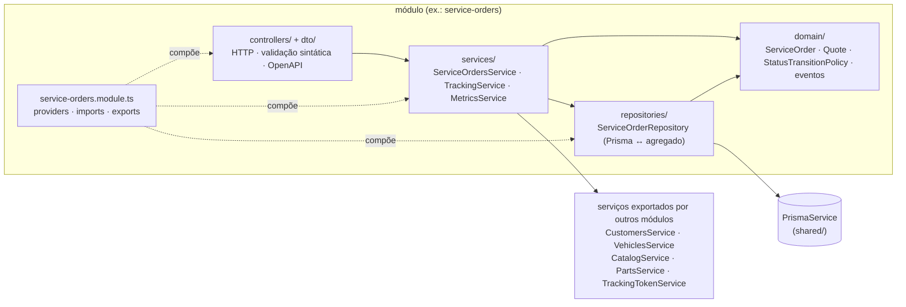

# Estrutura do repositório — NestJS em camadas clássicas, modular por contexto

> Concretiza as ADRs **001 (TypeScript + NestJS)**, **003 (camadas clássicas — revotada em 22/09/2026)**, **009 (UUID v4)** e
> **013 (código em inglês)**, e a decisão leve **E-17 (Prisma)**. O prompt `prompts/02-esqueleto-do-projeto.md` gera o
> esqueleto real a partir desta estrutura.

## 1. As camadas, no nosso vocabulário

| Camada | Pasta no módulo | O que mora aqui | Depende de |
|---|---|---|---|
| **Apresentação** | `controllers/` + `dto/` | Controllers REST (rotas, códigos HTTP, guards e `@Roles()`), DTOs de entrada com `class-validator` e de saída com `static fromDomain()`, decorators do `@nestjs/swagger` | `services/` |
| **Aplicação** | `services/` | Serviços de aplicação (`ServiceOrdersService`, `PartsService`…): um método por caso de uso; carregam agregados, chamam seus comandos, coordenam transações (`prisma.$transaction`) e conversam com outros módulos pelos serviços que eles exportam | `domain/`, `repositories/` |
| **Domínio** | `domain/` | Agregados, entidades, value objects, eventos de domínio, `StatusTransitionPolicy` — TypeScript puro, sem Nest e sem Prisma | nada |
| **Persistência** | `repositories/` | Repositórios sobre o `PrismaService`: consultas, lock otimista e mapeamento registro ↔ agregado (`toDomain` / `toPersistence`) | `domain/` |
| **Composição** | `<modulo>.module.ts` | Módulo Nest: providers, `imports` (outros módulos) e `exports` (o serviço que outros módulos podem usar) | tudo |

Regra: **controller → service → repository; todos podem usar `domain/`; ninguém pula camada** (controller não chama
repositório) **e o domínio não conhece framework**. A regra de negócio mora no agregado; o service orquestra.



## 2. Árvore alvo

```text
FIAP-SOAT/
├── README.md
├── CLAUDE.md
├── docker-compose.yml                  # api + postgres (+ prisma migrate deploy + seed na subida) — obrigatório
├── Dockerfile                          # multi-stage (node:22-alpine), usuário não-root — obrigatório
├── .dockerignore
├── .env.example                        # DATABASE_URL, JWT_SECRET, JWT_EXPIRES_MIN, APP_ENV, ADMIN_EMAIL, ADMIN_PASSWORD, PORT
│                                       # (+ LOG_LEVEL, POSTGRES_*, SHADOW_DATABASE_URL e SEED_PASSWORD, todos opcionais/fictícios)
├── package.json · tsconfig*.json · nest-cli.json · eslint.config.mjs · .prettierrc
├── jest.config.ts · cucumber.js        # projetos unit/integration com gate de cobertura por pasta · BDD em português
├── prisma.config.ts                    # Prisma 7: URL do banco, pasta de migrações e comando de seed (fora do schema.prisma)
├── .dependency-cruiser.cjs             # regras da seção 4
├── .github/
│   ├── workflows/ci.yml                # PR/push em develop e master: título Conventional · lint · dependency-cruiser · unit ·
│   │                                   # integration (Testcontainers) · bdd · cobertura (gate) · openapi.json (artefato) · imagem
│   ├── workflows/security.yml          # semgrep · npm audit + trivy fs · hadolint · gitleaks · trivy image · (zap em develop/master ou manual)
│   ├── workflows/claude.yml · claude-code-review.yml
│   ├── ISSUE_TEMPLATE/ · PULL_REQUEST_TEMPLATE.md
├── docs/ · prompts/
├── prisma/
│   ├── schema.prisma                   # datasource com multiSchema (customers, catalog, service_orders, identity);
│   │                                   # um bloco de models por módulo, cada model com @@schema("...")
│   ├── migrations/                     # Prisma Migrate (SQL versionado; sequência anual da OS e CHECKs escritos à mão)
│   ├── seed.ts                         # dados de demonstração (só em APP_ENV=dev)
│   └── README.md                       # como criar migração com SQL à mão, drift check e seed
├── src/
│   ├── main.ts                         # bootstrap Nest (porta, logger)
│   ├── app.setup.ts                    # configuração comum ao main, aos testes e ao export do OpenAPI: prefixo /api/v1,
│   │                                   # Swagger em /docs e /docs/openapi.json (só APP_ENV=dev), bearerAuth e tags por módulo
│   ├── app.module.ts                   # ConfigModule (env validado), LoggerModule (pino), ValidationPipe → 422, filtro
│   │                                   # Problem Details, SharedModule e os 4 módulos de contexto
│   ├── generated/prisma/               # cliente do Prisma gerado por `prisma generate` (não versionado; só shared/prisma e repositories/ importam)
│   ├── shared/
│   │   ├── config/                     # env.ts: schema (zod) das variáveis de ambiente, validado na subida
│   │   ├── domain/                     # Money, Quantity, Document (Cpf, Cnpj), LicensePlate, Email, Phone, ServiceOrderNumber,
│   │   │                               # Role (enum usado por @Roles() em todos os módulos), DomainError, ValidationError,
│   │   │                               # InvalidTransitionError, DomainEvent, AggregateRoot, masking
│   │   ├── auth/                       # JwtAuthGuard (aud=api) + RolesGuard, TrackingAuthGuard (aud=tracking ou papel CUSTOMER),
│   │   │                               # @Roles(), @Public(), @TrackingRoute(), @CurrentUser(), principal (request.user / request.tracking)
│   │   ├── http/                       # ProblemDetailsFilter, ValidationPipe (422 com errors[].field), logs pino com requestId e
│   │   │                               # máscara de PII, HealthController (/health, /ready)
│   │   ├── prisma/                     # PrismaService (conexão via driver adapter pg, $transaction) e tipo da transação
│   │   ├── clock.ts · id-generator.ts  # SystemClock/FixedClock · UuidV4IdGenerator (crypto.randomUUID)/FixedIdGenerator
│   │   ├── events/                     # DomainEventPublisher em processo (@nestjs/event-emitter)
│   │   └── shared.module.ts
│   └── modules/
│       ├── customers/                  # contexto Cadastro
│       │   ├── domain/                 # Customer, Vehicle, eventos
│       │   ├── services/               # CustomersService, VehiclesService (exportados)
│       │   ├── repositories/           # CustomerRepository, VehicleRepository (Prisma)
│       │   ├── controllers/ · dto/     # CustomersController, VehiclesController
│       │   └── customers.module.ts
│       ├── catalog/                    # contexto Catálogo & Estoque
│       │   ├── domain/                 # Service, Part, StockMovement, eventos
│       │   ├── services/               # CatalogService (entidade Service), PartsService (peças + estoque) — exportados
│       │   ├── repositories/           # ServiceRepository, PartRepository (Prisma)
│       │   ├── controllers/ · dto/     # CatalogController (/services), PartsController (/parts, /parts/{id}/stock-movements)
│       │   └── catalog.module.ts
│       ├── service-orders/             # contexto Atendimento (core)
│       │   ├── domain/                 # ServiceOrder, ServiceItem, PartItem, Quote, ServiceOrderStatus,
│       │   │                           # StatusTransitionPolicy, StatusHistoryEntry, eventos
│       │   ├── services/               # ServiceOrdersService (create, startDiagnosis, addServiceItem, addPartItem, removeItem,
│       │   │                           #   sendQuote, approveQuote, rejectQuote, complete, deliver, cancel, findById, list),
│       │   │                           # TrackingService (getTracking, listMine, approveQuote, rejectQuote),
│       │   │                           # MetricsService (averageExecutionTime), CustomerNotifier → LogCustomerNotifier
│       │   ├── repositories/           # ServiceOrderRepository (Prisma, lock otimista, sequência anual do número)
│       │   ├── controllers/ · dto/     # ServiceOrdersController, TrackingController, MetricsController
│       │   └── service-orders.module.ts  # imports: CustomersModule, CatalogModule, IdentityModule
│       └── identity/
│           ├── domain/                 # User, Role (ATTENDANT, MECHANIC, MANAGER, CUSTOMER), PasswordHash
│           ├── services/               # AuthService (login, validateToken), UsersService (register…), TrackingTokenService — exportados
│           ├── repositories/           # UserRepository (Prisma)
│           ├── controllers/ · dto/     # AuthController, UsersController
│           └── identity.module.ts      # seed do usuário MANAGER a partir de env
├── test/
│   ├── unit/                           # domain + services com repositórios fake em memória (sem Nest, sem banco) — rápidos
│   ├── integration/                    # services + repositórios reais (Testcontainers Postgres) + controllers (supertest)
│   ├── bdd/                            # features/*.feature (# language: pt) + steps + support (World e hooks do Cucumber-js)
│   └── support/                        # test-database (Testcontainers ou TEST_DATABASE_URL + migrate deploy), test-app (app real),
│                                       # test-env, geradores de CPF/CNPJ/placa válidos, builders (aServiceOrder().inDiagnosis()…)
└── scripts/                            # export-openapi.ts, security/ (scans locais), demo.sh
```

## 3. Como um caso de uso atravessa as camadas (exemplo: aprovar orçamento)

1. `TrackingController` (`POST /tracking/service-orders/{id}/quote/approve`): o `TrackingAuthGuard` aceita o token de
   acompanhamento (`aud=tracking`, `sub` = id da OS) **ou** o JWT de cliente (papel `CUSTOMER`) e rejeita JWT de equipe;
   o controller chama `trackingService.approveQuote(id, credential)`.
2. `TrackingService` verifica a propriedade (token → `sub` = `{id}`; login → `customerId` do token = `customerId` da OS;
   senão 404) e delega a `ServiceOrdersService.approveQuote(id, actor)`.
3. `ServiceOrdersService.approveQuote` abre uma transação (`prisma.$transaction`), carrega o agregado pelo
   `ServiceOrderRepository`, chama `serviceOrder.approveQuote()` (domínio: valida a transição, marca
   `executionStartedAt`, registra histórico, emite `QuoteApproved`), pede
   `PartsService.reserveForServiceOrder(partItems, id, tx)` (módulo `catalog`: `RESERVATION` por item, tudo ou nada —
   sem disponibilidade → 422) e salva o agregado; qualquer falha reverte tudo.
4. O controller devolve `200` com `TrackingResponseDto.fromDomain(serviceOrder)` (documento e placa mascarados,
   `statusDescription` em português).

Na finalização (`POST /service-orders/{id}/complete`) o padrão se repete com `serviceOrder.complete()` +
`PartsService.withdrawReservedForServiceOrder(...)` (`OUTBOUND`). O agregado nunca vê HTTP, Prisma ou Nest; o controller
nunca vê o repositório — é isso que o vídeo mostra no bloco "organização do monólito e suas camadas".

## 4. Regras de dependência (verificáveis por lint de arquitetura)

1. `domain/` não importa `services/`, `repositories/`, `controllers/`, `@nestjs/*` nem `@prisma/client`.
2. `services/` importa `domain/`, `repositories/` do próprio módulo, `shared/` e **serviços exportados** de outros módulos;
   nunca `controllers/`.
3. `controllers/` e `dto/` importam `services/` e `domain/` (VOs/enums para mapear); nunca `repositories/`.
4. `repositories/` importa `domain/` e `shared/prisma`; nunca `services/` nem `controllers/`.
5. Um módulo só conhece outro pelo serviço que ele **exporta** (`CustomersService`, `VehiclesService`, `CatalogService`,
   `PartsService`, `AuthService`, `TrackingTokenService`) — nunca por `domain/`, `repositories/` ou `controllers/` alheios;
   nunca JOIN entre schemas.
6. `shared/` é pequeno e estável; se crescer, é sinal de que algo deveria ser de um módulo.

Ferramenta: `dependency-cruiser` (`.dependency-cruiser.cjs` com as regras acima), rodando no CI.

## 5. Toolchain (concretização da ADR-001)

| Necessidade | Escolha | Observação |
|---|---|---|
| Runtime / linguagem | Node 22 LTS · TypeScript 5 (`strict`) | Dockerfile `node:22-alpine` |
| Framework | NestJS 11 (`@nestjs/common`, `@nestjs/core`, `@nestjs/platform-express`) | Decorators do Nest só em `controllers/`, `services/`, `repositories/` e `*.module.ts` |
| Validação de entrada | `class-validator` + `class-transformer` (DTOs em `dto/`) | Regras de negócio ficam nos VOs/agregados, não nos DTOs |
| OpenAPI | `@nestjs/swagger` (code-first, ADR-005) em `/docs` e `/docs/openapi.json`; `scripts/export-openapi.ts` gera o artefato do CI | Exemplos, tags por módulo e `bearerAuth` obrigatórios |
| Auth | `@nestjs/jwt` (HS256, ADR-004) · `bcrypt` · `@nestjs/throttler` (rate limit, Should) | Guards em `shared/auth`; papéis `ATTENDANT`/`MECHANIC`/`MANAGER`/`CUSTOMER` (ADR-011) |
| ORM / migrações | **Prisma 7** (E-17): `prisma/schema.prisma` com `multiSchema` (um schema PostgreSQL por módulo, `@@schema`), Prisma Migrate, `prisma db seed`; driver adapter `@prisma/adapter-pg` (sem engine nativa), cliente gerado em `src/generated/prisma`, `prisma.config.ts` com a URL e o seed | Ids vêm do domínio (`@id @db.Uuid` sem `@default`); repositórios mapeiam registro ↔ agregado; o domínio nunca importa o cliente gerado (`@prisma/client`/`src/generated`) |
| Configuração | `@nestjs/config` + `zod` (`src/shared/config/env.ts`) | Falha rápida na subida; `.env.example` completo |
| Logs | `pino` via `nestjs-pino` | `requestId` por requisição; máscara central de CPF/CNPJ/placa/telefone (ADR-009) |
| Decimal | `decimal.js` | `Money` (2 casas) e `Quantity` (3 casas) sem float |
| Eventos em processo | `@nestjs/event-emitter` | Handlers rodam na mesma transação na Fase 1 |
| Testes | Jest · `supertest` · Testcontainers (`@testcontainers/postgresql`) · Cucumber-js (`@cucumber/cucumber`) | ADR-006: BDD nos 3 fluxos principais |
| Cobertura | Istanbul via Jest (`coverageThreshold` por pasta: `src/modules/service-orders/{domain,services}` e `src/modules/catalog/{domain,services}` ≥ 80 %) | Gate no CI |
| Lint / formato | ESLint + Prettier · `dependency-cruiser` para arquitetura | Falha o CI |
| Segurança (ADR-007) | Semgrep · `npm audit` + Trivy fs · Trivy image · hadolint · gitleaks · ZAP | `security.yml` |
| Ids | `crypto.randomUUID()` (UUID v4, ADR-009) | `UuidV4IdGenerator` em `shared/`; `FixedIdGenerator` nos testes |
| Git / CI | GitFlow (`develop` → `release/*` → `master`) com Conventional Commits validados no título do PR (ADR-008) | `amannn/action-semantic-pull-request` |
