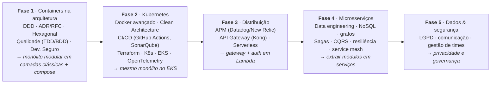
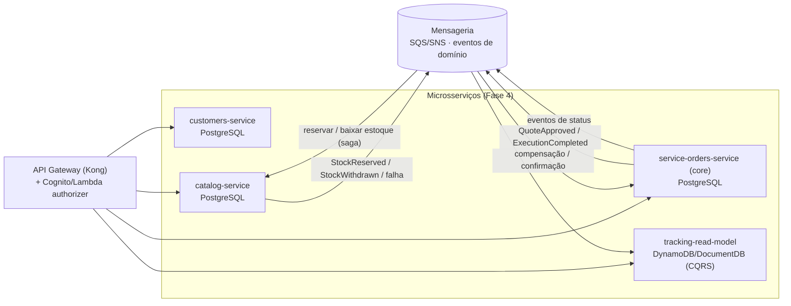

# Evolução do projeto nas próximas fases do curso

> A grade da Pós Tech Software Architecture (FIAP+Alura) tem 5 fases, cada uma com Tech Challenge sobre **o mesmo
> projeto**. O que decidimos agora determina quanto retrabalho teremos depois. Esta página lista o que cada fase vai
> pedir (pela ementa pública) e **o que já fazemos na Fase 1 para facilitar** — sem antecipar complexidade.

## 1. Roteiro das fases

## 2. O que a Fase 1 já deixa pronto (decisões "grátis" agora, caras depois)

| Fase futura vai pedir | Decisão na Fase 1 | Onde |
|---|---|---|
| **K8s/EKS**: app stateless, config por env, probes, imagem enxuta | 12-factor (`.env.example`), `GET /health` + `GET /ready`, Dockerfile multi-stage com usuário não-root, sem estado em memória entre requisições | `visao-geral.md` §6, Dockerfile |
| **CI/CD + SonarQube**: pipeline com testes/cobertura/qualidade | GitHub Actions desde o 1º PR (GitFlow: PR para `develop`, release para `master`) com gate de cobertura; relatório lcov que o Sonar lê | ADR-006, ADR-008 |
| **Clean Architecture** (Fase 2) | Camadas clássicas na Fase 1 (ADR-003, E-06 revotada em 22/09), mas com o que a Clean exige de caro já pronto: módulos por contexto, domínio rico sem framework, fronteira entre módulos por serviço exportado. Na Fase 2 os `services/` viram casos de uso + portas e os repositórios viram gateways — o domínio não muda | ADR-003 |
| **OpenTelemetry** | Logs estruturados com `requestId`; um ponto único de middleware onde o tracing entra | `visao-geral.md` §6 |
| **API Gateway + Lambda authorizer / Cognito** (Fase 3) | JWT HS256 validado por um único guard (`JwtAuthGuard`); claims padrão (`sub`, `roles`, `iss`, `aud`, `customerId`); rotas do cliente separadas (`/tracking`: token de acompanhamento ou login `CUSTOMER`) — trocar por RS256/JWKS do Cognito muda só o guard | ADR-004, ADR-011 |
| **Serverless** (Fase 3) | Domínio e services sem dependência de HTTP → uma função Lambda pode instanciar o mesmo service e chamar o mesmo agregado | ADR-003 |
| **Microsserviços** (Fase 4) | Módulos por bounded context; sem imports de domínio entre módulos; sem JOIN entre schemas; ids gerados na aplicação; snapshots em vez de referências vivas | `contextos-delimitados.md` §3, ADR-009 |
| **SAGA** (Fase 4) — o curso usa exatamente "ordem de serviço" como exemplo | `ServiceOrdersService.approveQuote` (reserva) e `.complete` (baixa) já coordenam `service-orders` + `catalog`; hoje transação local, amanhã saga com `QuoteApproved` → `StockReserved`/`StockReservationFailed` + compensação `RevertQuoteApproval` (e o mesmo para `ExecutionCompleted` → `StockWithdrawn`) | ADR-012, `fluxos.md` §3–§4 |
| **CQRS / read models / NoSQL** (Fase 4) | Consultas (`/tracking`, `/metrics`, fila por status) isoladas em casos de uso de leitura; podem migrar para projeção em DocumentDB/DynamoDB | PRD-004, PRD-006 |
| **Eventos assíncronos** (Fase 4) | Eventos de domínio nomeados e publicados em barramento em processo; trocar o barramento por SQS/SNS/Kafka é um adaptador | `agregados.md` §4 |
| **LGPD** (Fase 5) | PII concentrada (`clientes`, `veiculos`); máscara central; sem PII em logs; soft delete → futuro "anonimizar cliente"; base legal e retenção documentáveis | ADR-009, PRD-005 |

## 3. Como a extração vai acontecer (Fase 4) — visão alvo

Cada serviço nasce de um módulo do monólito: `customers` → `customers-service`, `catalog` → `catalog-service`,
`service-orders` → `service-orders-service` (+ read model). As chamadas que hoje são feitas em processo aos serviços exportados dos outros módulos passam a ser
clientes HTTP/eventos — **o domínio não muda**.

## 4. O que **não** fazer na Fase 1 (over-engineering que não pontua)

- Mensageria real (Kafka/RabbitMQ), múltiplos bancos, cache distribuído, service mesh, Kubernetes manifests — tudo é
  conteúdo de fases seguintes e o enunciado pede **monólito + docker-compose**.
- Microsserviços "disfarçados" (vários processos no compose) — fere o enunciado.
- Abstrações genéricas sem uso (repositório genérico, "framework interno").
- Front-end.

## 5. Frase para o vídeo

> "Organizamos o monólito em módulos por contexto delimitado, em camadas clássicas (controller → service → repository)
> sobre um domínio rico, com comunicação entre módulos só pelos serviços que cada módulo exporta e por eventos de
> domínio, e o banco separado por schema. Isso não custa nada agora e é exatamente o que permite,
> nas próximas fases, levar o mesmo sistema para Kubernetes, colocar um API Gateway na frente e extrair cada módulo
> como microsserviço com SAGA — sem reescrever o domínio."
