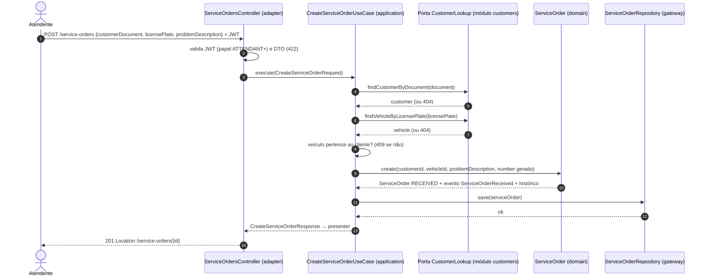
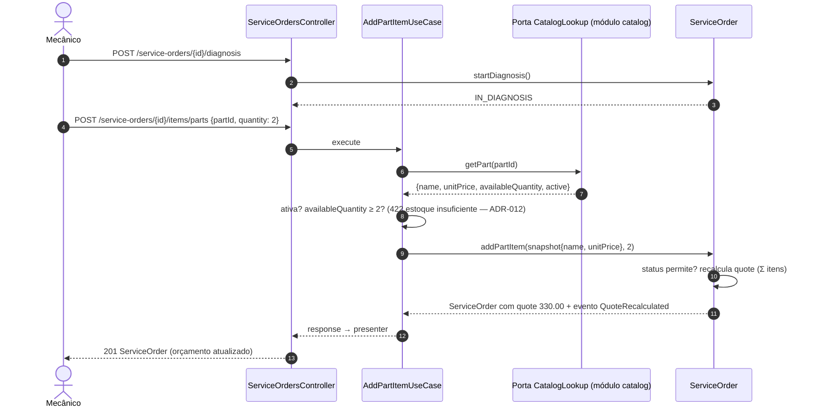
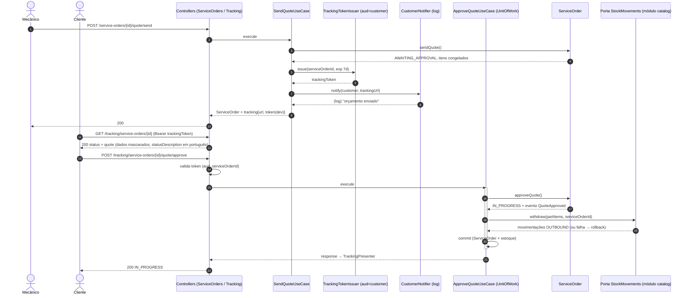
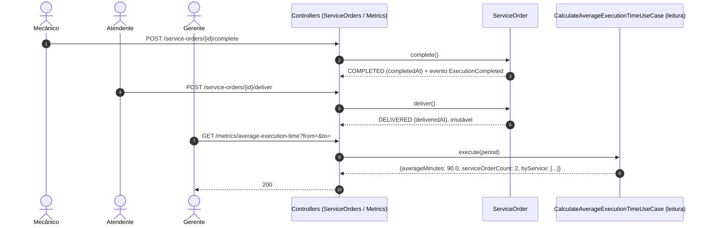
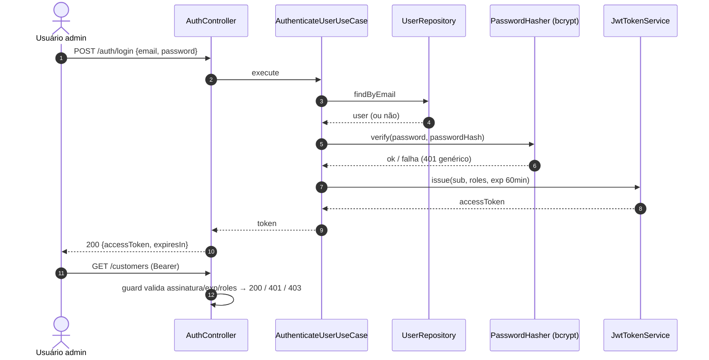
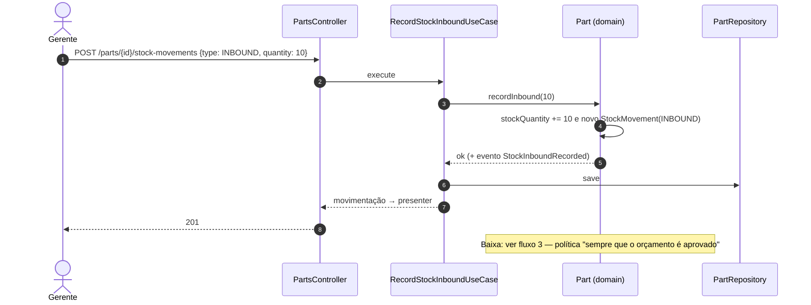

# Fluxos principais — diagramas de sequência

> Um por bloco do vídeo. Participantes = camadas/módulos do monólito (ADR-003, Clean Architecture); identificadores em
> inglês (ADR-013), textos em português.

## 1. Criação da OS (com identificação do cliente por documento)

## 2. Diagnóstico, inclusão de itens e orçamento automático

## 3. Envio do orçamento e aprovação pelo cliente (2 módulos, 1 transação)

## 4. Execução, finalização, entrega e métrica

## 5. Autenticação administrativa

## 6. Gestão de estoque (entrada e baixa)

