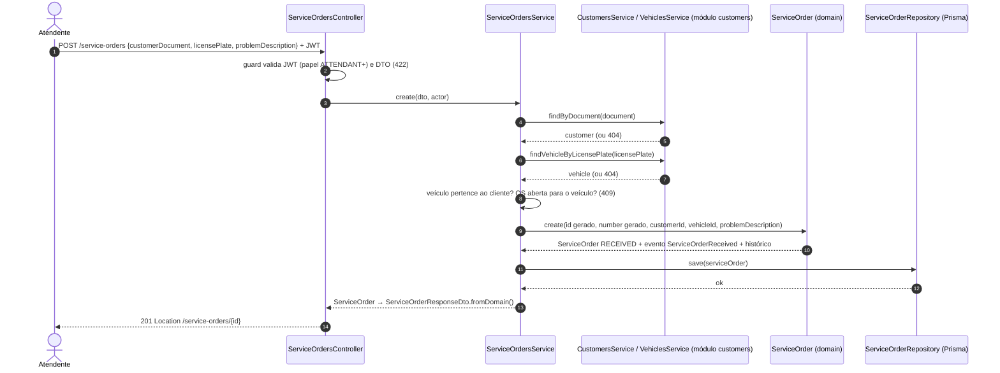
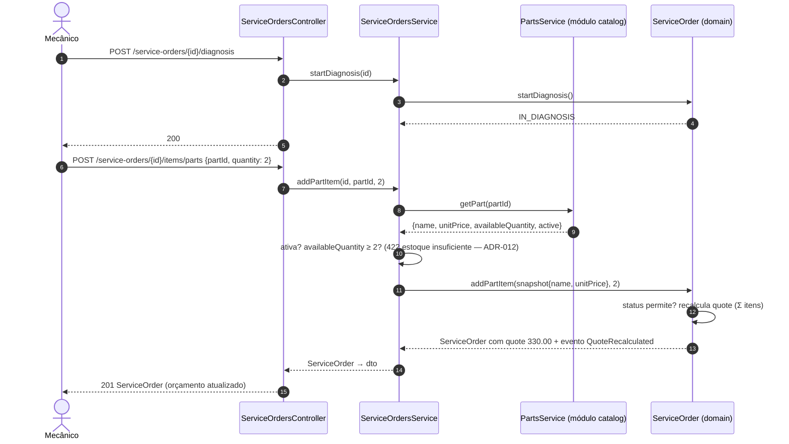
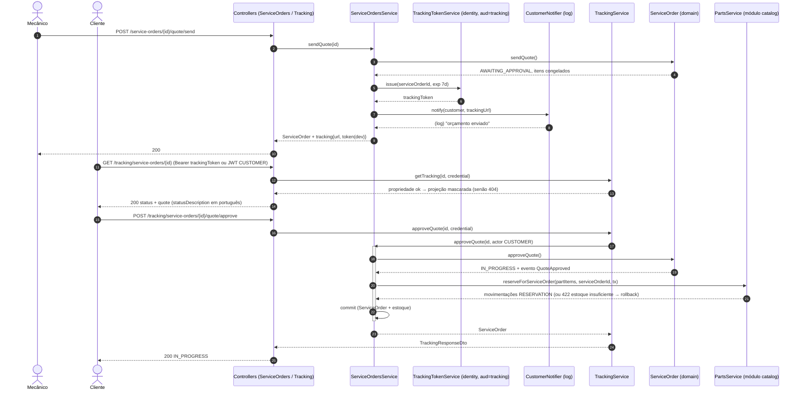
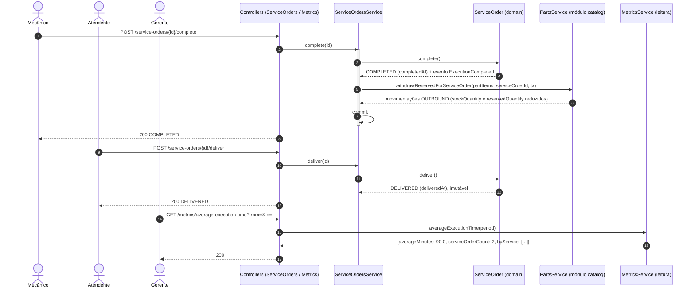
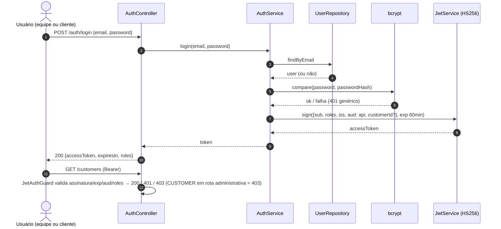
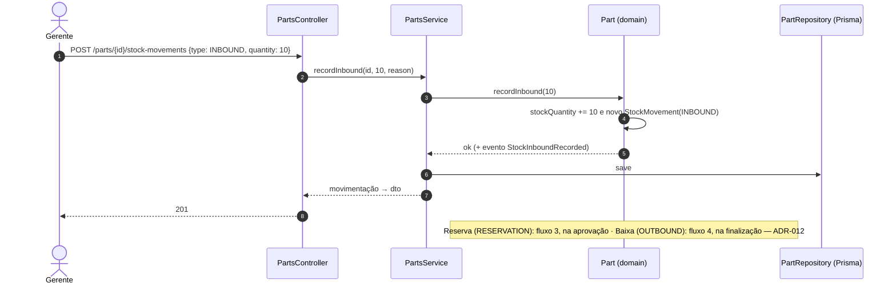

# Fluxos principais — diagramas de sequência

> Um por bloco do vídeo. Participantes = camadas/módulos do monólito (ADR-003, camadas clássicas: controller → service →
> repository, sobre o domínio); identificadores em inglês (ADR-013), textos em português.

## 1. Criação da OS (com identificação do cliente por documento)

## 2. Diagnóstico, inclusão de itens e orçamento automático

## 3. Envio do orçamento e aprovação pelo cliente (2 módulos, 1 transação — reserva de estoque)

Recusa (`POST …/quote/reject { reason }`) segue o mesmo caminho e leva a OS para `CANCELLED` sem efeito no estoque
(ADR-010): a reserva só existe depois da aprovação.

## 4. Execução, finalização (baixa de estoque), entrega e métrica

## 5. Autenticação (equipe e cliente)

## 6. Gestão de estoque (entrada; reserva e baixa vêm dos fluxos 3 e 4)

