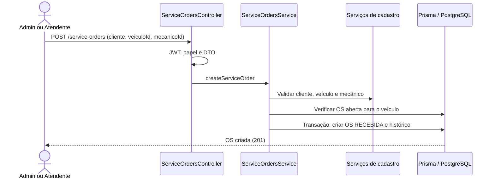
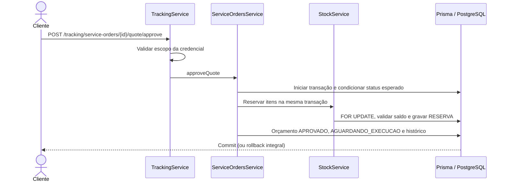

# Fluxos principais — comportamento implementado

Participantes são serviços reais e Prisma; os eventos nos textos de DDD são fatos de negócio, não publicação em broker.

## 1. Abrir a OS

Cliente por `clientId` ou `customerDocument`. Cadastro de cliente/veículo é anterior e separado. Veículo alheio ou com OS aberta gera conflito; perfis incorretos são regras de negócio.

## 2. Diagnóstico, itens e envio

1. Admin/Mecanico executa `POST /service-orders/{id}/diagnosis`.
2. Inclui serviço/peça em `/{id}/items/services` ou `/items/parts`; o serviço busca catálogo ativo, congela preço, verifica disponibilidade da peça e recalcula orçamento. Itens só mudam em RECEBIDA/EM_DIAGNOSTICO.
3. `POST /service-orders/{id}/quote/send` exige itens; grava orçamento ENVIADO, status AGUARDANDO_APROVACAO e histórico na transação.
4. Token de acompanhamento é gerado e a comunicação é simulada em log. Fora de produção o token retorna na resposta; não há provedor de e-mail/`CustomerNotifier` implementado.

## 3. Aprovação e execução

Falta de saldo retorna 422 sem aprovação/reserva parcial. Admin/Mecanico inicia execução por `/start-execution`, mudando para EM_EXECUCAO. `/complete` muda para FINALIZADA e baixa saldo físico/reservado com movimentação SAIDA na mesma transação. Admin/Atendente registra `/deliver`, chegando a ENTREGUE.

## 4. Recusa, cancelamento e concorrência

- Cliente recusa via `/tracking/service-orders/{id}/quote/reject` com `reason`: orçamento REJEITADO e OS ORCAMENTO_RECUSADO. Terminal, sem retorno ao diagnóstico e sem reserva a liberar.
- Admin cancela com motivo somente em RECEBIDA/EM_DIAGNOSTICO/AGUARDANDO_APROVACAO. CANCELADA é terminal. Não há cancelamento depois da aprovação nem reparo adicional.
- Cada transição grava histórico e efeitos no mesmo commit. Update condicionado ao status faz só uma requisição concorrente vencer; a perdedora recebe 409. Não equivale a lock otimista por versão em toda edição.
- Estoque bloqueia linhas em ordem fixa; movimentações manuais não podem consumir saldo reservado. Ver [modelo](modelo-de-dados.md).

## 5. Consultas e métricas

`GET /service-orders` para equipe; `GET /service-orders/{id}` inclui itens/orçamento/marcos e permite Cliente proprietário. `/tracking/service-orders/{id}` oferece projeção mascarada por token de uma OS ou login Cliente; não há listagem de tracking.

`GET /metrics/average-execution-time`: média em minutos entre histórico EM_EXECUCAO e FINALIZADA, duas casas; sem amostras retorna `null`. A média por serviço usa a duração das OS que contêm o serviço, não tempo individual de tarefa. `from`, `to` e `serviceId` são opcionais; não há janela obrigatória padrão de 30 dias.
