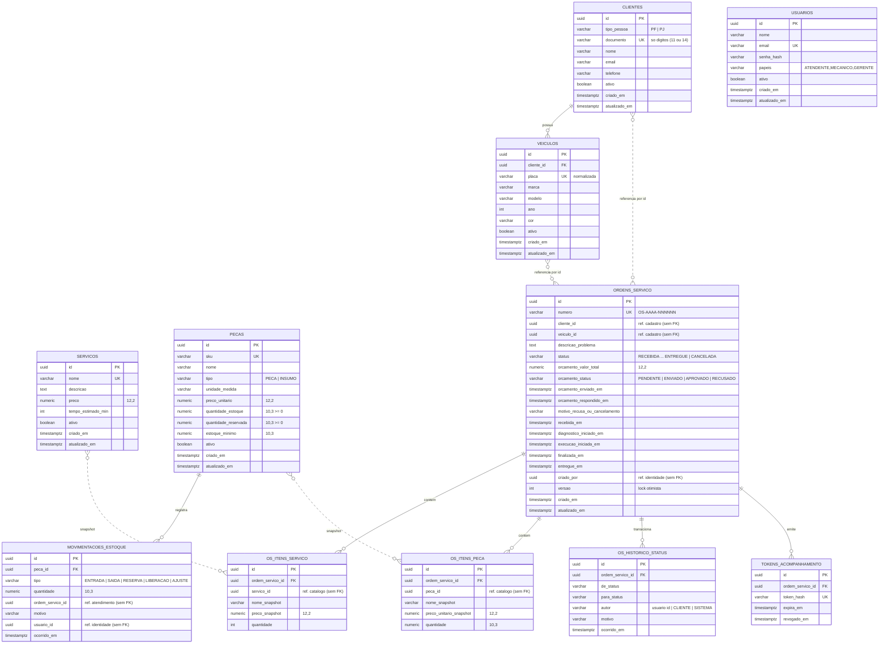

# Modelo de dados (relacional — assume ADR-002 = PostgreSQL; adaptável a MySQL/SQL Server)

> Um *schema* (ou prefixo) por módulo. **Sem chaves estrangeiras entre módulos** (apenas colunas de referência com
> índice) — o que permite separar os bancos na Fase 4 sem migração de esquema. Dentro do módulo, FKs normais.

## 1. Diagrama ER



`TOKENS_ACOMPANHAMENTO` só existe se a ADR-011 escolher tokens **opacos** persistidos; com JWT assinado (recomendado)
a tabela é opcional (útil para revogação — Could).

## 2. Schemas por módulo

| Schema | Tabelas |
|---|---|
| `cadastro` | `clientes`, `veiculos` |
| `catalogo` | `servicos`, `pecas`, `movimentacoes_estoque` |
| `atendimento` | `ordens_servico`, `os_itens_servico`, `os_itens_peca`, `os_historico_status`, `tokens_acompanhamento`, `os_numero_seq` (sequência anual) |
| `identidade` | `usuarios` |

## 3. Constraints que protegem invariantes (defesa em profundidade)

| Tabela | Constraint |
|---|---|
| `clientes` | `UNIQUE (documento) WHERE ativo` (índice parcial) · `CHECK (tipo_pessoa IN ('PF','PJ'))` · `CHECK (length(documento) IN (11,14))` |
| `veiculos` | `UNIQUE (placa) WHERE ativo` · `CHECK (ano BETWEEN 1900 AND 2100)` |
| `pecas` | `CHECK (quantidade_estoque >= 0)` · `CHECK (quantidade_reservada >= 0 AND quantidade_reservada <= quantidade_estoque)` · `CHECK (preco_unitario >= 0)` |
| `movimentacoes_estoque` | `CHECK (quantidade > 0)` · `CHECK (tipo IN (...))` |
| `ordens_servico` | `CHECK (status IN (...))` · `CHECK (orcamento_valor_total >= 0)` · `UNIQUE (numero)` · índice parcial "1 OS aberta por veículo" (Should): `UNIQUE (veiculo_id) WHERE status NOT IN ('ENTREGUE','CANCELADA')` |
| `os_itens_*` | `CHECK (quantidade > 0)` |
| `os_historico_status` | índice `(ordem_servico_id, ocorrido_em)` |
| `usuarios` | `UNIQUE (email)` |

## 4. Consultas de leitura relevantes

**Tempo médio de execução (geral, período):**

```sql
SELECT AVG(EXTRACT(EPOCH FROM (finalizada_em - execucao_iniciada_em)) / 60.0) AS media_minutos,
       COUNT(*) AS quantidade_os
FROM atendimento.ordens_servico
WHERE finalizada_em IS NOT NULL
  AND execucao_iniciada_em IS NOT NULL
  AND finalizada_em BETWEEN :de AND :ate;
```

**Tempo médio por serviço (OS que contêm o serviço):**

```sql
SELECT i.servico_id, i.nome_snapshot,
       AVG(EXTRACT(EPOCH FROM (o.finalizada_em - o.execucao_iniciada_em)) / 60.0) AS media_minutos,
       COUNT(DISTINCT o.id) AS quantidade_os
FROM atendimento.ordens_servico o
JOIN atendimento.os_itens_servico i ON i.ordem_servico_id = o.id
WHERE o.finalizada_em IS NOT NULL AND o.execucao_iniciada_em IS NOT NULL
  AND o.finalizada_em BETWEEN :de AND :ate
GROUP BY i.servico_id, i.nome_snapshot;
```

**Fila por status:** `SELECT ... FROM atendimento.ordens_servico WHERE status = :status ORDER BY recebida_em`.

## 5. Dados de demonstração (seed)

- 1 usuário por papel (`gerente@oficina.local`, `mecanico@…`, `atendente@…`) com senhas via env.
- 3 clientes (2 PF, 1 PJ) com documentos fictícios válidos; 4 veículos (2 placas antigas, 2 Mercosul).
- 6 serviços (troca de óleo, alinhamento, balanceamento, troca de pastilhas, revisão, diagnóstico eletrônico).
- 8 peças/insumos com estoque e mínimo; 2 com estoque baixo para demonstrar alerta.
- 4 OS em status diferentes, incluindo 2 **finalizadas** (para o tempo médio ≠ null) e 1 aguardando aprovação (para
  demonstrar a aprovação ao vivo no vídeo).

## 6. Migrações

Versionadas na ferramenta da linguagem (Flyway/Liquibase · Prisma Migrate/TypeORM migrations · EF Migrations · Alembic ·
golang-migrate). `V001__schemas.sql`, `V002__cadastro.sql`, `V003__catalogo.sql`, `V004__atendimento.sql`,
`V005__identidade.sql`, `V900__seed_dev.sql` (somente em `APP_ENV=dev`).
