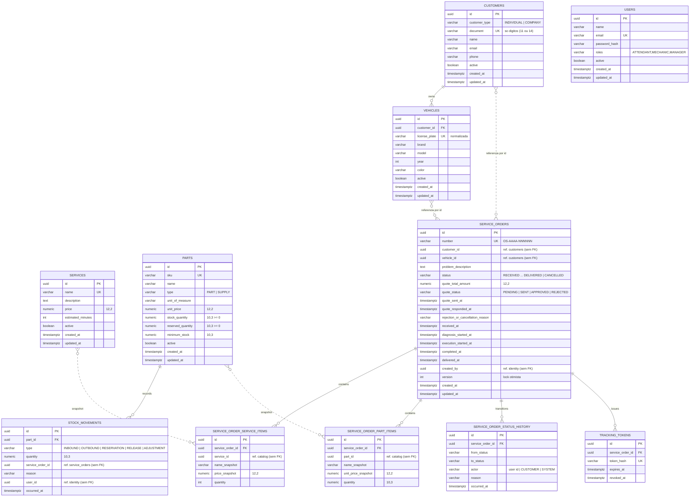

# Modelo de dados (PostgreSQL 16 — ADR-002 Aceita)

> Um *schema* por módulo. **Sem chaves estrangeiras entre módulos** (apenas colunas de referência com índice) — o que
> permite separar os bancos na Fase 4 sem migração de esquema. Dentro do módulo, FKs normais. Nomes em inglês,
> `snake_case` (ADR-013; glossário em `docs/03-ddd/linguagem-ubiqua.md`).

## 1. Diagrama ER



`TRACKING_TOKENS` só existe se a ADR-011 escolher tokens **opacos** persistidos; com JWT assinado (recomendado)
a tabela é opcional (útil para revogação — Could).

## 2. Schemas por módulo

| Schema | Tabelas |
|---|---|
| `customers` | `customers`, `vehicles` |
| `catalog` | `services`, `parts`, `stock_movements` |
| `service_orders` | `service_orders`, `service_order_service_items`, `service_order_part_items`, `service_order_status_history`, `tracking_tokens`, `service_order_number_seq` (sequência anual) |
| `identity` | `users` |

## 3. Constraints que protegem invariantes (defesa em profundidade)

| Tabela | Constraint |
|---|---|
| `customers` | `UNIQUE (document) WHERE active` (índice parcial) · `CHECK (customer_type IN ('INDIVIDUAL','COMPANY'))` · `CHECK (length(document) IN (11,14))` |
| `vehicles` | `UNIQUE (license_plate) WHERE active` · `CHECK (year BETWEEN 1900 AND 2100)` |
| `parts` | `CHECK (stock_quantity >= 0)` · `CHECK (reserved_quantity >= 0 AND reserved_quantity <= stock_quantity)` · `CHECK (unit_price >= 0)` |
| `stock_movements` | `CHECK (quantity > 0)` · `CHECK (type IN (...))` |
| `service_orders` | `CHECK (status IN (...))` · `CHECK (quote_total_amount >= 0)` · `UNIQUE (number)` · índice parcial "1 OS aberta por veículo" (Should): `UNIQUE (vehicle_id) WHERE status NOT IN ('DELIVERED','CANCELLED')` |
| `service_order_*_items` | `CHECK (quantity > 0)` |
| `service_order_status_history` | índice `(service_order_id, occurred_at)` |
| `users` | `UNIQUE (email)` |

## 4. Consultas de leitura relevantes

**Tempo médio de execução (geral, período):**

```sql
SELECT AVG(EXTRACT(EPOCH FROM (completed_at - execution_started_at)) / 60.0) AS average_minutes,
       COUNT(*) AS service_order_count
FROM service_orders.service_orders
WHERE completed_at IS NOT NULL
  AND execution_started_at IS NOT NULL
  AND completed_at BETWEEN :from AND :to;
```

**Tempo médio por serviço (OS que contêm o serviço):**

```sql
SELECT i.service_id, i.name_snapshot,
       AVG(EXTRACT(EPOCH FROM (o.completed_at - o.execution_started_at)) / 60.0) AS average_minutes,
       COUNT(DISTINCT o.id) AS service_order_count
FROM service_orders.service_orders o
JOIN service_orders.service_order_service_items i ON i.service_order_id = o.id
WHERE o.completed_at IS NOT NULL AND o.execution_started_at IS NOT NULL
  AND o.completed_at BETWEEN :from AND :to
GROUP BY i.service_id, i.name_snapshot;
```

**Fila por status:** `SELECT ... FROM service_orders.service_orders WHERE status = :status ORDER BY received_at`.

## 5. Dados de demonstração (seed)

- 1 usuário por papel (`manager@oficina.local`, `mechanic@…`, `attendant@…`) com senhas via env.
- 3 clientes (2 PF, 1 PJ) com documentos fictícios válidos; 4 veículos (2 placas antigas, 2 Mercosul).
- 6 serviços (troca de óleo, alinhamento, balanceamento, troca de pastilhas, revisão, diagnóstico eletrônico).
- 8 peças/insumos com estoque e mínimo; 2 com estoque baixo para demonstrar alerta.
- 4 OS em status diferentes, incluindo 2 **finalizadas** (para o tempo médio ≠ null) e 1 aguardando aprovação (para
  demonstrar a aprovação ao vivo no vídeo).

## 6. Migrações

Versionadas na ferramenta escolhida para o NestJS (decisão leve pendente de F1/F3: **TypeORM migrations** ou **Prisma
Migrate** — ver ADR-001, seção *Consequências*). Convenção de nomes: `001_schemas`, `002_customers`, `003_catalog`,
`004_service_orders`, `005_identity`, `900_seed_dev` (somente em `APP_ENV=dev`).
