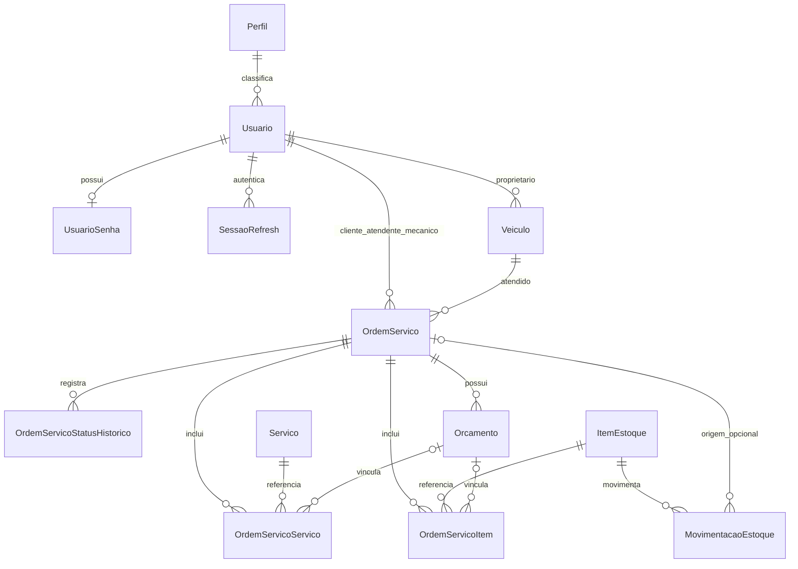

# Modelo de dados — PostgreSQL 16 e Prisma

Fonte: `prisma/schema.prisma` e `prisma/migrations/`. Um banco compartilhado com FKs entre os conceitos. Não há schemas independentes por módulo nem tabela `Customer` separada.

## Relações principais (recorte lógico)

Diagrama resumido: não representa todos os atributos/FKs (por exemplo autor de histórico, respondente de orçamento e autor de movimentação). O schema é a referência completa.

## Entidades e campos relevantes

| Modelo | Campos/regras |
|---|---|
| `Perfil` | `perfilId`, `perfilNome` único; um perfil para muitos usuários |
| `Usuario` | Identidade de clientes e funcionários; `perfilId`, nome, e-mail/documento únicos, tipo CPF/CNPJ, contato, ativo e datas |
| `UsuarioSenha` | Relação opcional 1:1; hash PHC Argon2id separado dos dados cadastrais |
| `SessaoRefresh` | Hash SHA-256 único, família, expiração, revogação e usuário |
| `Veiculo` | Proprietário `usuarioId`, placa, chassi opcional, marca, modelo, ano, cor, km e inativação |
| `Servico` | Nome único, descrição opcional, `servicoPrecoBase` inteiro em centavos e ativo; sem tempo estimado persistido |
| `ItemEstoque` | Tipo PECA/INSUMO, código único, nome, unidade, preço em centavos, saldo físico/reservado Decimal(12,3), ativo |
| `MovimentacaoEstoque` | Tipo, quantidade Decimal(12,3), motivo, autor, item e OS opcional |
| `OrdemServico` | UUID, número BigInt sequencial, cliente/veículo/atendente/mecânico, status, descrição, diagnóstico, km, motivo de cancelamento e datas |
| `OrdemServicoStatusHistorico` | Status anterior/novo, observação, autor opcional e instante; fonte de marcos e métricas |
| `Orcamento` | OS/versão únicos em conjunto, status, total em centavos, envio/resposta, respondente e motivo de rejeição |
| `OrdemServicoServico` | Referências OS/serviço/orçamento, quantidade inteira e preço unitário congelado |
| `OrdemServicoItem` | Referências OS/item/orçamento, quantidade Decimal(12,3) e preço unitário congelado |

Há **13 modelos**. `orcamentoVersao` no schema não comprova um fluxo de reparo adicional: esse comando não foi implementado. `Orcamento` tem id e estado persistidos; não é um VO imutável no código.

## Integridade e persistência

- UUIDs com defaults Prisma; campos mapeados por `@map` (ver schema e migrações para os nomes físicos).
- E-mail/documento do usuário permanecem únicos mesmo após inativação. Veículos possuem índices parciais de placa/chassi únicos entre ativos nas migrações.
- Preços inteiros em centavos; quantidades fracionárias Decimal(12,3). **Somente preço** é snapshot nos itens; nome continua consultado no catálogo.
- Migrações complementam o Prisma com constraints de estoque: físico ≥ 0; 0 ≤ reservado ≤ físico. Saldo e movimentação são gravados juntos; atualização de cadastro não é ajuste de saldo.
- Relações/FKs preservam integridade referencial. Inativação de cadastros preserva referências e histórico; regras de bloqueio por OS aberta são verificadas nos serviços.
- Uma OS aberta por veículo é verificada na aplicação; não há índice único no banco para essa regra.
- Transições usam update condicionado ao status, não `version`. Reservas/baixas usam `FOR UPDATE` na transação; sem `If-Match`.
- Marcos de início/fim são derivados do histórico, não colunas `executionStartedAt`/`completedAt` na OS. Não há tabelas de eventos/outbox.

Ver [fluxos](fluxos.md), [agregados e limites táticos](../ddd/agregados.md) e [contrato](contrato-api.md).
