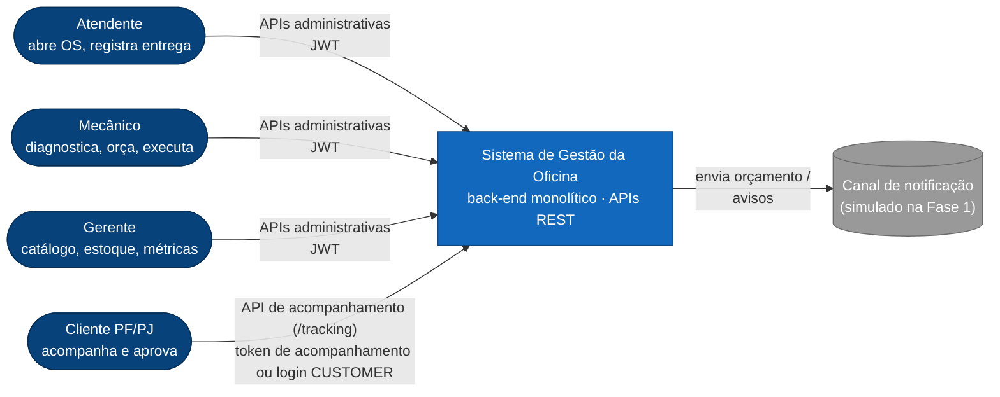
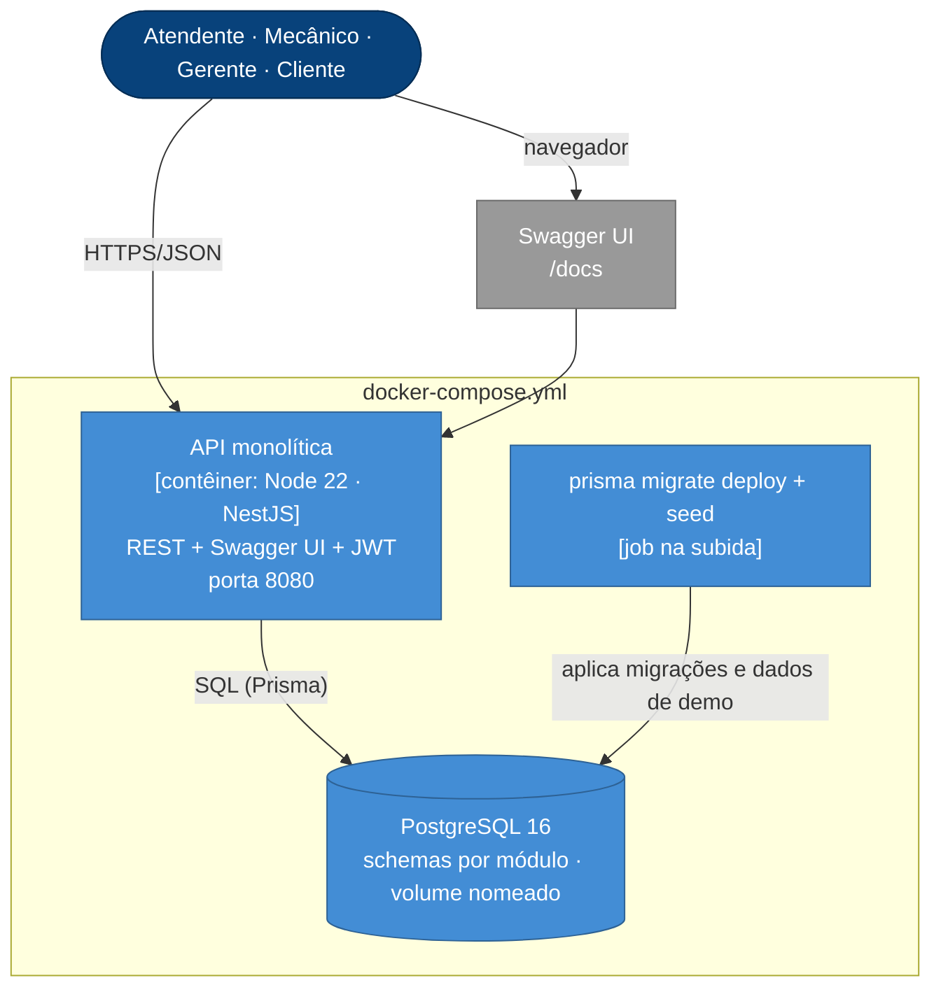
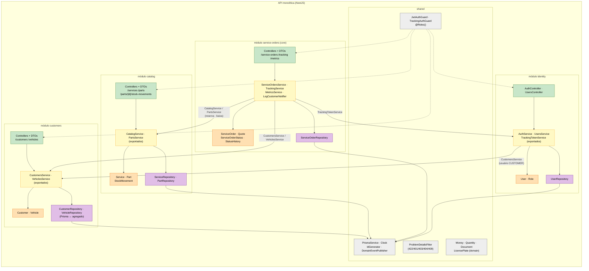
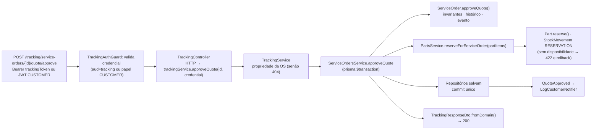

# Visão geral da arquitetura (Fase 1 — monólito modular em camadas clássicas)

> Diagramas no modelo **C4** (contexto → contêineres → componentes) + a organização em camadas pedida no vídeo.
> Decisões aceitas: NestJS + TypeScript (ADR-001), PostgreSQL + Prisma (ADR-002, E-17), **camadas clássicas dentro de
> módulos por contexto** (ADR-003, revotada em 22/09/2026), código em inglês (ADR-013), JWT próprio (ADR-004), token de
> acompanhamento + login de cliente (ADR-011), reserva na aprovação + baixa na finalização (ADR-012). Identificadores
> conforme `docs/03-ddd/linguagem-ubiqua.md`.

## 1. C4 — Nível 1: Contexto

## 2. C4 — Nível 2: Contêineres (o que sobe no `docker compose up`)

## 3. C4 — Nível 3: Componentes da API (módulos por contexto delimitado, camadas clássicas)

## 4. Camadas do monólito (o que dizer no vídeo)

| Camada | Pasta | Responsabilidade | Depende de | Nunca depende de |
|---|---|---|---|---|
| **Apresentação** | `controllers/` + `dto/` | Rotas REST, códigos HTTP, guards e papéis, DTOs com validação sintática e `fromDomain()`, OpenAPI | `services/`, `domain/` (VOs/enums) | `repositories/`, Prisma |
| **Aplicação** | `services/` | Um método por caso de uso: carrega agregados, executa comandos do domínio, coordena a transação e chama serviços exportados de outros módulos | `domain/`, `repositories/`, serviços exportados | `controllers/` |
| **Domínio** | `domain/` | Agregados, entidades, value objects, regras/invariantes, transições, eventos de domínio | nada (puro TypeScript) | Nest, Prisma, HTTP |
| **Persistência** | `repositories/` | Consultas e mapeamento registro ↔ agregado sobre o `PrismaService`; lock otimista | `domain/`, `shared/prisma` | `services/`, `controllers/` |

Regra: **controller → service → repository, todos sobre o domínio; ninguém pula camada e o domínio não conhece
framework.** O domínio rico (invariantes no agregado) é testável sem banco e sem HTTP — é o que faz a cobertura de
80 % nos módulos críticos ser barata e o que o vídeo mostra como "elementos de DDD". A disciplina da Fase 1 ensina
hexagonal e a Fase 2 pede Clean Architecture: o que já está pronto para isso é a modularidade por contexto, o domínio sem
framework e a fronteira entre módulos por serviço exportado — na Fase 2, os services viram casos de uso + portas sem
mexer no domínio (`evolucao-fases.md`).

## 5. Fluxo de uma requisição (exemplo: aprovar orçamento)

## 6. Decisões transversais

| Tema | Decisão |
|---|---|
| Configuração | 12-factor: tudo por variáveis de ambiente (`DATABASE_URL`, `JWT_SECRET`, `APP_ENV`, `ADMIN_EMAIL/PASSWORD`); `.env.example` versionado; schema validado na subida |
| Erros | Problem Details (`contrato-api.md` §5); erros de domínio → 409/422; nunca stack trace |
| Logs | Estruturados (JSON), com `requestId`, sem PII (máscara central em `shared/http`) |
| Health | `GET /health` (liveness) e `GET /ready` (checa banco) — já pensando em Kubernetes |
| Transações | Uma por método de serviço que muda estado (`prisma.$transaction`); a aprovação (reserva) e a finalização (baixa) tocam dois módulos na mesma transação; eventos de domínio processados dentro da transação na Fase 1 |
| Tempo | `Clock` injetável (testes determinísticos); UTC no banco |
| Ids | UUID v4 gerado na aplicação (`crypto.randomUUID()`), nunca pelo banco; número da OS por sequência anual (ADR-009) |
| Idempotência | Comandos de transição são idempotentes por estado (aprovar duas vezes → 409 na segunda) |
| Idioma | Código/API em inglês; textos ao usuário e docs em português (ADR-013) |
