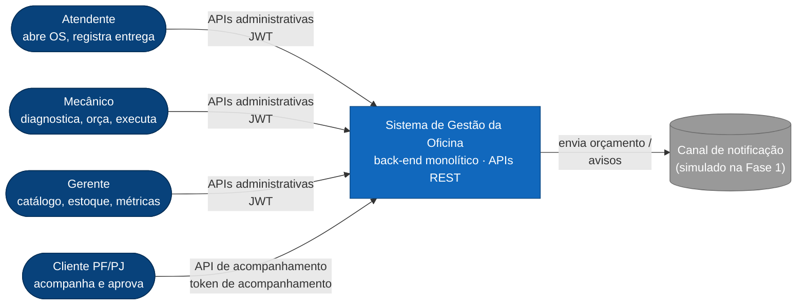
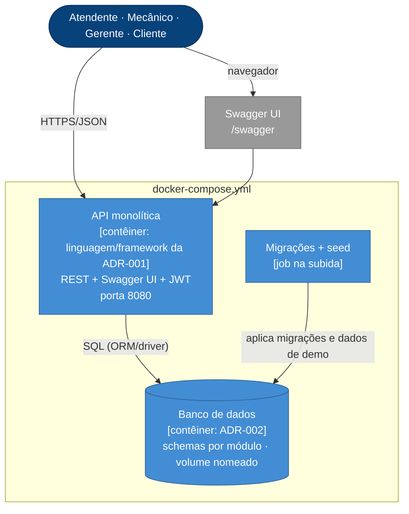
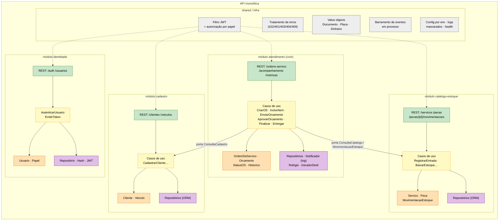
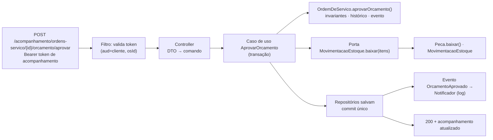

# Visão geral da arquitetura (Fase 1 — monólito modular)

> Diagramas no modelo **C4** (contexto → contêineres → componentes) + a organização em camadas pedida no vídeo.
> Assume ADR-003 = monólito modular + hexagonal; se a votação escolher camadas clássicas, o nível 3 muda (o resto não).

## 1. C4 — Nível 1: Contexto

## 2. C4 — Nível 2: Contêineres (o que sobe no `docker compose up`)

## 3. C4 — Nível 3: Componentes da API (módulos e camadas)

## 4. Camadas do monólito (o que dizer no vídeo)

| Camada | Responsabilidade | Depende de | Nunca depende de |
|---|---|---|---|
| **Interface (adapters/in)** | Controllers REST, DTOs de entrada/saída, validação sintática, OpenAPI, mapeamento de erros | Aplicação | Persistência |
| **Aplicação** | Casos de uso (um por comando), orquestração, transação, portas de entrada/saída (interfaces), publicação de eventos | Domínio | Framework web/ORM |
| **Domínio** | Agregados, entidades, value objects, regras/invariantes, eventos de domínio, interfaces de repositório | Nada (puro) | Qualquer framework |
| **Infraestrutura (adapters/out)** | Implementações: repositórios (ORM/SQL), JWT, hash, notificação (log), relógio, gerador de ids, config | Domínio/Aplicação (implementa as portas) | — |

Regra de dependência: **de fora para dentro** (interface → aplicação → domínio; infraestrutura implementa as
interfaces do domínio/aplicação). O domínio é testável sem banco e sem HTTP — é o que faz a cobertura de 80 % ser barata.

## 5. Fluxo de uma requisição (exemplo: aprovar orçamento)

## 6. Decisões transversais

| Tema | Decisão (proposta) |
|---|---|
| Configuração | 12-factor: tudo por variáveis de ambiente (`DB_URL`, `JWT_SECRET`, `APP_ENV`, `ADMIN_EMAIL/PASSWORD`); `.env.example` versionado |
| Erros | Formato único (`docs/04-arquitetura/contrato-api.md` §6); erros de domínio → 409/422; nunca stack trace |
| Logs | Estruturados (JSON), com `requestId`, sem PII (máscara central) |
| Health | `GET /health` (liveness) e `GET /ready` (checa banco) — já pensando em Kubernetes |
| Transações | Uma por caso de uso (Unit of Work); eventos de domínio processados dentro da transação na Fase 1 |
| Tempo | Porta `Relogio` injetável (testes determinísticos); UTC no banco |
| Ids | ADR-009 (UUID gerado na aplicação) |
| Idempotência | Comandos de transição são idempotentes por estado (aprovar duas vezes → 409 na segunda) |
