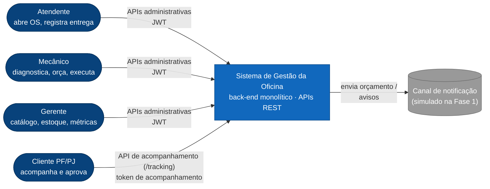
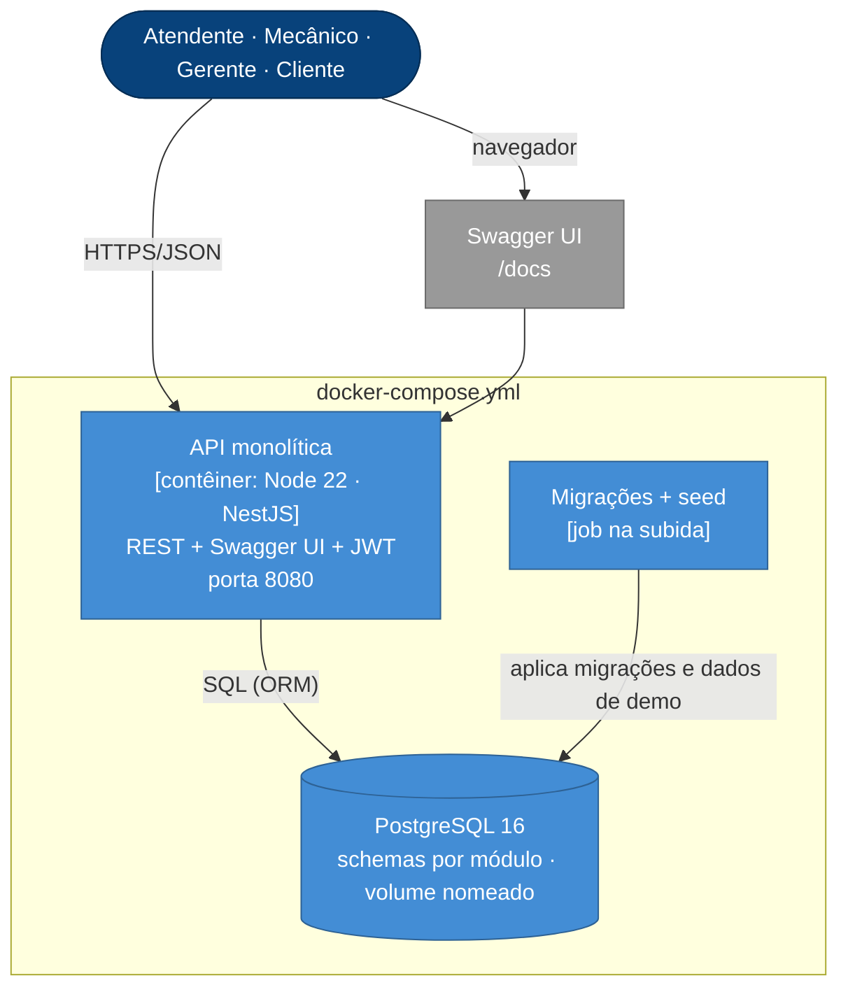
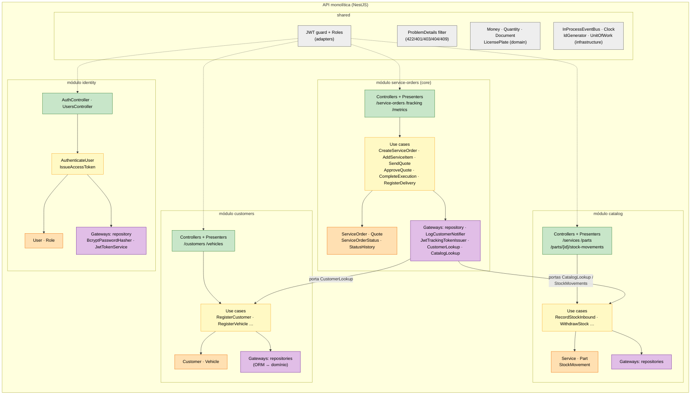
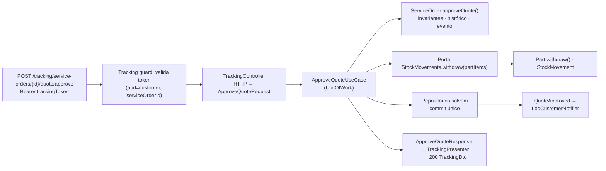

# Visão geral da arquitetura (Fase 1 — monólito modular em Clean Architecture)

> Diagramas no modelo **C4** (contexto → contêineres → componentes) + a organização em camadas pedida no vídeo.
> Decisões aceitas: NestJS + TypeScript (ADR-001), PostgreSQL (ADR-002), **Clean Architecture completa** (ADR-003),
> código em inglês (ADR-013). Identificadores conforme `docs/03-ddd/linguagem-ubiqua.md`.

## 1. C4 — Nível 1: Contexto

## 2. C4 — Nível 2: Contêineres (o que sobe no `docker compose up`)

## 3. C4 — Nível 3: Componentes da API (módulos por contexto delimitado, camadas da Clean Architecture)

## 4. Camadas do monólito (o que dizer no vídeo)

| Camada (Clean Architecture) | Pasta | Responsabilidade | Depende de | Nunca depende de |
|---|---|---|---|---|
| **Entities** | `domain/` | Agregados, entidades, value objects, regras/invariantes, eventos de domínio, interfaces de repositório | nada (puro TypeScript) | Nest, ORM, HTTP |
| **Use Cases** | `application/` | Um caso de uso por comando/consulta; input/output boundaries e request/response models; portas de saída; transação | `domain` | Framework web/ORM |
| **Interface Adapters** | `adapters/` | Controllers (HTTP → request model), presenters (response model → DTO), gateways (implementam repositórios/portas mapeando ORM ↔ domínio), DTOs com validação sintática, OpenAPI | `application`, `domain` | `infrastructure` de outros módulos |
| **Frameworks & Drivers** | `infrastructure/` | Módulo Nest e DI, entidades do ORM, migrações, config, Swagger, servidor HTTP | tudo (camada mais externa) | — |

Regra de dependência: **de fora para dentro**. O domínio é testável sem banco e sem HTTP — é o que faz a cobertura de
80 % nos módulos críticos ser barata. A diferença prática para a hexagonal (que a disciplina da Fase 1 ensina) é que a
Clean explicita **presenters** e **boundaries**: o controller depende da interface do caso de uso, o caso de uso devolve um
modelo de resposta, e o presenter é o único que conhece o JSON — e é exatamente o conteúdo da Fase 2, já adiantado.

## 5. Fluxo de uma requisição (exemplo: aprovar orçamento)

## 6. Decisões transversais

| Tema | Decisão |
|---|---|
| Configuração | 12-factor: tudo por variáveis de ambiente (`DB_URL`, `JWT_SECRET`, `APP_ENV`, `ADMIN_EMAIL/PASSWORD`); `.env.example` versionado; schema validado na subida |
| Erros | Problem Details (`contrato-api.md` §5); erros de domínio → 409/422; nunca stack trace |
| Logs | Estruturados (JSON), com `requestId`, sem PII (máscara central em `shared/adapters`) |
| Health | `GET /health` (liveness) e `GET /ready` (checa banco) — já pensando em Kubernetes |
| Transações | Uma por caso de uso (`UnitOfWork`); eventos de domínio processados dentro da transação na Fase 1 |
| Tempo | Porta `Clock` injetável (testes determinísticos); UTC no banco |
| Ids | ADR-009 (em votação; proposta: UUID v7 gerado na aplicação) |
| Idempotência | Comandos de transição são idempotentes por estado (aprovar duas vezes → 409 na segunda) |
| Idioma | Código/API em inglês; textos ao usuário e docs em português (ADR-013) |
