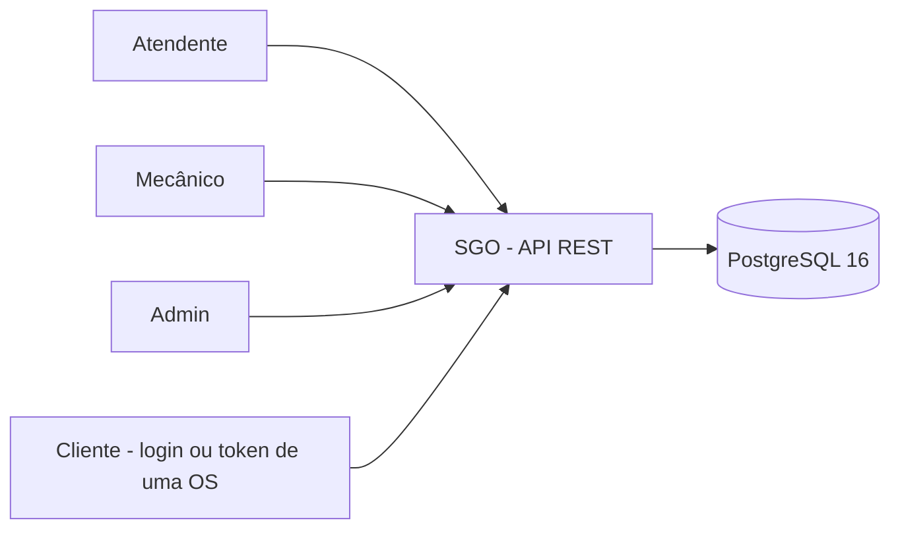
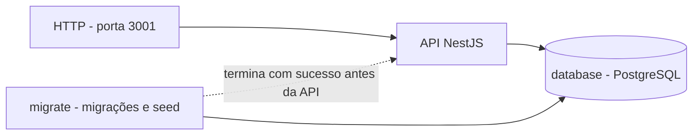
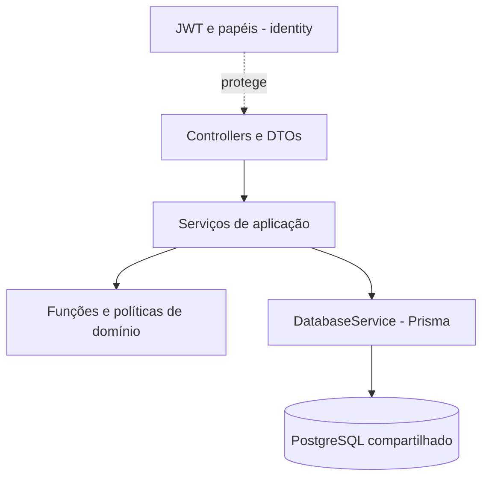

# Visão geral — monólito modular em camadas

Um processo NestJS, uma API REST e um PostgreSQL 16 compartilhado. Não há microsserviços, broker ou provedor externo de identidade/notificação nesta fase.

## Contexto

## Contêineres de execução

`docker-compose.yaml` coordena banco, tarefa de migração/seed e API. O healthcheck do contêiner não significa que existam endpoints `/health` ou `/ready`; esses endpoints não foram implementados. UI Swagger em `/docs`; OpenAPI em `/docs-json`.

## Componentes e camadas

| Módulo | Responsabilidade |
|---|---|
| `service-orders` (core) | OS, itens, orçamento, transições, tracking e média de execução |
| `customers` | Cadastro de clientes e veículos; cliente persiste como `Usuario` |
| `catalog` | Catálogo de serviços, peças/insumos em `/itens` e movimentações |
| `identity` | Usuários/perfis, Argon2id, JWT, refresh e tracking token |
| `shared` | Acesso Prisma e configuração compartilhada; não é contexto de negócio |

## Decisões observadas e limites

- Monólito em camadas, com regras puras de domínio e serviços transacionais. Não há repositórios separados ou agregados ricos implementados conforme o desenho inicial.
- Um banco com FKs reais; não há schema por módulo nem extração pronta para microsserviços.
- Preços são snapshots nos itens da OS; nomes são obtidos do catálogo. Dinheiro em centavos; estoque Decimal(12,3).
- Aprovar reserva; iniciar execução é comando separado; finalizar consome a reserva. Recusa é terminal ORCAMENTO_RECUSADO. Cancelamento só Admin antes da aprovação.
- JWT HS256 e papéis protegem a API; tracking tem escopo próprio. CORS permissivo, Swagger sempre exposto e notificação apenas simulada são limitações, não hardening concluído.
- Testes sem banco/build foram aprovados com Node 24.22.2 temporário. O CI roda em Node 24 (exigência do Jest) e a imagem Docker de produção usa Node 22.

Detalhes: [estrutura](estrutura-do-repositorio.md), [dados](modelo-de-dados.md), [fluxos](fluxos.md), [contrato](contrato-api.md), [DDD](../ddd/README.md), [segurança](../05-qualidade-e-seguranca/seguranca.md). ADRs mantêm o histórico; ver [leitura das divergências](../02-adr/README.md).
