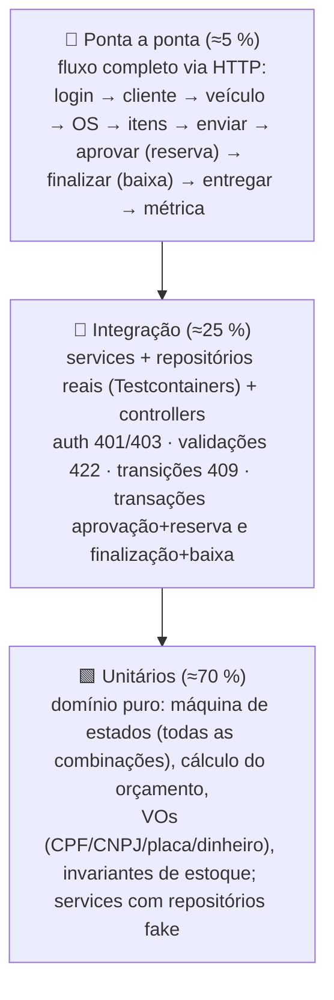
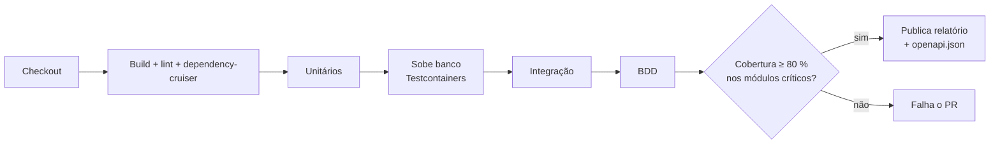

# Estratégia de testes

> Concretiza a ADR-006 (Aceita, E-12: Testcontainers + BDD com Cucumber-js). Meta do enunciado: testes unitários e de
> integração dos fluxos principais; **cobertura ≥ 80 % nos domínios críticos** (`service-orders`, `catalog`).

## 1. Pirâmide



## 2. O que testar, por módulo

| Módulo | Unitário (domínio / services com fakes) | Integração | BDD (Cucumber-js, ADR-006) |
|---|---|---|---|
| `shared` | `Document` (CPF/CNPJ válidos/inválidos/repetidos/formatados), `LicensePlate` (antiga/Mercosul/normalização), `Money` (arredondamento, soma, multiplicação), `Quantity`; guards (aud errado, papel `CUSTOMER` em rota administrativa) | — | — |
| `customers` | Regras de inativação; unicidade via fake de repositório | POST/GET/PUT/DELETE clientes/veículos; 409 duplicado; 422 documento/placa | — |
| `catalog` | `Part.recordInbound/reserve/withdraw/release/adjust` (nunca negativo; reservado ≤ estoque; movimentação gerada; `availableQuantity`); snapshot de preço | Movimentações via API; constraints de estoque no banco; `reserveForServiceOrder` tudo ou nada | *Gestão de estoque* (`stock-management.feature`) — Must |
| `service-orders` | **Tabela de transições completa** (parametrizado: cada par status × comando → esperado, incluindo `CANCELLED`); orçamento recalculado; itens congelados; enviar sem itens; aprovar duas vezes; recusa/cancelamento; histórico append-only; `version` incrementa | Fluxo completo via API; aprovação reserva estoque na mesma transação (falha na reserva → OS não muda, 422); finalização baixa; recusa → `CANCELLED` sem efeito no estoque; acompanhamento com token válido/inválido/expirado/de outra OS e com login `CUSTOMER` (própria e alheia → 404); tempo médio com seed | *Criação da OS e orçamento* (`service-order-creation.feature`) — Must; *Aprovação e execução* (`quote-and-approval.feature`) — Must; *Execução e entrega* — Should |
| `identity` | Emissão/validação de JWT (assinatura, exp, `aud`, roles, `customerId`); hash de senha; token de acompanhamento | Login 200/401; rota protegida 401/403; criação de usuário `CUSTOMER` (404 cliente inexistente) | *Autenticação* (`authentication.feature`) — Should |

## 3. Convenções

- Nome: `should <resultado> when <condição>` no `it()` (ex.: `it('should reject completion when status is RECEIVED')`) — descrições em inglês, como o código (ADR-013).
- Arrange/Act/Assert; um comportamento por teste; builders (`aServiceOrder().inDiagnosis().withService(...).build()`).
- Dados fictícios válidos gerados por utilitário (`validCpf()`, `mercosulLicensePlate()`); nunca dados reais.
- Relógio e ids injetados (`FixedClock`, `FixedIdGenerator`) → testes determinísticos.
- Testes de integração sobem o banco com **Testcontainers** (`@testcontainers/postgresql`, PostgreSQL 16) e aplicam as
  migrações reais do Prisma (`prisma migrate deploy`) antes da suíte; cada teste limpa as tabelas que usou.
- Cada endpoint: caso feliz + 1 validação (422) + 1 autorização (401/403) no mínimo.

## 4. Cobertura

| Escopo | Meta | Ferramenta |
|---|---|---|
| `service-orders` `domain/` + `services/` | ≥ 80 % linhas e branches (gate) | Jest/Istanbul (`coverageThreshold` por pasta) |
| `catalog` `domain/` + `services/` | ≥ 80 % (gate) | idem |
| Global | ≥ 60 % (informativo) | idem |
| Excluídos da métrica | DTOs, controllers, repositórios (cobertos pela integração), configuração, `main`, código gerado do Prisma | configuração da ferramenta |

O CI publica o relatório (HTML) como artefato e falha abaixo do gate. Badge no README (Could).

## 5. BDD — features (Gherkin, em português)

```gherkin
# language: pt
Funcionalidade: Aprovação do orçamento inicia a execução e reserva as peças
  Contexto:
    Dado uma OS "OS-2026-000001" em "AWAITING_APPROVAL" com orçamento de R$ 330,00
    E a peça "Pastilha de freio" com estoque 12, reservado 0 e 2 unidades na OS

  Cenário: Cliente aprova o orçamento com o token de acompanhamento
    Quando o cliente aprova o orçamento com um token de acompanhamento válido
    Então a OS passa para "IN_PROGRESS"
    E a peça "Pastilha de freio" fica com estoque 12, reservado 2 e disponibilidade 10
    E o histórico registra a transição "AWAITING_APPROVAL -> IN_PROGRESS" pelo autor "CUSTOMER"

  Cenário: Finalização baixa as peças reservadas
    Dado que o cliente aprovou o orçamento
    Quando o mecânico finaliza a execução
    Então a OS passa para "COMPLETED"
    E a peça "Pastilha de freio" fica com estoque 10 e reservado 0

  Cenário: Token inválido
    Quando o cliente tenta aprovar com um token expirado
    Então a resposta é 401
    E a OS continua em "AWAITING_APPROVAL"
```

Features (arquivos em inglês, cenários em português): `service-order-creation.feature`, `quote-and-approval.feature` e
`stock-management.feature` (os 3 fluxos principais decididos na E-12 — Must); `execution-and-delivery.feature` e
`authentication.feature` (Should). Shirley (F2) escreve as features a partir dos critérios de aceite dos PRDs; Hermando
(F4) automatiza os steps com Cucumber-js + supertest sobre o banco do Testcontainers.

## 6. Pipeline de testes no CI



Roda em todo PR para `develop`/`master` e no push nessas branches (GitFlow, ADR-008).

## 7. Evidências para a entrega

- Print/GIF do relatório de cobertura (percentual por módulo) → `docs/06-entrega/evidencias/`.
- Saída dos testes BDD passando (cenários em português) → vídeo, bloco "testes automatizados".
- Link do workflow verde no PR final.
