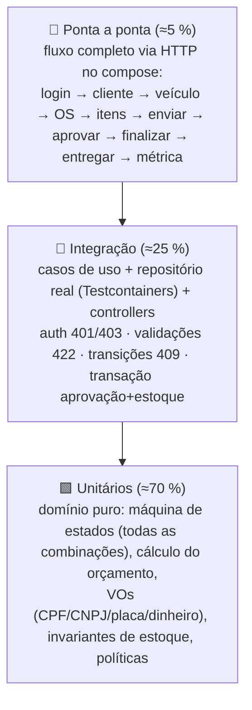
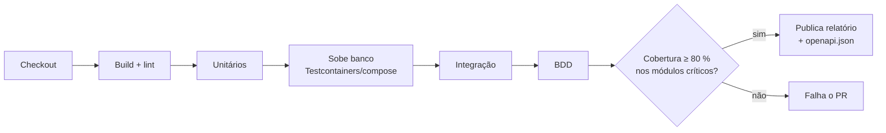

# Estratégia de testes

> Concretiza a ADR-006. Meta do enunciado: testes unitários e de integração dos fluxos principais; **cobertura ≥ 80 %
> nos domínios críticos** (`atendimento`, `catalogo-estoque`).

## 1. Pirâmide



## 2. O que testar, por módulo

| Módulo | Unitário (domínio/aplicação com fakes) | Integração | BDD (se ADR-006 aprovar) |
|---|---|---|---|
| `shared` | `Documento` (CPF/CNPJ válidos/inválidos/repetidos/formatados), `Placa` (antiga/Mercosul/normalização), `Dinheiro` (arredondamento, soma, multiplicação), `Quantidade` | — | — |
| `cadastro` | Regras de inativação; unicidade via fake de repositório | POST/GET/PUT/DELETE clientes/veículos; 409 duplicado; 422 documento/placa | — |
| `catalogo-estoque` | `Peca.registrarEntrada/baixar/reservar/liberar/ajustar` (nunca negativo; movimentação gerada); snapshot de preço | Movimentações via API; constraint de estoque ≥ 0 | *Gestão de estoque* |
| `atendimento` | **Tabela de transições completa** (parametrizado: cada par de/ação → esperado); orçamento recalculado; itens congelados; enviar sem itens; aprovar duas vezes; histórico append-only; `versao` incrementa | Fluxo completo via API; aprovação baixa estoque na mesma transação (falha na baixa → OS não muda); acompanhamento com token válido/inválido/expirado; tempo médio com seed | *Criação da OS e orçamento*; *Aprovação e execução* |
| `identidade` | Emissão/validação de JWT (assinatura, exp, roles); hash de senha | Login 200/401; rota protegida 401/403 | — |

## 3. Convenções

- Nome: `deve_<resultado>_quando_<condição>` (ex.: `deve_recusar_finalizacao_quando_status_e_recebida`).
- Arrange/Act/Assert; um comportamento por teste; builders (`umaOS().emDiagnostico().comServico(...).build()`).
- Dados fictícios válidos gerados por utilitário (`gerarCpfValido()`, `gerarPlacaMercosul()`); nunca dados reais.
- Relógio e ids injetados (`RelogioFixo`, `GeradorDeIdSequencial`) → testes determinísticos.
- Testes de integração sobem o banco com **Testcontainers** (ou o serviço do compose em CI) e aplicam migrações reais.
- Cada endpoint: caso feliz + 1 validação (422) + 1 autorização (401/403) no mínimo.

## 4. Cobertura

| Escopo | Meta | Ferramenta (por linguagem) |
|---|---|---|
| `atendimento` domain+application | ≥ 80 % linhas e branches (gate) | JaCoCo · Jest/Istanbul · coverlet · coverage.py · go cover |
| `catalogo-estoque` domain+application | ≥ 80 % (gate) | idem |
| Global | ≥ 60 % (informativo) | idem |
| Excluídos da métrica | DTOs, mapeadores triviais, configuração, `main`, código gerado | configuração da ferramenta |

O CI publica o relatório (HTML) como artefato e falha abaixo do gate. Badge no README (Could).

## 5. BDD — features (Gherkin, em português)

```gherkin
# language: pt
Funcionalidade: Aprovação do orçamento inicia a execução
  Contexto:
    Dado uma OS "OS-2026-000001" em "AGUARDANDO_APROVACAO" com orçamento de R$ 330,00
    E a peça "Pastilha de freio" com estoque 12 e 2 unidades na OS

  Cenário: Cliente aprova o orçamento
    Quando o cliente aprova o orçamento com um token de acompanhamento válido
    Então a OS passa para "EM_EXECUCAO"
    E o estoque de "Pastilha de freio" passa a 10
    E o histórico registra a transição "AGUARDANDO_APROVACAO -> EM_EXECUCAO" pelo autor "CLIENTE"

  Cenário: Token inválido
    Quando o cliente tenta aprovar com um token expirado
    Então a resposta é 401
    E a OS continua em "AGUARDANDO_APROVACAO"
```

Features planejadas: `criacao-da-os.feature`, `orcamento-e-aprovacao.feature`, `execucao-e-entrega.feature`,
`gestao-de-estoque.feature`, `autenticacao.feature`.

## 6. Pipeline de testes no CI



## 7. Evidências para a entrega

- Print/GIF do relatório de cobertura (percentual por módulo) → `docs/06-entrega/evidencias/`.
- Saída dos testes BDD passando (cenários em português) → vídeo, bloco "testes automatizados".
- Link do workflow verde no PR final.
