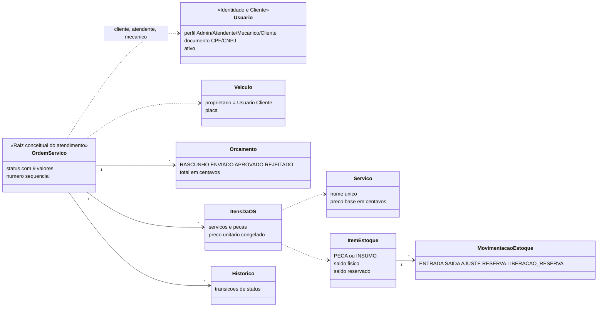

# Agregados, entidades e invariantes — modelo conceitual × implementação

> O desenho tático inicial (agregados ricos, objetos de valor `Money`/`Document`, eventos publicados) **não foi implementado**. O MVP usa classes de dados em `domain/entities`, funções e políticas puras em `domain/` e serviços de aplicação transacionais. Abaixo: o modelo conceitual e onde cada invariante vive.

## 1. Agregados conceituais e fronteiras de consistência

Referências entre agregados são por identificador. No banco, porém, há FKs reais entre as tabelas (ver [modelo de dados](../04-arquitetura/modelo-de-dados.md)).

Diferenças em relação ao desenho original:

- **Não existe agregado `Customer`**: cliente é um `Usuario` com perfil Cliente (ADR-011 mantém o login de Cliente).
- **`Orcamento` é entidade persistida** (id, versão, status, total), não objeto de valor.
- **`OrdemServico` não carrega `version`**; concorrência é tratada por update condicionado ao status esperado (409 para quem perde a corrida).
- O **estoque** pertence ao agregado `ItemEstoque`; a OS apenas referencia e aciona reserva/baixa pelo `StockService` na mesma transação.
- Não há `Part`, `Customer`, `ServiceItem`, `PartItem` como classes. Os nomes reais são `ItemEstoque`, `Usuario`, `OrdemServicoServico` e `OrdemServicoItem`.

## 2. Onde cada invariante vive

### Ordem de serviço

| Invariante | Implementação |
|---|---|
| Só as transições da tabela são válidas; terminais não aceitam comando | `StatusTransitionPolicy.resolve` / `isTerminal`; violação → 409 |
| Itens só mudam em `RECEBIDA` ou `EM_DIAGNOSTICO` | `StatusTransitionPolicy.canEditItems`, usado por `ServiceOrderItemsService` |
| Total do orçamento é derivado dos itens, nunca informado | `domain/quote.ts` (`buildQuote`, `calculateQuoteTotal`); recalculado a cada inclusão/remoção |
| Preço unitário é congelado na inclusão; nome vem do catálogo | `ServiceOrderItemsService` |
| Envio exige ao menos um item | `ServiceOrdersService` (quote/send) |
| Aprovar reserva estoque; falta de saldo → 422 e nada muda | `ServiceOrdersService` + `StockService.reserve…` na mesma transação |
| Finalizar baixa a reserva | `StockService` na transação do `complete` |
| Recusa → `ORCAMENTO_RECUSADO` (terminal); cancelamento só Admin, só antes da aprovação, com motivo | política + `CancelServiceOrderDto` |
| Cada transição grava histórico na mesma transação | `OrdemServicoStatusHistorico` |
| Veículo pertence ao cliente e não tem outra OS aberta | verificado em `ServiceOrdersService` (sem índice único no banco) |
| Marcos e tempo de execução vêm do histórico | `domain/milestones.ts`, `domain/execution-time.ts` |

### Estoque

| Invariante | Implementação |
|---|---|
| Físico ≥ 0 e 0 ≤ reservado ≤ físico | funções de `domain/stock.ts` **e** `CHECK` no banco |
| Saldo só muda por movimentação | `StockService`; `PUT /itens/{id}` não altera saldo |
| Disponível = físico − reservado | `availableQuantity` |
| Ajuste define o novo saldo físico (inventário), com motivo, nunca abaixo do reservado | `adjust` |
| Saída manual só consome o disponível | `issue` |
| Linhas bloqueadas em ordem fixa na reserva/baixa | `SELECT … FOR UPDATE` no `StockService` |
| Liberação de reserva | função `release` e tipo `LIBERACAO_RESERVA` existem; **nenhum fluxo atual os aciona** (recusa e cancelamento ocorrem antes de qualquer reserva) |

### Usuário, cliente e veículo

- E-mail e documento únicos, mesmo após inativação; exclusão lógica preserva histórico.
- Documento validado por `isValidCpf` / `isValidCnpj` (`identity/domain/validators`); placa por `license-plate.validator` (padrão antigo e Mercosul); ano por `vehicle-year.validator`.
- Senha em Argon2id, em tabela própria (`UsuarioSenha`); sessões em `SessaoRefresh`.
- Inativar cliente é bloqueado com OS em aberto (verificado no serviço).

## 3. Eventos de negócio

Os eventos abaixo (por exemplo *Orçamento aprovado*, *Reserva realizada*) são **fatos conceituais** usados no Event Storming. **Não há classes de evento, barramento, outbox nem handlers** no código; o efeito de cada fato é executado diretamente no serviço, dentro da transação, e o rastro persistido é o histórico de status e as movimentações de estoque. `CustomerNotifier` também não existe: o envio ao cliente é só log.

| Fato (post-it) | Rastro real no sistema |
|---|---|
| OS recebida / Diagnóstico iniciado / Execução iniciada / finalizada / Veículo entregue / OS cancelada | linha em `OrdemServicoStatusHistorico` |
| Orçamento enviado / aprovado / recusado | `Orcamento.orcamentoStatus` + datas, respondente e motivo + histórico |
| Item incluído / removido; Orçamento recalculado | linhas de `OrdemServicoServico` / `OrdemServicoItem`; total do `Orcamento` |
| Entrada, ajuste, reserva, baixa | `MovimentacaoEstoque` |
| Estoque abaixo do mínimo | **não implementado** (não há estoque mínimo no schema) |
| Usuário autenticado | resposta do login; não há tabela de eventos de login |

## 4. Serviços de aplicação (reais)

| Serviço | Responsabilidade |
|---|---|
| `ServiceOrdersService` | criar OS, comandos de transição (`applyCommand`), aprovar (com reserva), finalizar (com baixa), cancelar, listar e detalhar |
| `ServiceOrderItemsService` | incluir/remover serviços e peças, congelar preço, conferir disponibilidade, recalcular orçamento |
| `TrackingService` | consulta mascarada e aprovar/recusar pelo cliente, com verificação de escopo |
| `MetricsService` | tempo médio de execução |
| `CatalogService`, `ItemService`, `StockService` | serviços, itens de estoque e movimentações |
| `CustomersService`, `VehiclesService` | clientes e veículos |
| `AuthService`, `UsersService`, `TrackingTokenService` | login, refresh, usuários e token de acompanhamento |

## 5. Se o grupo quiser evoluir o DDD tático (fora do MVP)

Encapsular as invariantes de `ServiceOrder` e `ItemEstoque` em classes com comandos, introduzir objetos de valor (`Document`, `LicensePlate`, `Money`) e publicar eventos de domínio com outbox. Fora do escopo desta entrega.
