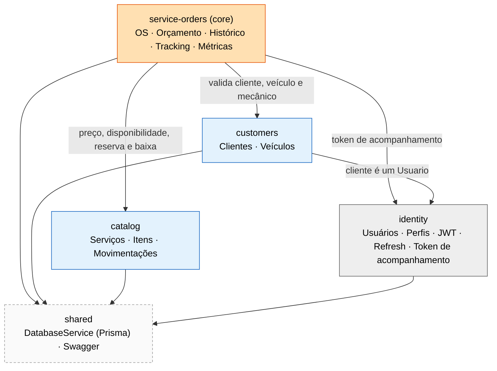

# Contextos delimitados e mapa de contextos

Mapa visual: [`diagramas/06-mapa-de-contextos`](diagramas/06-mapa-de-contextos.png) (`.drawio` + `.png`).

## 1. Subdomínios

| Subdomínio | Tipo | Por quê |
|---|---|---|
| **Atendimento** (OS, orçamento, status, acompanhamento) | **Core** | Concentra as regras de negócio: máquina de estados, orçamento derivado, aprovação pelo cliente, efeitos no estoque |
| **Catálogo e Estoque** (serviços, peças/insumos, movimentações) | Supporting | Específico da oficina, com regras de saldo e reserva |
| **Cadastro** (clientes, veículos) | Supporting | CRUD com validação de CPF/CNPJ e placa |
| **Identidade e Acesso** (usuários, perfis, JWT, token de acompanhamento) | Generic | Problema resolvido; poderia ser terceirizado numa fase futura |
| **Consultas e Métricas** (listagem, marcos, tempo médio) | Supporting (leitura) | Sem módulo próprio: vive dentro de `service-orders` |

## 2. Mapa de contextos

São **quatro módulos de negócio no mesmo monólito**, mais `shared` como infraestrutura (Prisma e Swagger), que não é contexto de negócio. Setas apontam do consumidor para o provedor.

O guard JWT e o guard de papéis (`identity`) protegem as rotas de todos os módulos. O relacionamento é de colaboração em processo; **não há** anticorrupção, barramento de eventos nem serviço externo de notificação ou de fornecedor.

## 3. Como os módulos colaboram hoje

| Relação | Implementação |
|---|---|
| OS → Cadastro | `service-orders` usa serviços exportados de `customers` e consulta usuários/veículos; cliente é um `Usuario` com perfil Cliente |
| OS → Catálogo (incluir item) | busca serviço/item ativo, congela o **preço unitário**, confere disponibilidade da peça (422 se insuficiente, sem reservar) |
| OS → Estoque (aprovação e finalização) | `StockService`, exportado por `catalog`, é chamado **com a transação da OS**: reserva na aprovação, baixa na finalização |
| OS → Notificação | só log; o token de acompanhamento volta na resposta fora de produção; não há `CustomerNotifier` nem e-mail |
| Identidade → todos | guards globais; papéis `Admin`, `Atendente`, `Mecanico`, `Cliente` |
| Consultas e Métricas | consultas Prisma sobre as tabelas da OS e do histórico (`MetricsService`, `list`) |

Limites do isolamento:

- Um único banco e um único schema, com **FKs entre os conceitos** e transações que cruzam OS e estoque.
- Os módulos importam serviços de outros módulos; não há verificador automático de dependências.
- Não existem tabelas por contexto (`service_orders.service_orders` etc.), ids gerados fora do banco nem eventos publicados.

## 4. Mapeamento contexto → módulo → modelos Prisma

| Contexto | Módulo | Modelos Prisma | Observação |
|---|---|---|---|
| Atendimento | `service-orders` | `OrdemServico`, `OrdemServicoStatusHistorico`, `Orcamento`, `OrdemServicoServico`, `OrdemServicoItem` | inclui rotas `/tracking` e `/metrics` |
| Catálogo e Estoque | `catalog` | `Servico`, `ItemEstoque`, `MovimentacaoEstoque` | rotas `/services` e `/itens` |
| Cadastro | `customers` | usa `Usuario` e `Veiculo` | rotas `/customers` e `/vehicles` |
| Identidade | `identity` | `Perfil`, `Usuario`, `UsuarioSenha`, `SessaoRefresh` | rotas `/auth` e `/users` |

`Usuario` é compartilhado por `identity` e `customers`: dono da conta no primeiro, cliente no segundo.

## 5. Evolução futura (não implementada)

A extração para serviços independentes exigiria redesenhar as FKs e as transações compartilhadas, definir contratos entre serviços e tratar consistência eventual e compensações. Ver [evolução](../04-arquitetura/evolucao-fases.md).
