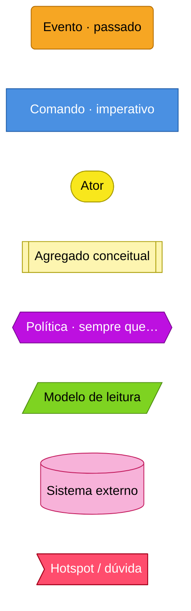
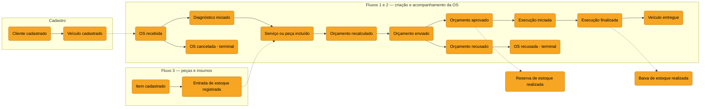
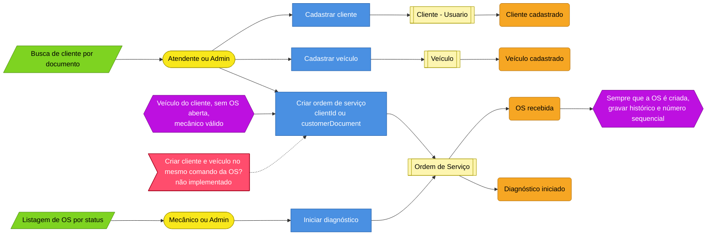
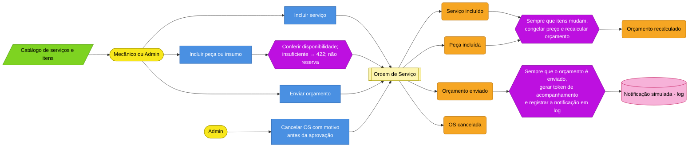
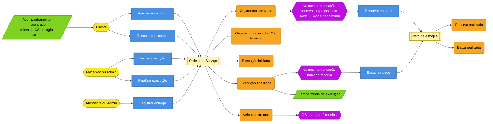
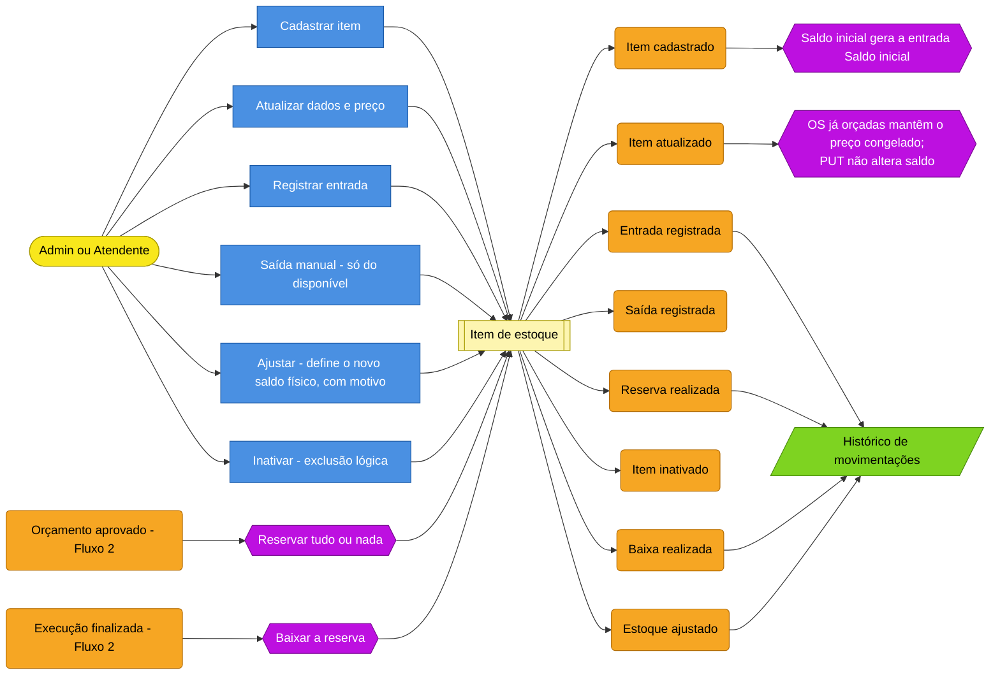

# Event Storming — fluxos obrigatórios

Entregável: event storming da criação da OS, do acompanhamento da OS e da gestão de peças e insumos, no Miro (link pendente) e exportado para `docs/ddd/event-storming.pdf`.

Versões visuais dos três fluxos em `diagramas/`: `02-event-storming-criacao-os`, `03-event-storming-acompanhamento-os` e `04-event-storming-estoque` (`.drawio` editável + `.png`), reunidas em `event-storming.pdf`; a máquina de estados está em `01-maquina-de-estados`.

> **Eventos são fatos conceituais de negócio**, não eventos publicados no código. Não há classes de evento, barramento nem handlers: cada "política" abaixo é executada diretamente pelo serviço de aplicação, na mesma transação. O rastro real é o histórico de status, o orçamento e as movimentações de estoque ([agregados §3](agregados.md)).

Papéis reais: **Admin**, **Atendente**, **Mecânico**, **Cliente**. Não existem Gerente nem Analista financeiro; "gestão" é feita pelo Admin.

## 0. Legenda

Gramática: **Ator → Comando → Agregado → Evento**; **Evento → Política → Comando**.

## 1. Big picture

Marcos pivotais: OS recebida · Orçamento enviado · Orçamento aprovado · Execução iniciada · Execução finalizada · Veículo entregue. Desvios terminais: **OS recusada** (cliente recusou) e **OS cancelada** (Admin, antes da aprovação).

## 2. Fluxo 1 — Criação da OS

### 2.1 Recepção e diagnóstico

### 2.2 Composição do orçamento e envio

Itens só podem mudar em **Recebida** e **Em diagnóstico**; o envio exige ao menos um item.

## 3. Fluxo 2 — Acompanhamento da OS

A máquina de estados implementada (9 status, 8 comandos) está em `01-maquina-de-estados` e na [política de transições](../04-arquitetura/fluxos.md). Tabela:

| Comando | De | Para | Papel |
|---|---|---|---|
| startDiagnosis | RECEBIDA | EM_DIAGNOSTICO | Admin, Mecânico |
| sendQuote | EM_DIAGNOSTICO | AGUARDANDO_APROVACAO | Admin, Mecânico |
| approveQuote | AGUARDANDO_APROVACAO | AGUARDANDO_EXECUCAO | Cliente |
| rejectQuote | AGUARDANDO_APROVACAO | ORCAMENTO_RECUSADO | Cliente |
| startExecution | AGUARDANDO_EXECUCAO | EM_EXECUCAO | Admin, Mecânico |
| complete | EM_EXECUCAO | FINALIZADA | Admin, Mecânico |
| deliver | FINALIZADA | ENTREGUE | Admin, Atendente |
| cancel | RECEBIDA, EM_DIAGNOSTICO, AGUARDANDO_APROVACAO | CANCELADA | Admin |

### 3.1 Aprovação, execução, finalização e entrega

A aprovação **não inicia** a execução; `start-execution` é um comando separado.

### 3.2 Tabela consolidada dos Fluxos 1 e 2

| # | Ator | Comando | Evento | Efeito |
|---|---|---|---|---|
| 1 | Atendente/Admin | Cadastrar cliente e veículo | Cliente/Veículo cadastrado | — |
| 2 | Atendente/Admin | Criar OS | **OS recebida** | histórico + número |
| 3 | Mecânico/Admin | Iniciar diagnóstico | Diagnóstico iniciado | histórico |
| 4 | Mecânico/Admin | Incluir serviço/peça | Item incluído | congela preço; recalcula; peça sem saldo → 422 |
| 5 | Mecânico/Admin | Enviar orçamento | **Orçamento enviado** | token; log simulado |
| 6 | Cliente | Aprovar | **Orçamento aprovado** | reserva atômica |
| 6b | Cliente | Recusar | Orçamento recusado | ORCAMENTO_RECUSADO, motivo |
| 6c | Admin | Cancelar | OS cancelada | motivo; só antes da aprovação |
| 7 | Mecânico/Admin | Iniciar execução | Execução iniciada | histórico |
| 8 | Mecânico/Admin | Finalizar | **Execução finalizada** | baixa a reserva |
| 9 | Atendente/Admin | Entregar | **Veículo entregue** | terminal |

## 4. Fluxo 3 — Gestão de peças e insumos

Fora do implementado: **estoque mínimo e alerta**, reposição a fornecedor e **liberação de reserva**. O tipo `LIBERACAO_RESERVA` e a função `release` existem, mas nenhum fluxo os usa: recusa e cancelamento só ocorrem antes da aprovação, portanto antes de qualquer reserva.

Movimentações manuais (`ENTRADA`, `SAIDA`, `AJUSTE`) usam `POST /itens/{id}/stock-movements`; `RESERVA` e a `SAIDA` da OS nascem só dos comandos da OS.

## 5. Hotspots

| Hotspot | Situação |
|---|---|
| Recusa do orçamento: voltar ao diagnóstico ou encerrar | Implementado como **ORCAMENTO_RECUSADO** (terminal); ADR-010 previa `CANCELLED` — divergência registrada em `decisoes-leves.md` |
| Acesso do cliente | Implementado: token de acompanhamento (uma OS) **ou** login de Cliente (ADR-011) |
| Momento da baixa e falta de estoque | Implementado: conferir ao incluir, reservar ao aprovar, baixar ao finalizar; 422 sem saldo (ADR-012) |
| Estorno após cancelamento | Não se aplica: cancelamento só antes da aprovação |
| Criar cliente/veículo junto com a OS | **Não implementado** (RF-010 era Should) |
| Quantidade decimal para insumos | Implementado: `Decimal(12,3)` |
| Reparo adicional / reabertura | **Não implementado** |

## 6. Agregados e nomes no código

Os post-its ficam em português (linguagem falada). Os identificadores do código são mistos, em português no schema e nos DTOs (ver [glossário](linguagem-ubiqua.md)).

| Agregado conceitual | Fatos | No código | Módulo |
|---|---|---|---|
| Cliente | cadastrado, atualizado, inativado | `Usuario` com perfil Cliente; `CustomersService` | `customers` / `identity` |
| Veículo | cadastrado, atualizado, inativado | `Veiculo`; `VehiclesService` | `customers` |
| Serviço | cadastrado, atualizado, inativado | `Servico`; `CatalogService` | `catalog` |
| Item de estoque | cadastrado, entrada, saída, ajuste, reserva, baixa | `ItemEstoque`, `MovimentacaoEstoque`; `ItemService`, `StockService` | `catalog` |
| Ordem de Serviço | todos os marcos do §1 | `OrdemServico`, `Orcamento`, `OrdemServicoStatusHistorico`; `ServiceOrdersService`, `ServiceOrderItemsService`, `TrackingService` | `service-orders` |
| Usuário | criado, autenticado, inativado | `Usuario`, `UsuarioSenha`, `SessaoRefresh`; `AuthService`, `UsersService` | `identity` |

## 7. Como montar no Miro e exportar

1. Frames: legenda, big picture, Fluxo 1, Fluxo 2 (com a máquina de estados), Fluxo 3 e hotspots com a situação do §5.
2. Domain storytelling, mapa de contextos, modelo de agregados e glossário em frames próprios (`domain-storytelling.md`, `contextos-delimitados.md`, `agregados.md`, `linguagem-ubiqua.md`).
3. Compartilhar como "qualquer pessoa com o link pode ver" e testar em janela anônima.
4. Os PDFs `event-storming.pdf` e `diagramas.pdf` já estão no repositório, gerados a partir dos PNGs de `diagramas/`. Se o Miro for alterado, regenerar e conferir contra o código entregue.
